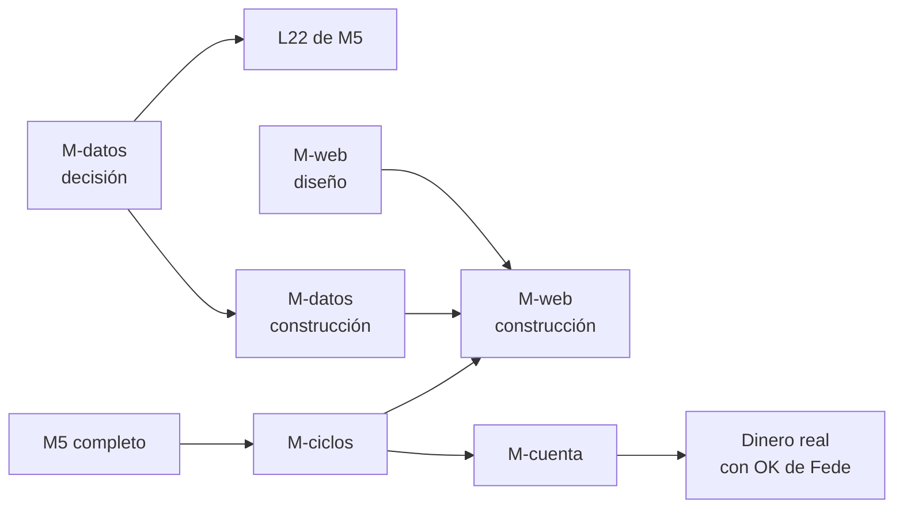

# Roadmap después de M5: propuesta

- **Estado:** propuesta para que Fede decida (2026-10-28). Solo planificación: no hay tickets en Beads ni código. Los nombres de hito son provisorios.
- **Pedido de Fede (2026-10-28):** no perder de vista cuatro ideas para después de M5 y bajarlas a detalle: ciclos continuos de generación hasta encontrar candidatas para producción, la prueba de que una candidata sirve para una cuenta chica, una aplicación web que reemplace Streamlit y la forma de guardar los datos de mercado y fundamentales.
- **Cuándo:** nada de esto entra en la cola actual. Primero se mira la primera semana de paper de M4 (L21). Los lotes que quedan de L20 (cupo por tema, sizing por riesgo) esperan a esa semana y no están en este documento.
- **Contexto leído:** `PLAN-CONTINUACION.md` (§3.7 lotes, §7 ideas), `docs/02_planning/QuantAgent-M5-PL-motor-top-down.md`, `docs/03_design/QuantAgent-M5-DS-motor-top-down.md`, `docs/04_decisions/QuantAgent-R01-DC-decisiones-investigacion-edge.md`, `docs/04_decisions/ui_framework_decision.md`, `local-data/README.md`, `quantagent/models.py`.

## 0. Antes de empezar: qué es "M5"

Hoy hay dos M5 distintos en el repo:

- En `milestone-tracker.md` (y en el `CLAUDE.md` de la VM), M5 es **"live con capital mínimo"**: la primera semana con dinero real.
- En el plan del 2026-10-25, M5 es el **motor top-down** (macro y momentum eligen sectores, screener elige acciones, stops en el broker), con lotes L22–L27, todo en paper.

Leo el pedido como "después del motor top-down", porque Fede dice que llegar a producción viene después. Propongo que el dinero real deje de ser un hito con número fijo y pase a ser la **salida** de las cuatro piezas de abajo: una candidata pasa los filtros (M-ciclos) y además sirve para el tamaño de cuenta (M-cuenta). Hasta que Fede decida el orden, uso nombres por tema (M-ciclos, M-cuenta, M-web, M-datos) en lugar de M6, M7, etc. Ver decisión **G1**.

## Glosario corto

- **Hipótesis:** una idea de estrategia escrita como archivo YAML en `hipotesis/` (qué compra, cuándo, con qué parámetros y por qué debería funcionar).
- **Embudo:** las etapas que recorre una hipótesis. Hoy: etapa 0 (admisión: que no mire el futuro, pocos parámetros), etapa 1 (filtro rápido con `vectorbt`), etapa 2 (control vela por vela con el motor propio), etapa 3 (veredicto con Sharpe deflactado contra 1/N), reserva 2023+ (una sola mirada a datos nunca usados), paper.
- **Sharpe deflactado:** el Sharpe corregido por la cantidad de intentos. Si probás 100 ideas, alguna sale bien por suerte; el deflactado sube la vara cuanto más probás. Por eso más ciclos no son gratis.
- **Reserva 2023+:** el tramo de datos que se guarda sin mirar para la prueba final. Se gasta: cada hipótesis la abre una vez, y hoy el cupo es 3.
- **Paper:** operar con dinero simulado en Alpaca. **Sombra local:** la misma simulación hecha por nuestro código, sin broker.
- **PDT (pattern day trader):** regla de FINRA para cuentas margin de menos de USD 25.000: cuatro o más operaciones abiertas y cerradas el mismo día en cinco días hábiles bloquean la cuenta para day trading.
- **Fraccionable:** un activo que Alpaca deja comprar en fracciones (0,3 acciones). Si no lo es, solo se compran acciones enteras.

---

## 1. M-ciclos: generar, filtrar y madurar candidatas de forma continua

### Objetivo

Que la generación de estrategias deje de ser un lote puntual y pase a ser un **ciclo que se repite** con reglas fijas: cada ciclo propone pocas hipótesis, las pasa por el embudo y las sobrevivientes maduran en paper hasta ser **candidatas a producción**. Fede espera, con razón, que las primeras carteras no sean rentables; el ciclo existe para que, cuando aparezca una buena, se la reconozca sin engañarse.

### El problema de fondo

Hay tres cosas que se gastan y que el ciclo tiene que administrar:

1. **La vara del Sharpe deflactado sube con cada intento.** Diez ciclos de diez hipótesis son cien intentos. Cuantos más ciclos, más difícil es que algo pase la etapa 3. Conviene pocas hipótesis por ciclo, con fundamento escrito (R01 #11–#12).
2. **La reserva 2023+ se gasta.** Una vez abierta por una hipótesis, ya no es dato nuevo para ella. Con ciclos continuos, la reserva deja de alcanzar.
3. **El único dato realmente nuevo es el tiempo que pasa.** Lo que se opera en paper desde hoy no lo vio nadie. Por eso las últimas etapas del embudo son de **tiempo**, no de cálculo: una candidata necesita meses en paper.

### Embudo propuesto (extiende el actual)

1. Etapas 0–3 como hoy, con un **cupo de intentos por ciclo** (por ejemplo, 5 hipótesis por ciclo y 2 por idea, como el cupo de R01 #8).
2. Reserva 2023+ con cupo por ciclo, mientras quede reserva útil.
3. **Paper en sombra local** para todas las que pasan la etapa 3: barato, sin límite de cuentas, sirve para medir cuánto se aleja lo operado de lo que decía el backtest.
4. **Paper en Alpaca** para las pocas mejores de la sombra (Alpaca permite pocas cuentas paper por usuario; verificar cuántas). Aquí se prueban órdenes reales, rechazos, dividendos y redondeos.
5. **Escalera de incubación** (R01 #4, pendiente de definir antes de dinero real): tiempo mínimo en paper, distancia máxima entre el paper y su backtest, y un percentil de corte. Recién quien la pasa es **candidata a producción**.
6. **Puerta de cuenta chica** (M-cuenta, §2). Pasarla habilita el pedido a Fede de operar con dinero real.

### Alcance

- Calendario del ciclo: cuándo se proponen hipótesis, cuándo corre el embudo, cuándo se revisan las de paper.
- Estado de cada hipótesis en un solo lugar (hoy está repartido entre `intentos.csv`, `hipotesis.csv` y los informes). Esto se cruza con M-datos (§4).
- Números de la escalera de incubación (R01 #4).
- Retiro de una candidata: qué la saca de paper o de producción (por ejemplo, una caída mayor que la peor del backtest).
- Un informe por ciclo para Fede, en formato teléfono, con cuántas entraron, cuántas pasaron cada etapa y por qué cayeron las demás.

### Dependencias

- Generador de hipótesis con los chequeos de R01 #12 (lote L20).
- Paper de M4 funcionando (L21) y, si M5 sigue su plan, la cuenta paper aparte de M5 (L27).
- Para ver el embudo en pantalla, M-web (§3); se puede arrancar con el informe por ciclo.

### Decisiones para Fede

- **C1.** Cadencia: un ciclo por mes (recomendado; da tiempo a revisar y no infla los intentos) o uno por semana.
- **C2.** Cupo de hipótesis por ciclo. Recomiendo 5.
- **C3.** Tiempo mínimo en paper antes de ser candidata. Recomiendo 3 meses en Alpaca después de la sombra; menos que eso casi no distingue suerte de método en estrategias diarias.
- **C4.** ¿Se guarda una parte de la reserva 2023+ para futuros ciclos o se acepta que, gastada la reserva, el paper es la única prueba fuera de muestra?

### Orden dentro del hito

Primero los números de la escalera y el registro único de estado; después el calendario automático; al final el informe por ciclo.

---

## 2. M-cuenta: que la candidata funcione en una cuenta de USD 2.000–3.000

### Objetivo

Probar, antes de poner dinero, que una candidata sigue funcionando con **la cuenta que Fede va a abrir de verdad**: mínimo USD 500–1.000, probable USD 2.000–3.000, techo USD 5.000. Un backtest con USD 100.000 puede esconder problemas que con USD 2.500 matan la estrategia.

### Por qué una cuenta chica cambia el resultado

Un ejemplo con números de hoy. Con USD 2.500, riesgo por operación de 0,25 % (R01) y stop a 2 %:

- Se puede perder USD 6,25 por operación. Eso da una posición de unos USD 312, y el tope de 10 % por posición la recorta a **USD 250**.
- SPY cotiza bastante más de USD 250 por acción. Sin fracciones, esa posición **no se puede abrir**. Con fracciones sí, pero las órdenes stop en fracciones solo duran el día en Alpaca (M5 §6.5), así que hay que reenviarlas cada mañana.
- Una cartera de 12 ETFs a pesos iguales queda en unos USD 208 por ETF: funciona solo con fracciones.

Lo que hay que revisar, punto por punto:

- **Acciones enteras y fracciones.** Qué activos son fraccionables en Alpaca (atributo `fractionable`) y qué pasa con la estrategia si los que no lo son se redondean a enteras o se descartan.
- **Costos fijos.** Alpaca no cobra comisión por acciones y ETFs, pero sí traslada tasas regulatorias chicas en las ventas. El costo que pesa en una cuenta chica es el **spread** (diferencia entre compra y venta) y, para Fede, la **transferencia desde Argentina** (costo fijo por giro, que en una cuenta de USD 2.000 puede ser 1–3 % solo de entrada).
- **Rotación.** Una estrategia que opera mucho paga spread muchas veces. Con poco capital conviene la de baja rotación.
- **PDT.** Afecta a cuentas margin de menos de USD 25.000 que hacen 4+ operaciones intradiarias en 5 días. Nuestras estrategias son diarias y no deberían abrir y cerrar el mismo día, pero un stop que salta el mismo día de la entrada cuenta como day trade. FINRA propuso en 2025 reemplazar esta regla; hay que verificar qué está vigente al momento de operar.
- **Margin y cortos.** Reg T exige USD 2.000 de capital para operar con margin. F2 (`tendencia-larga-corta`) necesita cortos, que requieren margin y no admiten fracciones. Con USD 2.000–3.000 eso queda al borde. R01 #8 ya dice que la cuenta margin real se decide antes de operar.
- **Cuenta cash en lugar de margin.** Evita PDT y el riesgo de deuda, pero cada venta tarda un día hábil en liquidarse (T+1) y usar esa plata antes de que se liquide genera infracciones. Con rebalanceos mensuales casi no molesta.
- **Residente argentino.** Dividendos con 30 % de retención (R01, confirmado con Alpaca); reemplazar DBC por PDBC y quitar USO, salvo confirmación de Alpaca (R01). Del lado argentino, la ganancia y los activos en el exterior tienen impuestos propios (ganancias y bienes personales); esto lo tiene que mirar un contador, no este plan. También cuenta cómo se giran y se repatrian los dólares.

### Alcance

- Un **modo "cuenta chica" del backtest**: capital inicial real, redondeo a enteras para los no fraccionables, retención de 30 % sobre dividendos, spread estimado por activo y costo fijo de entrada. La mayor parte de las piezas ya existe (`PositionSizer`, costos de M2, sizing por riesgo).
- Una **prueba de sensibilidad**: correr cada candidata con USD 1.000, 2.500 y 5.000 y ver dónde se rompe (posiciones que quedan en cero, demasiada concentración, costo que se come el rendimiento).
- Una **puerta escrita**: qué tiene que cumplir la candidata a ese capital (por ejemplo, que el Sharpe no caiga más de cierto porcentaje contra la versión de USD 100.000 y que ninguna posición planificada quede sin abrir).
- La cuenta paper con el capital real. M5 D6 ya recomienda USD 3.000; la idea es usar ese mismo criterio en todas las cuentas paper que lleguen a candidatas.

### Dependencias

- Ninguna fuerte: el modo cuenta chica se puede construir apenas haya una candidata para probar, y conviene tenerlo antes de la escalera de incubación de M-ciclos, para que la incubación ya se haga al capital real.

### Decisiones para Fede

- **K1.** Capital de partida para planificar: recomiendo **USD 2.500**, con pruebas a 1.000 y 5.000.
- **K2.** Cuenta cash o margin para la primera cuenta real. Recomiendo **cash**: sin PDT, sin deuda posible, y las estrategias de rebalanceo mensual no sufren la liquidación T+1. Implica dejar afuera las estrategias con cortos para la primera cuenta.
- **K3.** ¿Se pide a un contador argentino el costo fiscal real antes de abrir la cuenta? Recomiendo que sí, y que ese costo entre al modo cuenta chica.

### Orden dentro del hito

Modo cuenta chica en el backtest, después la prueba de sensibilidad sobre las candidatas que haya, después la puerta escrita y la cuenta paper al capital real.

---

## 3. M-web: aplicación web que reemplaza Streamlit

### Objetivo

Una aplicación web propia para seguir todo el sistema desde la compu y el teléfono:

1. Monitoreo de las **cuentas paper y live**: posiciones, órdenes, P&L, diferencia contra la sombra local, alarmas.
2. Monitoreo del **embudo de generación**: cuántas hipótesis hay en cada etapa, qué pasó en cada ciclo, la ficha de cada una.
3. **Datos de mercado**: gráficos de precios de los activos, series macro y su evolución.
4. Más adelante, un **asistente con IA** (que puede ser Claude por detrás) para preguntar "¿por qué cayó esta cuenta hoy?" o "explicame este gráfico".

Streamlit sirvió para el MVP (la decisión de `ui_framework_decision.md` ya preveía una fase 2 con API + frontend), pero el proceso cambió: hoy lo importante está en el embudo, los lotes y paper, y Streamlit no lo muestra.

### Primero el diseño, después el código

Fede pidió diseñar las pantallas antes de programar. Propuesta:

1. **Lista de pantallas y qué pregunta responde cada una** (este documento, abajo).
2. **Diseño visual de cada pantalla** con una herramienta de diseño web, en versión escritorio y teléfono, con datos de ejemplo realistas. Fede revisa y comenta sobre el diseño, no sobre el código.
3. Recién con el diseño aprobado se abren los tickets de construcción.

Pantallas propuestas (primer borrador):

- **Inicio:** estado de cada cuenta en una tarjeta (valor, día, semana, alarma si la hay), último ciclo del embudo y próximos eventos (rebalanceos, publicación de datos macro).
- **Cuenta:** curva de valor contra su benchmark y contra la sombra, posiciones con su stop, órdenes del día y las rechazadas con su motivo, dividendos y retenciones.
- **Embudo:** cuántas hipótesis hay en cada etapa (0, 1, 2, 3, reserva, sombra, paper, candidata, producción) y por qué cayeron las que cayeron; filtro por ciclo.
- **Ficha de hipótesis:** el YAML en palabras, su recorrido por el embudo, sus métricas y sus informes.
- **Mercado:** gráfico de velas de cualquier activo con indicadores, comparación de activos, series macro con ayuda por término (glosario expandible, como pidió Fede para la nota macro).
- **Asistente (después):** panel lateral que ve la pantalla actual y responde preguntas.

Cada pantalla tiene que leerse bien en el teléfono: tarjetas apiladas, nada de tablas anchas (lo que Fede pidió en octubre para los informes).

### Propuesta técnica (para discutir, no decidida)

- **API en Python (FastAPI)** encima del código actual: reusa `quantagent`, los modelos de la base y el estado del embudo. La aplicación nunca toca el broker directamente; lee estado y, como mucho, pide acciones que pasan por las mismas reglas que hoy.
- **Frontend en React con TypeScript.** El documento de 2025 decía Angular; propongo React porque tiene más bibliotecas de gráficos financieros (por ejemplo, `lightweight-charts` de TradingView para velas) y más ejemplos, lo que facilita que la IA lo construya y lo mantenga.
- **Acceso solo por Tailscale**, como el resto de la VM: no se publica a internet, y no hace falta armar usuarios y contraseñas.
- **Asistente:** Claude vía API con herramientas de solo lectura sobre la misma API (posiciones, embudo, datos). Nunca envía órdenes.
- Streamlit sigue vivo hasta que la web tenga lo que Fede usa hoy; después se retira.

### Dependencias

- Para el embudo, el registro único de estado de M-ciclos.
- Para los gráficos de mercado, M-datos (§4): la web lee los datos de un solo lugar consultable, no de mil archivos sueltos.
- El diseño de pantallas no depende de nada y se puede hacer en cualquier momento.

### Decisiones para Fede

- **W1.** ¿Se reemplaza Streamlit por completo o conviven un tiempo? Recomiendo convivir hasta tener Inicio, Cuenta y Embudo, y después retirarlo.
- **W2.** Stack: FastAPI + React (recomendado) o mantener Angular como decía la decisión anterior.
- **W3.** ¿Arrancamos el diseño de pantallas ya, en paralelo con M5? Es solo diseño, no toca código ni la cola. Recomiendo que sí.

### Orden dentro del hito

Diseño de pantallas, después API de solo lectura, después Inicio y Cuenta, después Embudo y Ficha, después Mercado, y el asistente al final.

---

## 4. M-datos: dónde guardar los datos de mercado y fundamentales

### Objetivo

Decidir dónde viven los datos: seguir con carpetas de Parquet y CSV, pasar todo a una base de datos o una mezcla. Fede recuerda que la idea original era una base de datos.

### Qué hay hoy

- **Datos de mercado:** snapshots en Parquet dentro de `local-data/`, cada uno con un `manifest.json` y hashes sha256 (por ejemplo, `etf-1d-2026-10`, `macro-2026-10`). Son pocos MB en total. Esto no es desprolijidad: el snapshot inmutable es lo que hace que un backtest de hoy dé lo mismo dentro de un año, porque Yahoo recalcula su historia en cada dividendo.
- **Registros del embudo:** CSV (`intentos.csv`, `hipotesis.csv` y otros), con copias `.bak` cada vez que se escriben. Hay más de mil CSV en `local-data/`, la mayoría resultados de corridas.
- **Estado operativo:** Postgres (órdenes, fills, posiciones, señales, corridas de backtest, heartbeats), con migraciones Alembic.
- **Lo que viene con M5:** precios de miles de acciones, incluidas las que dejaron de cotizar, y fundamentales con fecha de publicación (Sharadar). Esto es otra escala: decenas de millones de filas. Y tiene una condición de licencia: si se deja de pagar, hay que borrar los datos en 30 días (M5 §5.2).

### Opciones

- **A. Todo en carpetas (como hoy).** Simple y reproducible, pero cada consulta "lo que se sabía en la fecha t" se programa a mano en Python, y la web tendría que leer archivos sueltos. Con las acciones de M5 se vuelve lento y desordenado.
- **B. Todo en Postgres.** Un solo lugar y consultas en SQL. Pero Postgres no es bueno para tablas enormes de precios que se leen enteras (los backtests leen años de historia de golpe), y se pierde la inmutabilidad del snapshot: una tabla se puede pisar sin que nadie lo note.
- **C. Mezcla (recomendada).**
  - Los **datos de mercado y fundamentales siguen como snapshots Parquet inmutables con manifiesto**, una carpeta por fuente y fecha. Eso conserva la reproducibilidad y cumple la licencia de Sharadar (borrar una fuente es borrar su carpeta).
  - Encima se pone **DuckDB**, una base de datos de análisis que vive en un archivo, no necesita servidor y lee Parquet directamente. Permite consultar todos los snapshots con SQL ("precios de los miembros del S&P 500 al 2015-06-01 con los fundamentales publicados hasta ese día") y es muy rápida para este tipo de lectura. La web y los backtests consultan ahí.
  - Los **registros del embudo** (intentos, hipótesis, veredictos, ciclos) pasan de CSV a **Postgres**, junto al estado operativo. Son pocos datos pero muy consultados, se escriben desde varios procesos y la web los necesita; un CSV con copias `.bak` ya muestra el límite.
  - Las bases especializadas en series de tiempo (TimescaleDB, ClickHouse) quedan descartadas por ahora: resuelven escalas que no tenemos y agregan un servicio más para mantener.

### Alcance

- Una decisión escrita (ADR) con la opción elegida.
- Un catálogo DuckDB que registre los snapshots existentes y exponga vistas "punto en el tiempo".
- Migración de los registros del embudo a Postgres, con un test que compare el resultado con los CSV actuales.
- Política de retención: qué snapshots se guardan, cuáles se pueden borrar, y la regla de licencia de Sharadar.

### Dependencias y momento

Conviene decidir esto **antes de bajar los datos de acciones de M5 (lote L22)**: si los datos nuevos entran ya en el formato final, no hay que migrarlos después. La decisión no frena M5; la construcción puede ir en paralelo con L22.

### Decisiones para Fede

- **D1.** Opción A, B o C. Recomiendo **C** (Parquet inmutable + DuckDB para consultar + Postgres para el embudo y la operación).
- **D2.** ¿Se adelanta la decisión antes de L22, como recomiendo, o se deja para después de M5?

---

## 5. Orden propuesto entre los hitos

1. **M-datos (decisión)** antes de L22 de M5. La construcción, en paralelo con L22.
2. **M-web (solo diseño de pantallas)** en cualquier momento, en paralelo con M5: no toca la cola.
3. **M-ciclos** después de M5, cuando el generador de L20 y paper estén andando. Es el hito más largo porque incluye tiempo de paper.
4. **M-cuenta** apenas haya una candidata para probar, y antes de su incubación, para que la incubación ya corra al capital real.
5. **M-web (construcción)** cuando M-datos y el registro único del embudo existan.
6. **Dinero real:** la primera candidata que pase la escalera de incubación y la puerta de cuenta chica, con autorización explícita de Fede.

## 6. Decisiones que necesita Fede (resumen)

- **G1.** Numeración: ¿"M5" en `milestone-tracker.md` se actualiza al motor top-down y el dinero real pasa a ser la salida de M-ciclos + M-cuenta? Recomiendo que sí.
- **G2.** ¿Este orden (§5) sirve como marco, para que el PM arme los tickets de cada hito cuando toque?
- **C1–C4** (ciclos), **K1–K3** (cuenta chica), **W1–W3** (web), **D1–D2** (datos): en cada sección.

Ningún ticket se abre en Beads hasta que Fede apruebe.

## 7. Propuesta de actualización de README (no aplicada)

- `docs/02_planning/README.md`, sección "Current operating plan": agregar `2026-10-28_roadmap_post_m5.md` — Propuesta de hitos después de M5: ciclos de generación, cuenta chica, app web y almacenamiento de datos.
- `PLAN-CONTINUACION.md` **no se toca** (Fede, 2026-10-28: ya está muy grande). Queda para L20, L21 y M5 hasta que cierren. Los hitos de este documento van a un plan nuevo, `PLAN-POST-M5.md` en la raíz, que se crea cuando Fede apruebe esta propuesta, con el mismo formato de cola (§4 de `PLAN-CONTINUACION.md`) y una referencia a este documento.
- `milestone-tracker.md`: actualizar según G1.
