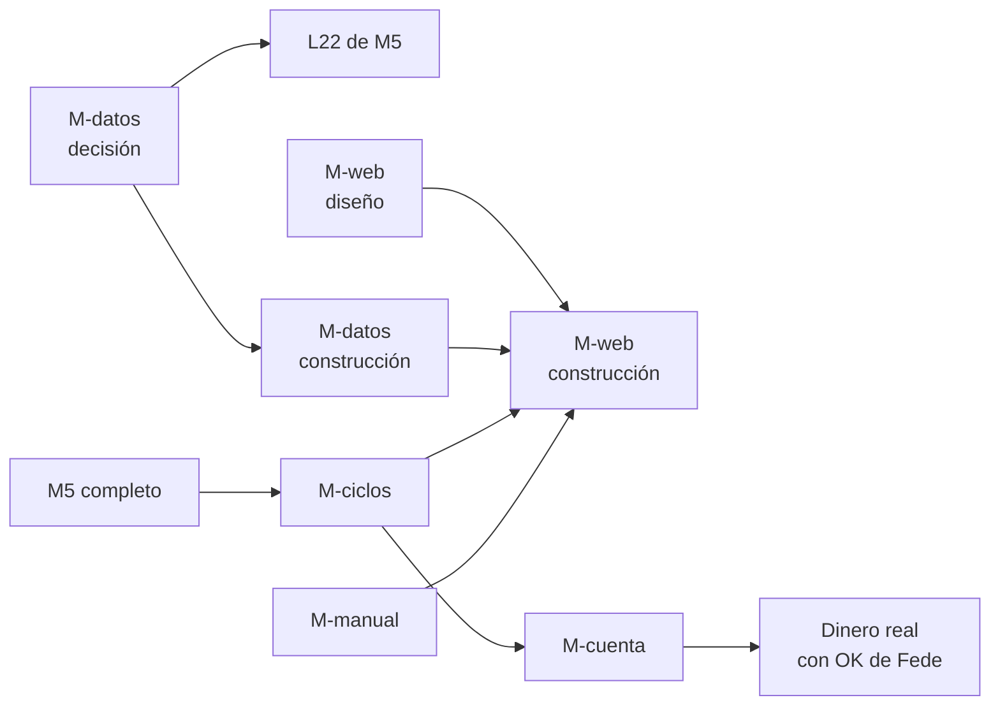

# Roadmap después de M5: propuesta

- **Estado:** propuesta para que Fede decida (2026-10-28). Solo planificación: no hay tickets en Beads ni código. Los nombres de hito son provisorios.
- **Pedido de Fede (2026-10-28):** no perder de vista cuatro ideas para después de M5 y bajarlas a detalle: ciclos continuos de generación hasta encontrar candidatas para producción, la prueba de que una candidata sirve para una cuenta chica, una aplicación web que reemplace Streamlit y la forma de guardar los datos de mercado y fundamentales. Agregado el mismo día: un manual de usuario actualizado, para leer como páginas de la app (§5).
- **Cuándo:** nada de esto entra en la cola actual. Primero se mira la primera semana de paper de M4 (L21). Los lotes que quedan de L20 (cupo por tema, sizing por riesgo) esperan a esa semana y no están en este documento.
- **Contexto leído:** `PLAN-CONTINUACION.md` (§3.7 lotes, §7 ideas), `docs/02_planning/QuantAgent-M5-PL-motor-top-down.md`, `docs/03_design/QuantAgent-M5-DS-motor-top-down.md`, `docs/04_decisions/QuantAgent-R01-DC-decisiones-investigacion-edge.md`, `docs/04_decisions/ui_framework_decision.md`, `local-data/README.md`, `quantagent/models.py`.

## 0. Antes de empezar: qué es "M5"

Hoy hay dos M5 distintos en el repo:

- En `milestone-tracker.md` (y en el `CLAUDE.md` de la VM), M5 es **"live con capital mínimo"**: la primera semana con dinero real.
- En el plan del 2026-10-25, M5 es el **motor top-down** (macro y momentum eligen sectores, screener elige acciones, stops en el broker), con lotes L22–L27, todo en paper.

Leo el pedido como "después del motor top-down", porque Fede dice que llegar a producción viene después. Propongo que el dinero real deje de ser un hito con número fijo y pase a ser la **salida** de las cuatro piezas de abajo: una candidata pasa los filtros (M-ciclos) y además sirve para el tamaño de cuenta (M-cuenta). Hasta que Fede decida el orden, uso nombres por tema (M-ciclos, M-cuenta, M-web, M-datos) en lugar de M6, M7, etc.

**Decidido por Fede (2026-10-28, G1):** M5 es el motor top-down. El dinero real es la salida de M-ciclos + M-cuenta, no un hito con número propio.

## Glosario corto

- **Hipótesis:** una idea de estrategia escrita como archivo YAML en `hipotesis/` (qué compra, cuándo, con qué parámetros y por qué debería funcionar).
- **Embudo:** las etapas que recorre una hipótesis. Hoy: etapa 0 (admisión: que no mire el futuro, pocos parámetros), etapa 1 (filtro rápido con `vectorbt`), etapa 2 (control vela por vela con el motor propio), etapa 3 (veredicto con Sharpe deflactado contra 1/N), reserva 2023+ (una sola mirada a datos nunca usados), paper.
- **Sharpe deflactado:** el Sharpe corregido por la cantidad de intentos. Si probás 100 ideas, alguna sale bien por suerte; el deflactado sube la vara cuanto más probás. Por eso más ciclos no son gratis.
- **Reserva 2023+:** el tramo de datos que se guarda sin mirar para la prueba final. Se gasta: cada hipótesis la abre una vez, y hoy el cupo es 3.
- **Paper:** operar con dinero simulado en Alpaca. **Sombra local:** la misma simulación hecha por nuestro código, sin broker.
- **PDT (pattern day trader):** regla de FINRA para cuentas margin de menos de USD 25.000: cuatro o más operaciones abiertas y cerradas el mismo día en cinco días hábiles bloquean la cuenta para day trading.
- **Fraccionable:** un activo que Alpaca deja comprar en fracciones (0,3 acciones). Si no lo es, solo se compran acciones enteras.

---

## 1. M-ciclos: generar, filtrar y madurar candidatas de forma continua

### Objetivo

Que la generación de estrategias deje de ser un lote puntual y pase a ser un **ciclo que se repite** con reglas fijas: cada ciclo propone pocas hipótesis, las pasa por el embudo y las sobrevivientes maduran en paper hasta ser **candidatas a producción**. Fede espera, con razón, que las primeras carteras no sean rentables; el ciclo existe para que, cuando aparezca una buena, se la reconozca sin engañarse.

### El problema de fondo

Hay tres cosas que se gastan y que el ciclo tiene que administrar:

1. **La vara del Sharpe deflactado sube con cada intento.** Diez ciclos de diez hipótesis son cien intentos. Cuantos más ciclos, más difícil es que algo pase la etapa 3. Conviene pocas hipótesis por ciclo, con fundamento escrito (R01 #11–#12).
2. **La reserva 2023+ se gasta.** Una vez abierta por una hipótesis, ya no es dato nuevo para ella. Con ciclos continuos, la reserva deja de alcanzar.
3. **El único dato realmente nuevo es el tiempo que pasa.** Lo que se opera en paper desde hoy no lo vio nadie. Por eso las últimas etapas del embudo son de **tiempo**, no de cálculo: una candidata necesita meses en paper.

### Embudo propuesto (extiende el actual)

1. Etapas 0–3 como hoy, con un **cupo de intentos por ciclo** (por ejemplo, 5 hipótesis por ciclo y 2 por idea, como el cupo de R01 #8).
2. Reserva 2023+ con cupo por ciclo, mientras quede reserva útil.
3. **Paper en sombra local** para todas las que pasan la etapa 3: barato, sin límite de cuentas, sirve para medir cuánto se aleja lo operado de lo que decía el backtest.
4. **Paper en Alpaca** para las pocas mejores de la sombra. Aquí se prueban órdenes reales, rechazos, dividendos y redondeos. **Alpaca permite tres cuentas paper por usuario** (Fede, 2026-10-28). M4 ya usa una (`~/secrets/alpaca.env`) y M5 planea otra (`alpaca-m5.env`), así que para candidatas queda **una** mientras esas dos sigan activas. Opciones si hace falta más:
   - rotar: cuando M4 termine su prueba de sistema, su cuenta pasa a candidatas;
   - una cuenta por candidata solo en la etapa final, y la sombra local para el resto;
   - más usuarios con otros mails (idea de Fede). Antes de hacerlo, revisar los términos de Alpaca: algunos brokers limitan las cuentas por persona y podrían cerrar todas, incluida la que después sería la real.
5. **Escalera de incubación** (R01 #4, pendiente de definir antes de dinero real): tiempo mínimo en paper, distancia máxima entre el paper y su backtest, y un percentil de corte. Recién quien la pasa es **candidata a producción**.
6. **Puerta de cuenta chica** (M-cuenta, §2). Pasarla habilita el pedido a Fede de operar con dinero real.

### Alcance

- Calendario del ciclo: cuándo se proponen hipótesis, cuándo corre el embudo, cuándo se revisan las de paper.
- Estado de cada hipótesis en un solo lugar (hoy está repartido entre `intentos.csv`, `hipotesis.csv` y los informes). Esto se cruza con M-datos (§4).
- Números de la escalera de incubación (R01 #4).
- Retiro de una candidata: qué la saca de paper o de producción (por ejemplo, una caída mayor que la peor del backtest).
- Un informe por ciclo para Fede, en formato teléfono, con cuántas entraron, cuántas pasaron cada etapa y por qué cayeron las demás.

### Dependencias

- Generador de hipótesis con los chequeos de R01 #12 (lote L20).
- Paper de M4 funcionando (L21) y, si M5 sigue su plan, la cuenta paper aparte de M5 (L27).
- Para ver el embudo en pantalla, M-web (§3); se puede arrancar con el informe por ciclo.

### Decisiones para Fede

- **C1.** Cadencia: un ciclo por mes (recomendado; da tiempo a revisar y no infla los intentos) o uno por semana.
- **C2.** Cupo de hipótesis por ciclo. Recomiendo 5.
- **C3.** Tiempo mínimo en paper antes de ser candidata. Recomiendo 3 meses en Alpaca después de la sombra; menos que eso casi no distingue suerte de método en estrategias diarias.
- **C4.** ¿Se guarda una parte de la reserva 2023+ para futuros ciclos o se acepta que, gastada la reserva, el paper es la única prueba fuera de muestra?

**Decidido por Fede (2026-10-28):** C1 mensual; C2 5 hipótesis por ciclo; C3 3 meses en paper de Alpaca; C4 no se guarda parte de la reserva 2023+. Con C4, una vez gastada la reserva, **el paper es la única prueba fuera de muestra**: por eso los 3 meses de C3 pesan.

### Aprendizaje del generador sin contaminar la prueba

Duda de Fede: si el generador no sabe qué funcionó y qué no, ¿cómo evoluciona? La respuesta corta es que **ya aprende, pero de las causas y no de los números**, y que lo que se protege es la prueba final, no la investigación.

Qué ve hoy el generador (`quantagent/fabrica/investigador.py`, `armar_pedido`):

- las **fichas de postmortem** (`catalogo/postmortem/`), que dicen por qué cortó cada cartera solo con causas estructurales (pocos trades, demasiada rotación, costos que se comen la ganancia, una pierna que domina), sin Sharpe ni P&L (`quantagent/fabrica/postmortem.py`);
- las **lecciones escritas por personas** en el catálogo (R01 #11);
- la **cantidad de intentos**, para que sepa que cada idea nueva sube la vara.

Por qué no se le pasan los números: si ve que la variante con media de 50 días dio Sharpe 0,6 y la de 60 dio 0,4, va a proponer 55, y eso es ajustar la muestra hasta que dé bien. Aprender que "las ideas de alta rotación mueren por costos" es investigar como un científico; aprender "qué parámetro dio mejor en 2007–2018" es sobreajustar.

El costo del aprendizaje ya está pagado de dos formas: cada intento cuenta en el N del Sharpe deflactado, y la decisión final se toma con datos que nadie vio (la reserva mientras dure, después 3 meses de paper). Mientras esas dos reglas se cumplan, el generador puede aprender todo lo que quiera de los fracasos anteriores.

Propuesta para M-ciclos:

- **Postmortem también de paper:** cuando una candidata se cae en paper, su ficha dice la causa (se alejó de su backtest, rechazos, costos reales, caída mayor que la peor histórica), también sin cifras.
- **Ficha por familia de idea** (tendencia, reversión, estacionalidad, carry...): cuántos intentos lleva y en qué etapa murió cada uno, para que el generador no repita ideas muertas y el PM vea qué familias están agotadas.
- **Revisión trimestral de las lecciones** por Fede y el PM: qué se aprendió en los últimos 3 ciclos, escrito en palabras.

### Orden dentro del hito

Primero los números de la escalera y el registro único de estado; después el calendario automático; al final el informe por ciclo.

---

## 2. M-cuenta: que la candidata funcione en una cuenta de USD 2.000–3.000

### Objetivo

Probar, antes de poner dinero, que una candidata sigue funcionando con **la cuenta que Fede va a abrir de verdad**: mínimo USD 500–1.000, probable USD 2.000–3.000, techo USD 5.000. Un backtest con USD 100.000 puede esconder problemas que con USD 2.500 matan la estrategia.

### Por qué una cuenta chica cambia el resultado

Un ejemplo con números de hoy. Con USD 2.500, riesgo por operación de 0,25 % (R01) y stop a 2 %:

- Se puede perder USD 6,25 por operación. Eso da una posición de unos USD 312, y el tope de 10 % por posición la recorta a **USD 250**.
- SPY cotiza bastante más de USD 250 por acción. Sin fracciones, esa posición **no se puede abrir**. Con fracciones sí, pero las órdenes stop en fracciones solo duran el día en Alpaca (M5 §6.5), así que hay que reenviarlas cada mañana.
- Una cartera de 12 ETFs a pesos iguales queda en unos USD 208 por ETF: funciona solo con fracciones.

Lo que hay que revisar, punto por punto:

- **Acciones enteras y fracciones.** Qué activos son fraccionables en Alpaca (atributo `fractionable`) y qué pasa con la estrategia si los que no lo son se redondean a enteras o se descartan.
- **Costos fijos.** Alpaca no cobra comisión por acciones y ETFs, pero sí traslada tasas regulatorias chicas en las ventas. El costo que pesa en una cuenta chica es el **spread** (diferencia entre compra y venta) y, para Fede, la **transferencia desde Argentina** (costo fijo por giro, que en una cuenta de USD 2.000 puede ser 1–3 % solo de entrada).
- **Rotación.** Una estrategia que opera mucho paga spread muchas veces. Con poco capital conviene la de baja rotación.
- **PDT.** Afecta a cuentas margin de menos de USD 25.000 que hacen 4+ operaciones intradiarias en 5 días. Nuestras estrategias son diarias y no deberían abrir y cerrar el mismo día, pero un stop que salta el mismo día de la entrada cuenta como day trade. FINRA propuso en 2025 reemplazar esta regla; hay que verificar qué está vigente al momento de operar.
- **Margin y cortos.** Reg T exige USD 2.000 de capital para operar con margin. F2 (`tendencia-larga-corta`) necesita cortos, que requieren margin y no admiten fracciones. Con USD 2.000–3.000 eso queda al borde. R01 #8 ya dice que la cuenta margin real se decide antes de operar.
- **Cuenta cash en lugar de margin.** Evita PDT y el riesgo de deuda, pero cada venta tarda un día hábil en liquidarse (T+1) y usar esa plata antes de que se liquide genera infracciones. Con rebalanceos mensuales casi no molesta.
- **Residente argentino.** Dividendos con 30 % de retención (R01, confirmado con Alpaca); reemplazar DBC por PDBC y quitar USO, salvo confirmación de Alpaca (R01). Del lado argentino, la ganancia y los activos en el exterior tienen impuestos propios (ganancias y bienes personales); esto lo tiene que mirar un contador, no este plan. También cuenta cómo se giran y se repatrian los dólares.

### Alcance

- Un **modo "cuenta chica" del backtest**: capital inicial real, redondeo a enteras para los no fraccionables, retención de 30 % sobre dividendos, spread estimado por activo y costo fijo de entrada. La mayor parte de las piezas ya existe (`PositionSizer`, costos de M2, sizing por riesgo).
- Una **prueba de sensibilidad**: correr cada candidata con USD 1.000, 2.500 y 5.000 y ver dónde se rompe (posiciones que quedan en cero, demasiada concentración, costo que se come el rendimiento).
- Una **puerta escrita**: qué tiene que cumplir la candidata a ese capital (por ejemplo, que el Sharpe no caiga más de cierto porcentaje contra la versión de USD 100.000 y que ninguna posición planificada quede sin abrir).
- La cuenta paper con el capital real. M5 D6 ya recomienda USD 3.000; la idea es usar ese mismo criterio en todas las cuentas paper que lleguen a candidatas.

### Dependencias

- Ninguna fuerte: el modo cuenta chica se puede construir apenas haya una candidata para probar, y conviene tenerlo antes de la escalera de incubación de M-ciclos, para que la incubación ya se haga al capital real.

### Decisiones para Fede

- **K1.** Capital de partida para planificar: recomiendo **USD 2.500**, con pruebas a 1.000 y 5.000.
- **K2.** Cuenta cash o margin para la primera cuenta real. Recomiendo **cash**: sin PDT, sin deuda posible, y las estrategias de rebalanceo mensual no sufren la liquidación T+1. Implica dejar afuera las estrategias con cortos para la primera cuenta.
- **K3.** ¿Se pide a un contador argentino el costo fiscal real antes de abrir la cuenta? Recomiendo que sí, y que ese costo entre al modo cuenta chica.

**Decidido por Fede (2026-10-28):** K1 USD 2.500 (pruebas de sensibilidad a 1.000 y 5.000); K2 cuenta **cash**, así que las estrategias con cortos quedan fuera de la primera cuenta real; K3 sí, Fede lo revisa con una contadora de confianza y el costo fiscal que resulte entra al modo cuenta chica.

### Orden dentro del hito

Modo cuenta chica en el backtest, después la prueba de sensibilidad sobre las candidatas que haya, después la puerta escrita y la cuenta paper al capital real.

---

## 3. M-web: aplicación web que reemplaza Streamlit

### Objetivo

Una aplicación web propia para seguir todo el sistema desde la compu y el teléfono:

1. Monitoreo de las **cuentas paper y live**: posiciones, órdenes, P&L, diferencia contra la sombra local, alarmas.
2. Monitoreo del **embudo de generación**: cuántas hipótesis hay en cada etapa, qué pasó en cada ciclo, la ficha de cada una.
3. **Datos de mercado**: gráficos de precios de los activos, series macro y su evolución.
4. Más adelante, un **asistente con IA** (que puede ser Claude por detrás) para preguntar "¿por qué cayó esta cuenta hoy?" o "explicame este gráfico".

Streamlit sirvió para el MVP (la decisión de `ui_framework_decision.md` ya preveía una fase 2 con API + frontend), pero el proceso cambió: hoy lo importante está en el embudo, los lotes y paper, y Streamlit no lo muestra.

### Primero el diseño, después el código

Fede pidió diseñar las pantallas antes de programar. Propuesta:

1. **Lista de pantallas y qué pregunta responde cada una** (este documento, abajo).
2. **Diseño visual de cada pantalla** con una herramienta de diseño web, en versión escritorio y teléfono, con datos de ejemplo realistas. Fede revisa y comenta sobre el diseño, no sobre el código.
3. Recién con el diseño aprobado se abren los tickets de construcción.

Pantallas propuestas (primer borrador):

- **Inicio:** estado de cada cuenta en una tarjeta (valor, día, semana, alarma si la hay), último ciclo del embudo y próximos eventos (rebalanceos, publicación de datos macro).
- **Cuenta:** curva de valor contra su benchmark y contra la sombra, posiciones con su stop, órdenes del día y las rechazadas con su motivo, dividendos y retenciones.
- **Embudo:** cuántas hipótesis hay en cada etapa (0, 1, 2, 3, reserva, sombra, paper, candidata, producción) y por qué cayeron las que cayeron; filtro por ciclo.
- **Ficha de hipótesis:** el YAML en palabras, su recorrido por el embudo, sus métricas y sus informes.
- **Mercado:** gráfico de velas de cualquier activo con indicadores, comparación de activos, series macro con ayuda por término (glosario expandible, como pidió Fede para la nota macro).
- **Asistente (después):** panel lateral que ve la pantalla actual y responde preguntas.

Cada pantalla tiene que leerse bien en el teléfono: tarjetas apiladas, nada de tablas anchas (lo que Fede pidió en octubre para los informes).

### Dos diseños distintos

Fede (2026-10-28) separa dos trabajos que van antes del código:

- **Diseño visual:** cómo se ven las pantallas. Se hace en **sesiones aparte, mano a mano con Fede**, que además quiere aprender a usar las herramientas de diseño web para su trabajo. Esas sesiones explican cómo funcionan las herramientas mientras se diseñan las pantallas de QuantAgent.
- **Diseño de arquitectura:** qué piezas tiene la aplicación, con qué framework, cómo lee los datos y cómo se despliega. Se escribe como documento de diseño (`docs/03_design/`) y una decisión (`docs/04_decisions/`) antes de abrir tickets.

### Propuesta de arquitectura (para discutir, no decidida)

Fede preguntó si conviene Django, Flask o FastAPI. Recomiendo **FastAPI**:

- **Django** trae su propio ORM, su admin y sus plantillas HTML. Nosotros ya tenemos SQLAlchemy + Alembic para la base y el frontend iría aparte, así que usaríamos poco de Django y pelearíamos con lo que trae.
- **Flask** es el que usa hoy `apps/flask/` (health server y una interfaz vieja). Sirve, pero no valida datos ni documenta la API por sí solo; hay que sumar piezas a mano.
- **FastAPI** valida la entrada y la salida con Pydantic (que el proyecto ya usa), genera la documentación de la API sola y permite generar del lado del frontend los tipos de cada respuesta. Es el estándar actual para una API en Python que consume un frontend separado.

El resto de la propuesta:

- **API en Python (FastAPI)** encima del código actual: reusa `quantagent`, los modelos de la base y el estado del embudo. La aplicación nunca toca el broker directamente; lee estado y, como mucho, pide acciones que pasan por las mismas reglas que hoy.
- **Frontend en React con TypeScript.** El documento de 2025 decía Angular; propongo React porque tiene más bibliotecas de gráficos financieros (por ejemplo, `lightweight-charts` de TradingView para velas) y más ejemplos, lo que facilita que la IA lo construya y lo mantenga.
- **Acceso solo por Tailscale**, como el resto de la VM: no se publica a internet, y no hace falta armar usuarios y contraseñas.
- **Asistente:** Claude vía API con herramientas de solo lectura sobre la misma API (posiciones, embudo, datos). Nunca envía órdenes.
- **Streamlit se borra** (Fede, 2026-10-28: quedó en desuso; no convive con la web). Es un ticket de limpieza independiente de la web, que puede ir en cualquier lote: toca `apps/streamlit/`, sus tests (`tests/apps/streamlit/` y unos cinco `tests/test_*` de paper y heartbeat), el contenedor QA (`Dockerfile.qa`, chequeo de salud del puerto 8501 en `.github/workflows/main-ci-deploy.yml`) y la dependencia en `pyproject.toml`. El manual viejo que mostraba `views/manual.py` se archiva aparte (U2).

### Dependencias

- Para el embudo, el registro único de estado de M-ciclos.
- Para los gráficos de mercado, M-datos (§4): la web lee los datos de un solo lugar consultable, no de mil archivos sueltos.
- El diseño de pantallas no depende de nada y se puede hacer en cualquier momento.

### Decisiones para Fede

- **W1.** Decidido (2026-10-28): no conviven; Streamlit se borra.
- **W2.** Decidido (2026-10-28): FastAPI + React. Reemplaza el plan de Angular de `docs/04_decisions/ui_framework_decision.md`, que se marca como superado en la decisión de arquitectura de M-web.
- **W3.** Diseño visual en sesiones mano a mano con Fede (decidido 2026-10-28); falta acordar cuándo arrancan.

### Orden dentro del hito

Sesiones de diseño visual y documento de arquitectura (en paralelo), después API de solo lectura, después Inicio y Cuenta, después Embudo y Ficha, después Mercado, y el asistente al final.

---

## 4. M-datos: dónde guardar los datos de mercado y fundamentales

### Objetivo

Decidir dónde viven los datos: seguir con carpetas de Parquet y CSV, pasar todo a una base de datos o una mezcla. Fede recuerda que la idea original era una base de datos.

### Qué hay hoy

- **Datos de mercado:** snapshots en Parquet dentro de `local-data/`, cada uno con un `manifest.json` y hashes sha256 (por ejemplo, `etf-1d-2026-10`, `macro-2026-10`). Son pocos MB en total. Esto no es desprolijidad: el snapshot inmutable es lo que hace que un backtest de hoy dé lo mismo dentro de un año, porque Yahoo recalcula su historia en cada dividendo.
- **Registros del embudo:** CSV (`intentos.csv`, `hipotesis.csv` y otros), con copias `.bak` cada vez que se escriben. Hay más de mil CSV en `local-data/`, la mayoría resultados de corridas.
- **Estado operativo:** Postgres (órdenes, fills, posiciones, señales, corridas de backtest, heartbeats), con migraciones Alembic.
- **Lo que viene con M5:** precios de miles de acciones, incluidas las que dejaron de cotizar, y fundamentales con fecha de publicación (Sharadar). Esto es otra escala: decenas de millones de filas. Y tiene una condición de licencia: si se deja de pagar, hay que borrar los datos en 30 días (M5 §5.2).

### Opciones

- **A. Todo en carpetas (como hoy).** Simple y reproducible, pero cada consulta "lo que se sabía en la fecha t" se programa a mano en Python, y la web tendría que leer archivos sueltos. Con las acciones de M5 se vuelve lento y desordenado.
- **B. Todo en Postgres.** Un solo lugar y consultas en SQL. Pero Postgres no es bueno para tablas enormes de precios que se leen enteras (los backtests leen años de historia de golpe), y se pierde la inmutabilidad del snapshot: una tabla se puede pisar sin que nadie lo note.
- **C. Mezcla (recomendada).**
  - Los **datos de mercado y fundamentales siguen como snapshots Parquet inmutables con manifiesto**, una carpeta por fuente y fecha. Eso conserva la reproducibilidad y cumple la licencia de Sharadar (borrar una fuente es borrar su carpeta).
  - Encima se pone **DuckDB**, una base de datos de análisis que vive en un archivo, no necesita servidor y lee Parquet directamente. Permite consultar todos los snapshots con SQL ("precios de los miembros del S&P 500 al 2015-06-01 con los fundamentales publicados hasta ese día") y es muy rápida para este tipo de lectura. La web y los backtests consultan ahí.
  - Los **registros del embudo** (intentos, hipótesis, veredictos, ciclos) pasan de CSV a **Postgres**, junto al estado operativo. Son pocos datos pero muy consultados, se escriben desde varios procesos y la web los necesita; un CSV con copias `.bak` ya muestra el límite.
  - Las bases especializadas en series de tiempo (TimescaleDB, ClickHouse) quedan descartadas por ahora: resuelven escalas que no tenemos y agregan un servicio más para mantener.

**Fede (2026-10-28):** de acuerdo con que lo histórico quede en Parquet. Las acciones de M5 ya se están bajando a archivos desde la notebook; si hace falta, se convierten después según esta decisión. Dudas abiertas: cómo se suman los datos nuevos (activos que empezamos a seguir ahora, días que pasan) y cómo se documenta dónde va cada dato. Las dos subsecciones siguientes las responden.

### Datos nuevos: dos capas, histórica y viva

Un snapshot nunca se modifica: es la foto contra la que un backtest se puede repetir. Los datos que llegan cada día no pueden escribirse ahí. Propuesta:

1. **Capa histórica (congelada).** Snapshots Parquet con manifiesto, como hoy. Los backtests y el embudo leen siempre un snapshot con nombre, nunca la capa viva.
2. **Capa viva (se agrega).** Un job después del cierre del mercado suma los datos del día a una carpeta por fuente, en archivos por mes (`vivo/precios/2026-11.parquet`), sin pisar lo anterior. Cada fila guarda **cuándo se bajó**, no solo la fecha del dato, para saber qué se sabía cada día. Paper y la web leen esta capa.
3. **Congelado periódico.** Una vez por mes, un comando junta la historia anterior con la capa viva y congela un snapshot nuevo (`etf-1d-2026-11`), con su manifiesto. Los backtests pasan a ese snapshot solo cuando alguien lo pide; ninguno cambia de datos por sorpresa.
4. **Activo nuevo.** Cuando empezamos a seguir un activo, se baja su historia una sola vez (con la fecha de descarga en el manifiesto) y desde ese día entra al job diario. Entra a los backtests con el próximo congelado mensual.

Frecuencia por tipo de dato:

- **Precios diarios:** todos los días hábiles, después del cierre (con la salvedad conocida de que Alpaca puede liberar la última vela recién a medianoche UTC).
- **Macro (FRED/ALFRED):** cada semana, guardando todas las versiones publicadas, porque las series económicas se revisan (`macro_vivo.py` ya las lee así para paper).
- **Fundamentales:** a diario los cambios de Sharadar (o EDGAR); en la práctica se mueven con cada presentación trimestral de las empresas.
- **Consenso de EPS (M5-05):** una foto diaria, porque el proveedor no guarda la historia.
- **Congelado de snapshots:** mensual.

### Ajustes por dividendos, splits, revisiones y restataciones

Duda de Fede (2026-10-28): si la historia de AAPL bajada hoy de Yahoo viene ajustada por dividendos, lo que se suma cada día después no va a estar ajustado igual; ¿pasa lo mismo con earnings y macro?

Sí, ese es el problema, y la regla para resolverlo es una sola: **se guarda el dato tal como se conoció, y cualquier ajuste se calcula al leer, nunca se guarda.**

**Precios.** Un precio ajustado por dividendos cambia cada vez que la empresa paga un dividendo nuevo: todo el pasado se recalcula. Si se guarda el ajustado y después se le pegan días nuevos, la serie queda con dos bases distintas.

- Hoy el snapshot ya guarda el cierre **sin** ajuste por dividendos más la columna `adj_close` de Yahoo, y `read_snapshot` calcula el ajuste al leer (`quantagent/data/snapshot.py`). Eso sirve para un snapshot cerrado, pero `adj_close` vale solo hasta el día de la descarga.
- Los precios de Yahoo y de Alpaca (`adjustment: "split"`) vienen **ajustados por splits a la fecha de descarga**. Si AAPL hace un split 4 a 1 en marzo, los días que se agreguen después estarán en la escala nueva y los viejos en la anterior: un salto falso de 75 %. El chequeo `saltos` de `snapshot verify` (variación diaria mayor a 20 %) lo detectaría, pero no lo arregla.
- Propuesta: la capa viva guarda, además de los precios, una tabla de **eventos corporativos** (dividendos con fecha ex y monto, splits con fecha y proporción), también con su fecha de descarga. Al leer, o al congelar el snapshot mensual, el factor de ajuste se recalcula desde los eventos para toda la historia. Así historia y días nuevos quedan siempre en la misma base.
- El ajuste por dividendos no mete información del futuro en los **retornos** (el retorno ajustado es el retorno total real), pero sí cambia los **niveles de precio** del pasado. Por eso la admisión de hipótesis (etapa 0) ya rechaza umbrales de precio absolutos.

**Fundamentales.** No se ajustan: el riesgo es la **restatación** (la empresa corrige un balance viejo). Sharadar `ARQ`/`ART` da el dato tal como se presentó, indexado por fecha de presentación a la SEC (M5 §5.2). Una restatación entra como fila nueva con su propia fecha; nunca se pisa la anterior. El backtest en la fecha t usa la última versión presentada hasta t (M5-31).

**Macro.** Las series económicas (empleo, producción, inflación) se revisan meses después. ALFRED guarda cada versión con la fecha desde la que fue válida (`realtime_start`), y `macro_vivo.py` ya consulta así. La capa viva guarda todas las versiones, una fila por revisión; las series de mercado (tasas, VIX) no se revisan.

**Consenso de EPS.** La foto diaria es de por sí "lo que se sabía ese día"; no hay ajuste.

En resumen: precios crudos + eventos, fundamentales tal como se presentaron, macro con todas sus versiones. Nada ajustado se guarda; el catálogo de datos dice para cada dataset cuál es su columna de "cuándo se supo".

### Mapa de datos: dónde va cada dato

Para que cada dato nuevo se guarde igual que los anteriores, propongo un **catálogo de datos**: un archivo por dataset (por ejemplo `catalogo/datos/precios-etf.yaml`) con:

- fuente y licencia (incluida la regla de borrar de Sharadar);
- campos y unidades;
- la columna que dice **cuándo se supo** el dato (fecha de publicación, de presentación o de descarga);
- frecuencia de la capa viva y del congelado;
- carpeta donde vive y snapshots que lo contienen;
- qué código lo lee (estrategias, embudo, paper, web).

Los **indicadores** (medias, ATR, z-scores, `SectorScore`) no se guardan como datos: se calculan desde los datos crudos con código versionado, así un cambio de fórmula no deja datos viejos inconsistentes. Solo se guarda en caché lo que es caro de calcular, y con la versión del código que lo generó.

Un test recorre el catálogo y falla si una carpeta de datos no tiene su archivo, o si un archivo apunta a una carpeta que no existe. El catálogo es además la fuente de la página "Data" del manual (§5).

### Alcance

- Una decisión escrita (ADR) con la opción elegida, la capa viva y el congelado.
- Catálogo de datos con un archivo por dataset existente (ETFs, macro, ETFs ampliados, factores, acciones y fundamentales de M5) y su test.
- Job diario de la capa viva y comando de congelado mensual.
- Un catálogo DuckDB que registre los snapshots y la capa viva, y exponga vistas "punto en el tiempo".
- Migración de los registros del embudo a Postgres, con un test que compare el resultado con los CSV actuales.
- Política de retención: qué snapshots se guardan, cuáles se pueden borrar, y la regla de licencia de Sharadar.
- Pasar las descargas de acciones que hoy se hacen desde la notebook a este formato, si no coinciden.

### Dependencias y momento

Conviene escribir la decisión y el catálogo **antes de que los datos de acciones de M5 entren al repo (lote L22)**. La descarga desde la notebook no se frena: si el formato difiere, se convierte una vez.

### Decisiones para Fede

- **D1.** Decidido (2026-10-28): opción C. Parquet para lo histórico, DuckDB para consultar, registros del embudo a Postgres.
- **D2.** Decidido (2026-10-28): congelado mensual.
- **D3.** Duda de Fede: ¿SQLite en lugar de Postgres, para ahorrarse un contenedor? Es viable a nuestra escala, y los tests ya corren sobre SQLite. En contra: SQLite admite un solo proceso escribiendo a la vez, y vamos a tener varios (scheduler de M4, el de M5, la API de la web, el loop); las migraciones de Alembic usan tipos propios de Postgres (`ENUM`, `JSONB`) y habría que rehacerlas; y la base de paper de M4 vive hoy en Postgres, así que el cambio no se hace con paper corriendo. Recomendación del PM: **quedarse con Postgres**; el contenedor ya está y no da trabajo. Si Fede prefiere SQLite, es un ticket aparte después de la prueba de paper de M4.

---

## 5. M-manual: manual de usuario como páginas de la aplicación

Pedido de Fede (2026-10-28): en el desarrollo se sumaron muchas decisiones de diseño, comandos y etapas, y es muy difícil tenerlas todas presentes. Hace falta una ayuda a mano para revisar criterios rápido.

### Objetivo

**Idioma (Fede, 2026-10-28): inglés.** Es el idioma universal y sirve si algún día otra persona usa QuantAgent. Este documento de planificación sigue en español como el resto de `docs/02_planning/`.

Un manual organizado por las preguntas que Fede se hace al revisar, que se lea como páginas de la aplicación web (y, hasta que la web exista, como un sitio estático por Tailscale). Tiene que servir para contestar en un minuto cosas como "¿qué pide la etapa 3?", "¿cuál era el riesgo por operación?" o "¿qué comando verifica un snapshot?".

### Qué hay hoy

- `docs/user-manual/` tiene 9 páginas (unas 3.500 líneas) en inglés, que describen la UI de Streamlit, el paper trading y los agentes LLM de mayo de 2026. Su `index.md` dice que está **sin mantenimiento desde el 2026-10-09** (plan de M2, PR #62) y que la fuente vigente es el `README.md`.
- Streamlit ya tiene una vista que muestra esas páginas (`apps/streamlit/views/manual.py`). La idea de leer el manual dentro de la app ya existe; lo que falta es el contenido actual.
- Las decisiones están repartidas en 27 documentos de `docs/04_decisions/`, más las tablas de decisiones de cada plan (R01, M5 D1–D7, etc.), y los comandos solo se ven con `--help` en `quantagent/cli/`.

### Contenido propuesto

1. **Cómo funciona el sistema en una página:** del dato a la orden, con un diagrama.
2. **Glosario** con todos los términos (Sharpe deflactado, reserva, C0, 1/N, sombra, PDT...), en palabras simples y con un ejemplo cada uno.
3. **El embudo, etapa por etapa:** qué entra, qué se mide, qué criterio hay que pasar y qué decisión lo fijó (con fecha y enlace).
4. **Criterios vigentes en una tabla corta:** riesgo por operación 0,25 %, tope de posición 10 %, stop por defecto ±2 %, cupo de la reserva, etc. Cada número con la decisión que lo fijó.
5. **Índice de decisiones:** una línea por decisión de Fede (qué se decidió, cuándo, dónde está el detalle), incluidas las que viven dentro de los planes. Reemplaza tener que buscar en 27 archivos.
6. **Referencia de comandos:** cada comando de `python -m quantagent.cli` con para qué sirve y un ejemplo. La parte técnica (opciones, valores por defecto) se **genera automáticamente** del `--help`, para que no se desactualice.
7. **Operación:** paper (cómo se ve que anda, qué hacer si `reconcile` no coincide), el digest diario, datos locales y sus snapshots.
8. **Cómo trabajamos:** loop, lotes, revisión del PM, qué revisa Fede.

### Cómo se mantiene al día

El manual viejo murió porque nadie lo actualizaba. Propuesta:

- **Referencia de comandos generada desde el código** (de acuerdo según Fede). La CLI usa `click` en todos los comandos (`quantagent/cli/*.py`), y `click` ya guarda el texto de ayuda de cada comando y opción. Un script (o el plugin `mkdocs-click`) recorre los grupos y escribe una página por grupo; un test falla si un comando o una opción no tiene texto de ayuda. Para que esto funcione, se suman reglas a `AGENTS.md` sobre cómo escribir los comandos (borrador abajo).
- **Choque de idioma a resolver:** la ayuda de la CLI hoy está en español (`help="Datos de mercado congelados."`). Si el manual es en inglés, la referencia generada saldría en español. Ver U4.
- El índice de decisiones y la tabla de criterios se actualizan en el mismo PR que registra una decisión nueva: se agrega como regla del contrato del loop y de la revisión del PM.
- Las páginas explicativas (embudo, operación) se revisan al cerrar cada lote: el PR del lote dice qué páginas tocó o por qué no hacía falta.

### Formato

Markdown en una carpeta nueva del repo (`docs/manual/`, que reemplaza a `docs/user-manual/`), para que lo lean la web, Streamlit y GitHub sin convertir nada. Mientras no exista la web, se publica como sitio estático (por ejemplo con MkDocs, que trae buscador) en la VM, accesible solo por Tailscale. Cuando exista la web, M-web muestra las mismas páginas con buscador y con enlaces desde cada pantalla ("¿qué es esto?" → la página del glosario). El asistente de IA de M-web también puede usar el manual como fuente para contestar.

### Dependencias

Ninguna. Es el único hito que se puede empezar ya sin frenar nada, y además le sirve a Fede para revisar M4 y M5.

### Decisiones para Fede

- **U1.** ¿Se arranca ya, en paralelo con M4/M5? Recomiendo que sí, empezando por glosario, embudo, criterios vigentes e índice de decisiones, que son los que más sirven para revisar.
- **U2.** ¿Qué hacemos con el manual viejo? Recomiendo moverlo a un archivo histórico y escribir el nuevo desde cero: describe una versión del sistema que ya no existe, aunque esté en el mismo idioma.
- **U3.** ¿Sitio estático por Tailscale mientras no haya web, o alcanza con leerlo en GitHub? Recomiendo el sitio, por el buscador y porque se lee bien en el teléfono.
- **U4.** Idioma de la ayuda de la CLI. Recomiendo pasarla a inglés en un ticket (es texto, no lógica) y que los comandos nuevos ya se escriban en inglés. La alternativa es dejar la referencia de comandos en español dentro de un manual en inglés.

### Borrador de reglas para `AGENTS.md` (no aplicado)

> **CLI commands and the user manual.** Every `click` command and group must have a `help=` text: one sentence saying what it does, written for a user, not for a developer. Every option must have a `help=` text that names its unit and its default when it has one. Add an `epilog` with at least one example invocation for commands a user runs by hand. Do not document a command only in a docstring or a comment: the manual is generated from `help`, `epilog` and option metadata. A PR that adds or changes a command must regenerate the command reference and pass the manual coverage test.
>
> **Decisions and criteria.** A PR that records a new decision of Fede (a `-DC-` document or a decision table in a plan) must add one line to the manual's decision index and update the current-criteria table if a number changes.

### Orden dentro del hito

Índice de decisiones y criterios vigentes, después glosario y embudo, después referencia de comandos automática, después operación y cómo trabajamos, y por último la regla de mantenimiento en el contrato del loop.

---

## 6. Orden propuesto entre los hitos

0. **M-manual** ya, en paralelo con todo: no depende de nada y ayuda a revisar lo que está en curso.
1. **M-datos (decisión)** antes de L22 de M5. La construcción, en paralelo con L22.
2. **M-web (solo diseño de pantallas)** en cualquier momento, en paralelo con M5: no toca la cola.
3. **M-ciclos** después de M5, cuando el generador de L20 y paper estén andando. Es el hito más largo porque incluye tiempo de paper.
4. **M-cuenta** apenas haya una candidata para probar, y antes de su incubación, para que la incubación ya corra al capital real.
5. **M-web (construcción)** cuando M-datos y el registro único del embudo existan.
6. **Dinero real:** la primera candidata que pase la escalera de incubación y la puerta de cuenta chica, con autorización explícita de Fede.

## 7. Decisiones que necesita Fede (resumen)

- **G1.** Numeración: decidido (2026-10-28), M5 es el motor top-down.
- **G2.** ¿Este orden (§6) sirve como marco, para que el PM arme los tickets de cada hito cuando toque?
- **C1–C4** (ciclos, decididas), **W1–W2** (web, decididas), **W3** (cuándo arrancan las sesiones de diseño), **D1–D2** (datos, decididas), **D3** (SQLite o Postgres), **U1–U4** (manual): en cada sección.
- **K1–K3** (cuenta chica): decididas (2026-10-28): USD 2.500, cuenta cash, costo fiscal con contadora.

Ningún ticket se abre en Beads hasta que Fede apruebe.

## 8. Propuesta de actualización de README (no aplicada)

- `docs/02_planning/README.md`, sección "Current operating plan": agregar `2026-10-28_roadmap_post_m5.md` — Propuesta de hitos después de M5: ciclos de generación, cuenta chica, app web y almacenamiento de datos.
- `PLAN-CONTINUACION.md` **no se toca** (Fede, 2026-10-28: ya está muy grande). Queda para L20, L21 y M5 hasta que cierren. Los hitos de este documento van a un plan nuevo, `PLAN-POST-M5.md` en la raíz, que se crea cuando Fede apruebe esta propuesta, con el mismo formato de cola (§4 de `PLAN-CONTINUACION.md`) y una referencia a este documento.
- `milestone-tracker.md`: actualizar según G1.
