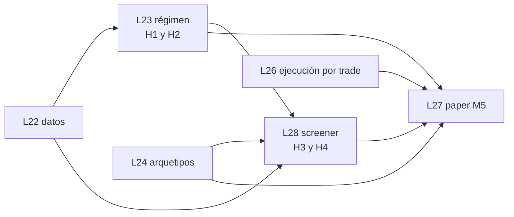

# QuantAgent-M5 — Plan: motor top-down después de M4

**Estado:** propuesta para revisión de Fede (2026-10-25). Ningún ticket existe en Beads: los IDs `M5-xx` son provisorios y los crea el PM (issue padre + hijos) cuando Fede apruebe el plan.
**Diseño:** [`docs/03_design/QuantAgent-M5-DS-motor-top-down.md`](../03_design/QuantAgent-M5-DS-motor-top-down.md).
**Propuesta original de Fede:** [`2026-10-25_propuesta_motor_jerarquico_fede.md`](./2026-10-25_propuesta_motor_jerarquico_fede.md).
**Cuándo:** después de los hitos definidos hoy. Ningún lote de M5 se abre antes de cerrar L20 y L21, salvo `M5-05` (§4), que conviene adelantar porque junta historia.

## 1. Objetivo y punto de control de M5

Una segunda rama de operación en QuantAgent, en una cuenta paper de Alpaca aparte, que cada semana lee la macro y el momentum, elige sectores y acciones, y cada día busca entradas técnicas con stop en el broker y un seguimiento que solo achica el riesgo.

**Punto de control de M5:** la cuenta paper M5 opera dos semanas sin intervención con el pipeline completo (Etapas 1–4), cada posición abierta tiene su stop en Alpaca, el digest diario muestra los intents aprobados y rechazados con su motivo, y la escalera H1–H4 tiene veredicto registrado (pase o no pase; un "no pasa" no frena paper, R01 #4).

## 2. Decisiones que necesita Fede

| # | Decisión | Antes de | Decisión o recomendación del PM |
|---|---|---|---|
| D1 | ¿Se paga Sharadar (o equivalente) para acciones, composición del S&P 500 y fundamentales? Excepción a R01 #14 | `M5-03` (lote L22) | **Decidido por Fede (2026-10-25):** fuentes gratuitas. La capa gratuita de Sharadar no sirve (empresas tipo Dow Jones, historia desde 2021-10) y su licencia obliga a borrar los datos al cancelar. Precios: Yahoo para los símbolos vivos y Quandl WIKI (espejo de Kaggle, incluye las que dejaron de cotizar, congelado al 2018-03-27) para las que salieron, sin empalmar fuentes dentro de un símbolo. Composición: `fja05680/sp500` + tabla manual de GICS. Fundamentales: SEC EDGAR. M5-03 informa la cobertura; una hipótesis de L28 que pase la etapa 2 se confirma con Sharadar pago antes de paper. |
| D2 | Sizing del bucket M5: riesgo por trade, tope por posición, heat máximo | `M5-50` (antes de paper) | **Decidido (Fede, 2026-10-29):** 0,25 % de riesgo por trade, tope de 10 % por posición, heat máximo 2 % (8 posiciones con riesgo completo, §6). |
| D3 | Filtro R/R: valor de `rr_min` y objetivo solo estructural | `M5-44` | **Decidido (Fede, 2026-10-29):** sin filtro R/R en v1. Los arquetipos A y B no tienen objetivo de precio (salen por stop o Chandelier), así que el filtro nunca actuaría. M5-44 queda en heat y redondeo a enteras. |
| D4 | Sustituto de ISM New Orders | `M5-01` | **Decidido:** NEWORDER (yoy). Única serie de pedidos con vintages en ALFRED desde 1997 que cubre el in-sample 2007-2018 punto en el tiempo. |
| D5 | ETFs de país sin Etapa 2 | `M5-32` | **Decidido (Fede, 2026-10-29):** `EEM`, `EWZ` y `SPY` saltean la Etapa 2 y pasan directo a la Etapa 3. `ARGT` queda fuera del universo de M5 (Fede: invertir en EE. UU.). |
| D6 | Capital inicial de la cuenta paper M5 | `M5-50` | **Decidido (Fede, 2026-10-29):** USD 3.000, para que paper ejercite fracciones, redondeos y tamaños mínimos. Con menos de USD 25.000 Alpaca aplica la regla de day trading (PDT) también en paper: M5-45 avisa cuando la cuenta se acerca a 3 day trades en 5 días hábiles. |
| D7 | ¿Alguna hipótesis de M5 entra a la reserva 2023+? | `M5-13` | **Decidido (Fede, 2026-10-29):** ni H1 ni H2 entran; la reserva se guarda para H4, el último escalón (§7 del diseño). |
| D8 | Métricas de calidad para Financials (bancos y aseguradoras no reportan `OperatingIncomeLoss` y el ROIC no tiene sentido con depósitos como deuda) | `M5-32a` | **Decidido (Fede, 2026-10-29):** para todo el sector GICS Financials, ROE de 4 trimestres (`NetIncomeLoss` / `StockholdersEquity`) en lugar de ROIC, y cambio interanual del margen antes de impuestos en lugar del margen operativo. Resto de los sectores: `OperatingIncomeLoss`, con el resultado antes de impuestos como aproximación solo donde falte. |
| D9 | Base de H3: ¿sectores habilitados por H1 o por H2? | `M5-33` | **Decidido (Fede, 2026-10-29):** H1. H2 no mejoró a H1 en la etapa 2 (ΔSharpe −0,09 ± 0,10); la macro vuelve a la escalera solo si suma en la etapa 2. |

## 3. Lotes

Seis lotes. L23, L24 y L28 son investigación (embudo, backtest); L26 es ejecución y sirve también a las estrategias sueltas de M4; L27 es paper. El screener es L28 y no L25 porque L25 ya lo usó `lote/paper-fix-tz`.

| Lote | Rama | Filas | Punto de control |
|---|---|---|---|
| L22 | `lote/m5-datos` | M5-01 a M5-05 | Snapshot macro con las series de la propuesta (o sus sustitutos) y transformaciones punto en el tiempo; snapshot de acciones, composición del S&P 500 por fecha y fundamentales con fecha de publicación; un test por fuente que prueba que una consulta en t no ve nada publicado después de t. |
| L23 | `lote/m5-regimen` | M5-10 a M5-13 | `regimen_semanal` calculado de 2006 a hoy; H1 y H2 con veredicto de las etapas 1–2 del embudo; tabla H2 contra H1. |
| L24 | `lote/m5-arquetipos` | M5-20 a M5-24 | Arquetipos A y B, con parámetros comunes, corridos agrupados sobre los 11 ETFs sectoriales hasta la etapa 2; entradas stop con vencimiento en el motor y en el filtro, verificadas contra `backtesting.py`. |
| L28 | `lote/m5-screener` | M5-30 a M5-34 | `candidatos_semanales` de 2007 a hoy; H3 contra los ETFs de sus sectores y H4 contra H3 con veredicto de etapa 2. |
| L26 | `lote/m5-ejecucion` | M5-40 a M5-45 | En la cuenta paper M5, una entrada llenada deja su stop en Alpaca; un cambio de stop reemplaza la orden; un stop llenado en Alpaca cierra la posición local; ningún camino del código baja el stop de un largo (test de propiedad); el heat rechaza con motivo. |
| L27 | `lote/m5-paper` | M5-50 a M5-54 | Punto de control de M5 (§1). |

**Paralelismo:** L24 y L26 no dependen de los datos nuevos y pueden ir en paralelo con L22–L23 (máquinas distintas, archivos distintos: `strategy/` y `backtesting/` contra `trading/`). L26 puede adelantarse incluso a M5 si M4 necesita stops en el broker.

**Opción de paper en dos tiempos (recomendada):** arrancar L27 con ETFs solamente (H1/H2 + arquetipos) apenas cierren L23, L24 y L26, y sumar acciones cuando cierre L28. Así la prueba de sistema empieza antes y la Etapa 2 entra sobre una ejecución que ya anda.

## 4. Tickets

Formato de la cola de `PLAN-CONTINUACION.md` §4. Revisión: **leer**, **decidir**, **probar**.

### L22 — datos

| # | Objetivo | Aceptación binaria | Revisión |
|---|---|---|---|
| M5-01 | Snapshot macro nuevo con `ICSA`, `T10YIE`, `T5YIE`, `DFII10`, `VIXCLS`, `DTWEXBGS` y el sustituto de ISM (D4), además de las 10 series actuales | `data macro verify <nombre>` pasa con todas las series; el manifiesto lista la serie elegida en lugar de ISM y la razón | probar |
| M5-02 | Transformaciones punto en el tiempo: variación interanual, diferencia de 12 meses y z-score de 36 meses sobre `serie_punto_en_el_tiempo` | Test: para una serie sintética con revisión posterior, el valor transformado en t usa la versión publicada hasta t y no la revisada | leer |
| M5-03 | Fuente de acciones (según D1): precios ajustados incluidas las que dejaron de cotizar, snapshot con manifiesto | Un símbolo que dejó de cotizar entre 2007 y 2018 tiene precios hasta su último día en el snapshot; `verify` pasa | probar |
| M5-04 | Composición por fecha: miembros del S&P 500 + sector GICS, con tabla manual versionada de las reclasificaciones de 2018 y 2023 | Test: `GOOGL` es Tecnología en 2017-06 y Comunicaciones en 2019-06; los miembros en una fecha dada coinciden con la fuente | leer |
| M5-05 | Foto diaria del consenso de EPS (FMP o similar, plan bajo) guardada con fecha; **conviene adelantarlo** porque junta historia | Dos días seguidos de corrida dejan dos fotos con fecha distinta y sin pisarse | probar |

### L23 — régimen (Etapa 1, H1 y H2)

| # | Objetivo | Aceptación binaria | Revisión |
|---|---|---|---|
| M5-10 | `PriceMomentumScore` (1, 3 y 6 meses sobre volatilidad de 60) y filtro de caída (SPY bajo su media 200 con pendiente negativa) extendiendo `fabrica/regimen.py` | Test con precios sintéticos: el filtro bloquea solo cuando se cumplen las dos condiciones; el score en t no cambia si se agregan precios después de t | leer |
| M5-11 | Matriz de signos en `catalogo/m5-priors.yaml`, con una cita por signo, y `MacroThemeScore` | Matriz versionada antes de cualquier corrida (fecha del commit anterior a la primera fila de H2 en `intentos.csv`); test con z-scores fijos da el score esperado a mano | decidir |
| M5-12 | `SectorScore` como métrica transversal (peso macro configurable: 0 para H1, 0,5 para H2) y tabla `regimen_semanal` | `regimen_semanal` tiene una fila por semana desde 2006 con habilitados y bloqueados; XLRE y XLC aparecen recién con historia suficiente | probar |
| M5-13 | H1 y H2 como hipótesis YAML por el embudo hasta la etapa 2 | Las dos tienen veredicto en `hipotesis.csv`; el informe muestra H2 contra H1 con ΔSharpe y su error estándar | decidir |

### L24 — arquetipos (Etapa 3)

| # | Objetivo | Aceptación binaria | Revisión |
|---|---|---|---|
| M5-20 | Indicadores compartidos: ATR, Force Index, SafeZone, Chandelier, Donchian, ancho de Bollinger, volumen relativo | Cada indicador coincide con un cálculo independiente (sin importar `quantagent`) sobre un fixture versionado | leer |
| M5-21 | Entradas con orden stop y vencimiento en el motor propio y en `vbt_filter` | Test: apertura por encima del stop llena en la apertura; sin llenado en 3 velas, la orden vence; motor y `backtesting.py` coinciden trade por trade en un fixture | probar |
| M5-22 | Arquetipo A (pullback, variante de Triple Screen) | ≥ 5 trades en el fixture de 3 ETFs; stops y entradas en múltiplos de ATR; registrado en `registry.py` | leer |
| M5-23 | Arquetipo B (ruptura después de compresión) | Idem M5-22 | leer |
| M5-24 | A y B agrupados sobre los 11 ETFs sectoriales hasta la etapa 2 | Veredicto de las dos en `hipotesis.csv`, intentos sumados a N | decidir |

### L28 — screener (Etapa 2, H3 y H4)

| # | Objetivo | Aceptación binaria | Revisión |
|---|---|---|---|
| M5-30 | Máscara de elegibilidad fecha × activo declarada por la hipótesis en el embudo | Test: un activo fuera de la máscara en t no recibe peso ni señal en t | leer |
| M5-31 | Métricas fundamentales punto en el tiempo: ROIC 4 trimestres, cambio interanual del margen operativo, aceleración de ingresos, crecimiento del EPS | Test: un balance presentado el día d no se ve en d − 1; ante una restatación se usa el último valor presentado hasta t (rige desde el día siguiente a la presentación); un dato cuyo último trimestre terminó hace más de 200 días queda vacío | leer |
| M5-32a | ROE de 4 trimestres y cambio interanual del margen antes de impuestos, punto en el tiempo, para Financials (D8) | Tests con datos sintéticos calculados a mano; cobertura desde 2010 en Financials informada en el PR | leer |
| M5-32 | Screener por sector (z-score intra sector, recorte ±3, exclusión del cuartil inferior de fuerza relativa, top 3) y tabla `candidatos_semanales`; Financials con las métricas de D8; `EEM`, `EWZ` y `SPY` directo a Etapa 3 (D5) | Para una fecha fija, el top 3 coincide con un cálculo a mano en una planilla adjunta al PR | probar |
| M5-33 | H3 (sectores de H1, D9) por el embudo hasta la etapa 2 | Veredicto en `hipotesis.csv`; el informe declara el sesgo de supervivencia si D1 fue "no" | decidir |
| M5-34 | H4 (H3 + arquetipos) por el embudo hasta la etapa 2 | Veredicto; informe H4 contra H3 | decidir |

### L26 — ejecución por trade

| # | Objetivo | Aceptación binaria | Revisión |
|---|---|---|---|
| M5-40 | `TradeIntent` (extiende `TradingSignal`, stop obligatorio) y tabla `trade_intents` con estado y motivo | Test: un intent rechazado por riesgo queda persistido con su motivo y su `reasoning_metadata` | leer |
| M5-41 | `AlpacaBroker`: órdenes stop de entrada y de salida, reemplazo del precio stop, vigencia GTC para cantidades enteras y day para fracciones | Test con cliente falso: un stop con fracción sale con vigencia day; uno entero con GTC; el reemplazo llama a la API con el id correcto | leer |
| M5-42 | Stop en el broker al llenarse la entrada; se apaga el chequeo local para esas posiciones; reconciliación cierra la posición si el stop se llenó en Alpaca | Test: posición con stop en el broker y vela que perfora el stop no genera una segunda venta local; stop llenado en Alpaca → `close_reason = stop_broker` | probar |
| M5-43 | `nuevo_stop()` como único camino para mover el stop; acciones breakeven, Chandelier e invalidación de tesis | Test de propiedad (Hypothesis o equivalente): para cualquier secuencia de propuestas, el stop de un largo nunca baja | leer |
| M5-44 | `RiskManager`: heat del bucket (D2; sin filtro R/R, D3); `PositionSizer`: redondeo a enteras si el activo no es fraccionable | Tests parametrizados: rechazo `max_heat`, `tamano_cero` con activo no fraccionable | leer |
| M5-45 | Job previo a la apertura: reenviar stops day, vencer entradas, verificar que toda posición tenga stop; aviso PDT cuando la cuenta se acerca a 3 day trades en 5 días hábiles (D6) | Corrida en paper: con una posición fraccionaria abierta, el stop del día existe en Alpaca antes de las 9:30 ET; sin stop, el job falla con alarma | probar |

### L27 — paper M5

| # | Objetivo | Aceptación binaria | Revisión |
|---|---|---|---|
| M5-50 | Cuenta paper M5: claves en `~/secrets/alpaca-m5.env` (las pone Fede), base y proceso propios, perfil del bucket con los valores de D2 y el capital de D6 | `reconcile` sobre la cuenta M5 no ve posiciones de las carteras de M4 | probar |
| M5-51 | Pipeline semanal y diario en el scheduler (§6.7 del diseño) | Una semana simulada en paper genera `regimen_semanal`, `candidatos_semanales`, intents y órdenes con stop | probar |
| M5-52 | Nota macro semanal y explicación de cada trade por el LLM, fuera del camino del dinero | La nota de una semana menciona los sectores que entraron y salieron; ningún número del pipeline cambia si el LLM falla | leer |
| M5-53 | Digest diario de M5 (intents aprobados y rechazados con motivo, stops vigentes, heat) | El digest de un día con un rechazo muestra el motivo | probar |
| M5-54 | Puesta en marcha: dos semanas sin intervención | Punto de control de M5 (§1). Requiere autorización operativa explícita de Fede | decidir |

## 5. Correspondencia con los tickets de la propuesta

| Propuesta | M5 | Cambio |
|---|---|---|
| 1.1 `PortfolioBucket` + `TradeIntentRecord` | M5-40, M5-50 | Sin tabla de buckets en paper (cuenta aparte, F4). |
| 1.2 `RiskGatekeeper` | M5-44 | Extiende `RiskManager` y `PositionSizer`; números por D2 y D3. |
| 1.3 `PositionTracker` | M5-41, M5-42, M5-43, M5-45 | Separado en broker, stop en el broker, invariante y job previo a la apertura. |
| 2.1 Arquetipos | M5-20 a M5-23 | Más entradas stop en el motor (M5-21). |
| 2.2 Evaluador agrupado + DSR | M5-24 | Usa el embudo y el DSR existentes; sin código de DSR nuevo. |
| 3.1 `MacroSeriesProvider` | M5-01, M5-02 | Extiende `data/macro.py`. |
| 3.2 `MacroRegimeEngine` | M5-10 a M5-13 | Medido como H1 y H2 (F2). |
| 4.1 `FundamentalFactorScreener` | M5-03, M5-04, M5-30 a M5-33 | Con datos nuevos y máscara de elegibilidad. |
| 4.2 Orquestador | M5-51 | En el scheduler existente. |
| — | M5-05, M5-34, M5-52, M5-53, M5-54 | Nuevos: foto de consenso, H4, rol del LLM, digest y puesta en marcha. |

## 6. Referencia para D2: cuánto riesgo y cuántas posiciones

Con equity del bucket E, riesgo por trade r y heat máximo h, el máximo de posiciones abiertas con riesgo completo es h / r (las que están en breakeven no cuentan). El tope por posición limita además cuánto capital va a cada una.

| r | h | Posiciones con riesgo completo | Riesgo por trade con E = USD 3.000 |
|---|---|---|---|
| 0,25 % (R01) | 6 % | 24 (el heat nunca limita) | USD 7,50 |
| 0,25 % | 2 % | 8 | USD 7,50 |
| 0,5 % | 3 % | 6 | USD 15 |
| 1 % (propuesta) | 6 % | 6 | USD 30 |

Con stop a 2 ATR (típicamente 3–6 % del precio en acciones), r = 0,25 % da posiciones de 4–8 % del bucket: el tope de 10 % de R01 casi no actúa. Con r = 1 % las posiciones serían de 17–33 % y el tope pasa a ser lo que manda.

## 7. Lo que no entra en M5

Dinero real, partición de una sola cuenta live entre M4 y M5, cortos (registrados como H5, abajo), veto del LLM sobre señales (posible hipótesis posterior), acciones por país (Brasil, Argentina), revisiones de EPS históricas pagas.

## 8. Registrado para después de M5

| Idea | Detalle | Cuándo |
|---|---|---|
| H5: pierna corta en sectores bloqueados | Vender en corto los activos con filtro de caída activo y momentum negativo, con arquetipos espejo; se mide contra H4. Motivo de dejarla afuera de v1 y antecedentes en el diseño §7. | Después del punto de control de M5 (Fede, 2026-10-25). Si suma, entra en paper con la cuenta M5; para dinero real requiere cuenta margin (sin fracciones en corto). |
