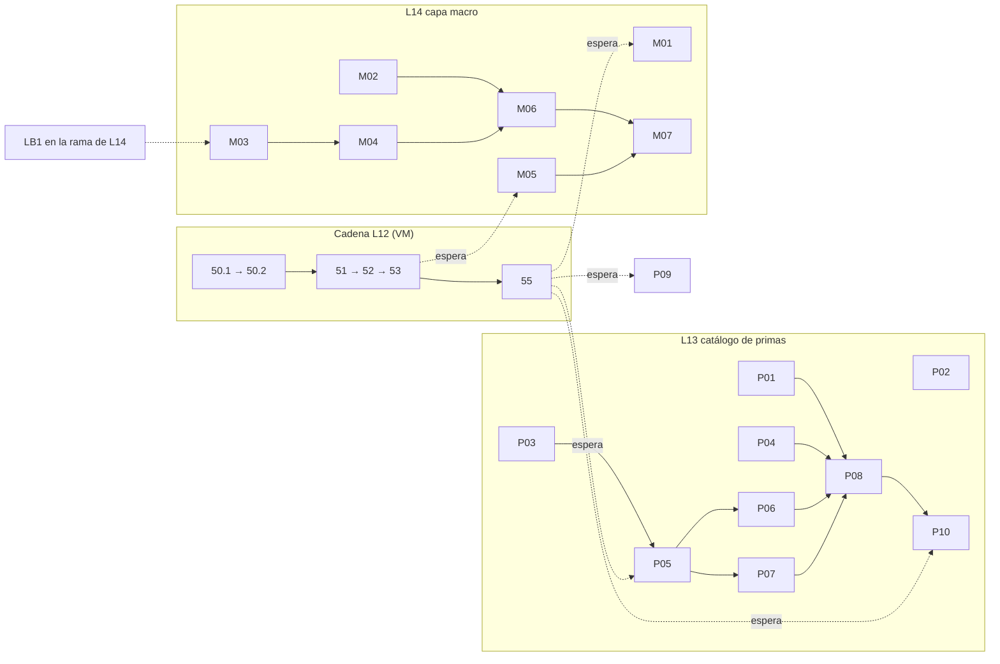

# QuantAgent-d4cq: propuesta de reescritura de L13 y L14

- **Estado:** plan y recomendaciones de §7 aprobados por Fede el 2026-10-17. Falta que la VM aplique §6 y abra los lotes. No abre los lotes ni toca `.beads/issues.jsonl`: la VM aplica los cambios de §6 si Fede aprueba.
- **Base:** `lote/cartera` en `ec1cf29` (C02, C03 y C09 ya mergeados) y `lote/datos-externos` en `238c82b` (LB1).
- **Reemplaza:** los tickets `QuantAgent-d4cq.38` a `.44`, escritos antes de [`2026-10-17-DC-cartera-de-primas`](../04_decisions/2026-10-17-DC-cartera-de-primas.md).
- **No fija dinero:** ningún ticket de este documento define capital, tamaño de posición ni pesos de cartera. Lo que los toca está en §5 como pregunta para Fede.

## 1. Qué cambió desde que se escribieron los tickets viejos

Los tickets `.39` a `.44` salieron del plan del 2026-10-14: un catálogo de 30 hipótesis, un generador con LLM que propone 20 y 12 ETFs. Después Fede decidió (D1 a D7):

- Entran **primas de riesgo con literatura**, no reglas técnicas ni combinaciones (D1). Cada intento sube la vara del Sharpe deflactado para todos, así que se prueba poco y con fundamento.
- El universo de cada pierna se fija **antes de la primera corrida**, por dónde está definida la estrategia y no por dónde le fue mejor (D2).
- El veredicto es de la **cartera**, con pesos por igual riesgo (D3, D4) y una fila por cartera y etapa en `intentos.csv` (D7).
- La capa macro es una **segunda capa**, con datos punto en el tiempo, aceptada solo si mejora el DSR del núcleo (D5).

Consecuencias para los tickets viejos:

| Ticket viejo | Problema contra lo decidido | Qué se hace |
|---|---|---|
| `.39`, `.40` catálogo de 30 hipótesis | Son 30 intentos potenciales; reversión, volatilidad y régimen no son primas de D1 | Un solo catálogo de primas (P01); `.40` se cierra absorbido |
| `.41` crítico | Compara `clase`, `activos` y grilla de una pierna (`Hipotesis.clase` devuelve la primera); una cartera tiene varias | Reescrito para carteras, más el congelado de universo de D2 (P02) |
| `.42`, `.43` generador y `proponer` | Producen hipótesis listas para correr, sobre 12 ETFs; con D1 el LLM investiga, no corre | Pasan a un extra opcional que propone entradas de catálogo (§4) |
| `.44` resumen y ERROR | El punto 1 (causas por hipótesis) ya está en `.53` | Queda solo el motivo de ERROR (P09) |
| `.38` RSI con régimen | Es una regla técnica de reversión; D1 la deja en la opción B | Se conserva, pero como capa que se mide contra el núcleo y con OK de Fede (M02) |

## 2. Qué hay hoy y de qué se puede apoyar cada lote

**Ya en `lote/cartera`:** YAML de cartera con piernas y universo (C02), snapshot amplio de 29 ETFs (C03), pesos 1/σ mensual y `combinar` (C04), `filtrar_activo` con retornos fuera de muestra (C05a), Sharpe a tasa 0 (C01), cartera tendencia + momentum con `UNIVERSO_AMPLIO` en `admision.py` (C09, #267 y #272). Clases registradas: `momentum-12m`, `sma-cross`, `fifty-two-week-high`, `rsi`, `triple-screen`, `llm-agent`.

**En la cadena L12 de la VM** (`.50.1` → `.50.2` → `.51` → `.52` → `.53` → `.55`): toca `fabrica/cartera.py`, `fabrica/filtro.py`, `cli/hipotesis.py`, `fabrica/validacion.py`, `backtesting/verdict.py`, `fabrica/candado.py`, `fabrica/informe.py`, `fabrica/estado.py`, `hipotesis/` y `docs/06_implementation/`. Esa lista es el criterio de choque de §3.

**En `lote/datos-externos` (LB1), todavía fuera de `lote/cartera`:** `quantagent/data/macro.py` con `crear_snapshot_macro`, `verificar_snapshot_macro`, `valor_conocido` y `serie_punto_en_el_tiempo`; `data macro create|verify`; el manifiesto versionado `tests/fixtures/snapshots/macro-2026-10.json` con 10 series (`BAA10Y`, `CPIAUCSL`, `DGS10`, `DGS2`, `DGS3MO`, `FEDFUNDS`, `INDPRO`, `PAYEMS`, `T10Y2Y`, `UNRATE`); `realtime_end` inclusivo (#268). Los parquets reales están en la VM, no en el repo ni en la nube.

**Lo que NO existe y condiciona el diseño:**

1. Una estrategia ve solo las velas de **su** activo (`generate_signal(kline_data, symbol, timeframe, current_price)`). Un ranking entre activos (momentum relativo, baja volatilidad) no se puede escribir como estrategia de hoy, y `filtrar_activo` elige parámetros por activo. Es el cuello de botella de L13.
2. Una estrategia que lee macro puede mirar el futuro **sin que la prueba de truncamiento lo note**: cortar las velas en T no corta las versiones de ALFRED. Hace falta una prueba de truncamiento de vintage (M03).
3. La rama de L14 necesita LB1 y L12. `git merge-tree` de `lote/cartera` con `lote/datos-externos` da un único conflicto, de texto, en `docs/loop/NUBE.md`; `cli/data.py` y `.beads/issues.jsonl` se fusionan solos.

## 3. Mapa de paralelismo contra la cadena L12

**Criterio.** *Paralelo* = no toca ningún archivo de la cadena ni depende de su resultado. *Espera* = depende del resultado o toca un archivo de la cadena, y arranca cuando cierra el ticket indicado. *VM* = compite por la sesión PM de la VM; no choca en archivos, pero conviene después de `.55`.

| Ticket | Máquina | Con la cadena L12 | Motivo |
|---|---|---|---|
| P01 catálogo | nube | **paralelo** | archivos nuevos |
| P02 crítico + universo congelado | nube | **paralelo** | `critico.py` nuevo y `admision.py`; el CLI no se toca (§4) |
| P03 diseño de piernas transversales | nube | **paralelo** | solo un documento de decisión |
| P04 estacionalidad | nube | **paralelo** | clase nueva y una entrada en `registry.py`, que la cadena no toca |
| M02 `RsiRegimenStrategy` | nube | **paralelo** (con OK de Fede, Q4) | clase nueva y `registry.py` |
| M03 prueba de truncamiento de vintage | nube | paralelo en archivos; **espera la rama de L14** | necesita `data/macro.py` de LB1 |
| M04 regla de pendiente de curva | nube + VM | igual que M03 | ídem |
| P05 piernas transversales en el embudo | nube, luego VM | **espera `.55`** | toca `filtro.py`, `validacion.py`, `cartera.py` |
| P06, P07 clases transversales | nube | espera P05 | usan lo que P05 define |
| P08 carteras YAML de las familias | nube | espera P01, P04, P06, P07 | |
| P09 motivo de ERROR | nube | **espera `.55`** | `cli/hipotesis.py` |
| M05 comparador núcleo contra núcleo + capa | nube | **espera `.53`** | `cli/hipotesis.py` e `informe.py` |
| M01 régimen contra la cartera núcleo | VM | VM: después de `.55` | lee datos reales 2007–2018 |
| M06 carteras YAML de la capa | nube | espera M04, M02, M05 | |
| P10, M07 puntos de control | VM | **espera `.55`** | corren sobre datos reales; la etapa 3 pide OK de Fede |

Orden recomendado para no frenar la cadena: ahora P01 a P04 y M02 (cinco entregas en la nube que la VM solo revisa); al cerrar `.55`, P05 y P09; después el resto.

## 4. L13 · `lote/catalogo-de-primas`

**Punto de control (nuevo).** Cada entrada del catálogo de primas aplicables con ETFs tiene una cartera con veredicto de las etapas 1 a 3 (la 3 con OK de Fede, una cartera por vez) o un motivo escrito de por qué no aplica con ETFs. El informe muestra el N total de intentos con que se calculó cada DSR. Es la condición de cierre de M3 que dejó escrita el plan.

**Rama.** Sale de `origin/lote/cartera`. Los tickets de la nube siguen `docs/loop/NUBE.md`.

**Hallazgo que cambia dónde vive el catálogo.** `backtest hipotesis tanda hipotesis/` carga todos los `*.yaml` de la carpeta (`cli/hipotesis.py`, `tanda_command`). Un `hipotesis/catalogo.yaml`, como pedía `.39`, se leería como una hipótesis y fallaría en cada tanda. El catálogo va en `catalogo/primas.yaml`.

### P01 · Catálogo de primas (reescribe `QuantAgent-d4cq.39`, absorbe `.40`)

- **Objetivo:** un único catálogo de primas aplicables con ETFs, con lo mínimo para decidir qué carteras armar. Contenido propuesto en el Apéndice A.
- **Aceptación:**
  - [ ] `catalogo/primas.yaml` con una entrada por prima: `id`, `prima`, `idea`, `fuente` (lista de DOI), `universo` (activos y criterio de definición, D2), `clase` (alias registrado o `null`), `datos` (`precios` o `macro`), `destino` (`L12`, `L13`, `L14` o `no-aplica`) y `motivo` cuando no aplica.
  - [ ] Test de carga: ids únicos, claves presentes, `clase` es `null` o un alias de `cli_aliases()`, `activos` ⊂ `UNIVERSO_AMPLIO`, cada DOI con forma `10.<registro>/<sufijo>`.
  - [ ] Test: ningún YAML de `hipotesis/` cita un DOI que no cumpla esa forma.
  - [ ] El cuerpo del PR lista cada DOI con el título que devuelve `https://api.crossref.org/works/<doi>` (se consulta desde la nube). Un DOI que no resuelve no entra.
  - [ ] ≤ 100 líneas de diff, CI verde.
- **Depende de:** nada. **Toca:** `catalogo/primas.yaml`, `tests/test_catalogo_primas.py`. **Máquina:** nube. **Con L12:** paralelo.
- **Fuera de alcance:** correr nada; inventar fuentes; escribir clases.

### P02 · Crítico para carteras y universo congelado (reescribe `QuantAgent-d4cq.41`)

- **Objetivo:** que la admisión rechace duplicadas y haga cumplir D2 de forma mecánica: el universo declarado en la primera corrida no cambia. El `.41` original comparaba una sola pierna y su regla de justificación (80 caracteres) contradecía `MIN_JUSTIFICACION = 40` de `admision.py`; acá se reutiliza esa constante.
- **Aceptación:**
  - [ ] `criticar(h, existentes) -> (veredicto, motivo, familia)` en `quantagent/fabrica/critico.py`. Una hipótesis es **duplicada de `<id>`** si tiene el mismo conjunto de piernas (`clase`, `parametros`, `activos`); **variante** si comparte las clases pero cambia activos o grilla (acepta, con la familia de la más antigua).
  - [ ] Test: dos carteras con las mismas piernas en distinto orden son duplicadas; una con un activo distinto es variante.
  - [ ] Primera admisión de un id: se guarda `sha256` de sus piernas (`clase` + `activos`) en `hipotesis-universos.csv` (archivo nuevo, solo agregado, junto a `hipotesis-candado.csv`). Una admisión posterior con otro hash corta con `universo distinto del declarado el <fecha> (D2)`.
  - [ ] `admitir()` llama al crítico leyendo `hipotesis/` por defecto, así que `cli/hipotesis.py` no cambia. Las 5 hipótesis actuales siguen pasando la etapa 0.
  - [ ] Si el diff pasa de 100 líneas se parte en dos (duplicadas/familia y universo congelado), como se partió `.50`.
- **Depende de:** nada. **Toca:** `quantagent/fabrica/critico.py` (nuevo), `quantagent/fabrica/admision.py`, tests. **Máquina:** nube. **Con L12:** paralelo.
- **No cambia:** cómo usa el DSR la familia (sigue N = total de `intentos.csv`); el formato de `hipotesis.csv`.

### P03 · Diseño de piernas transversales (nuevo, solo decisión)

- **Objetivo:** dejar escrito cómo una pierna que **rankea activos** (momentum relativo, baja volatilidad) entra a las etapas 1 a 3, antes de tocar `filtro.py` y `validacion.py` en medio de la cadena L12.
- **Aceptación:** `docs/04_decisions/<fecha>-DC-piernas-transversales.md` con una decisión por punto, opciones A/B y recomendación:
  - [ ] Señal: el ranking usa solo cierres hasta el cierre de decisión (fin de mes, como `momentum-12m`) y una fracción fija del universo; cómo se expresa para que la prueba de truncamiento cubra todos los activos a la vez.
  - [ ] Etapa 1: la grilla de parámetros se elige **por pierna**, no por activo; cómo se calculan retornos fuera de muestra con `filtrar_activo` o su reemplazo.
  - [ ] Etapa 2: el control contra `backtesting.py` se mantiene por celda alimentándolo con la serie 0/1 resultante, para que "todas las celdas coinciden" siga valiendo.
  - [ ] Pesos: cómo se aplica el 1/σ de `cartera.pesos` a los activos elegidos. **Es decisión de Fede** (Q1); el documento solo presenta opciones.
  - [ ] Lista de los tickets de implementación con archivos, para que el PM sepa qué choca con la cadena.
- **Depende de:** nada. **Toca:** un documento. **Máquina:** nube. **Con L12:** paralelo.

### P04 · Estacionalidad de Halloween (nuevo)

- **Objetivo:** clase `halloween` (alias propio): largo desde la última sesión de octubre hasta la última de abril, fuera el resto. Sin parámetros libres: las fechas son las de Bouman y Jacobsen (2002).
- **Aceptación:**
  - [ ] Test con velas sintéticas de varios años: posición larga solo en el tramo, cambio de estado en la última sesión del mes según `is_last_session_of_month` (reutiliza el de `momentum_12m_strategy.py`).
  - [ ] Pasa `check_no_lookahead` (depende solo de la fecha de la vela).
  - [ ] Registrada en `registry.py` con alias y 0 parámetros; `admitir` acepta un YAML de prueba en fixture.
  - [ ] ≤ 100 líneas, CI verde.
- **Depende de:** nada. **Toca:** `quantagent/strategy/halloween_strategy.py` (nuevo), `quantagent/strategy/registry.py`, tests. **Máquina:** nube. **Con L12:** paralelo.
- **Expectativa:** es la entrada con la evidencia más débil del catálogo. McLean y Pontiff (2016) muestran que los efectos publicados pierden parte de su retorno después de la publicación. Corre al final.

### P05 · Piernas transversales en el embudo (nuevo)

- **Objetivo:** implementar lo que decida P03: función pura `señales_transversales` sin lookahead y su integración en las etapas 1 a 3.
- **Aceptación (se afina con P03):**
  - [ ] Función pura en `quantagent/fabrica/transversal.py`: con 3 activos de retornos conocidos, el de mayor retorno a 12 meses entra y los demás no; la señal en t no cambia si se alteran las velas posteriores.
  - [ ] Una pierna transversal produce retornos fuera de muestra que `cartera.combinar` acepta junto a las piernas por activo.
  - [ ] Los trades de la pierna cuentan en el mínimo de 30 de la cartera.
  - [ ] Etapa 2: una celda del control que no coincide corta, igual que para las demás piernas.
- **Depende de:** P03 (decisión de Fede sobre pesos, Q1) y `.55` cerrado. **Toca:** `fabrica/transversal.py` (nuevo), `fabrica/filtro.py`, `fabrica/cartera.py`, `fabrica/validacion.py`. **Máquina:** nube para la función pura, VM para la integración. **Con L12:** **espera `.55`**.
- **Tamaño:** se espera partirlo en dos (función pura; integración), como `.50.1` y `.50.2`.

### P06 · Momentum transversal (nuevo)

- **Objetivo:** clase `momentum-transversal`: compra el tercio superior del universo por retorno de 12 meses menos el último mes, decisión a fin de mes (Jegadeesh y Titman 1993; Asness, Moskowitz y Pedersen 2013).
- **Aceptación:** [ ] test con 6 activos sintéticos: entran los 2 mejores; [ ] no mira el futuro; [ ] 0 parámetros libres si Q6 se resuelve fijando el tercio; [ ] registrada y admitida en fixture; [ ] ≤ 100 líneas.
- **Depende de:** P05. **Toca:** clase nueva y `registry.py`. **Máquina:** nube. **Con L12:** espera P05.

### P07 · Baja volatilidad transversal (nuevo)

- **Objetivo:** clase `baja-volatilidad`: dentro de **una misma clase de activo**, compra el tercio de menor volatilidad de 252 sesiones (Ang et al. 2006; Frazzini y Pedersen 2014; Baker, Bradley y Wurgler 2011).
- **Aceptación:** [ ] test con activos sintéticos de distinta volatilidad; [ ] no mira el futuro; [ ] el universo de la pierna es solo ETFs de acciones, declarado por definición y no por resultados.
- **Riesgo que el ticket debe dejar escrito:** rankeando todos los ETFs juntos, "baja volatilidad" es casi siempre "bonos", que es otra apuesta. Por eso el universo se limita a una clase.
- **Depende de:** P05. **Toca:** clase nueva y `registry.py`. **Máquina:** nube. **Con L12:** espera P05.

### P08 · Carteras de las familias (nuevo)

- **Objetivo:** un YAML de cartera por familia, con universo y fuente fijados antes de la primera corrida (como `.54`): `hipotesis/cartera-transversal.yaml` (momentum relativo + baja volatilidad) y `hipotesis/cartera-estacionalidad.yaml`.
- **Aceptación:** [ ] `admitir` acepta cada una sobre la fixture; [ ] `universo` de cada pierna dice el criterio de definición; [ ] la cita de cada fuente coincide con P01; [ ] 0 parámetros libres.
- **Depende de:** P01, P04, P06, P07 y la decisión de Q2 (una cartera por familia o una combinada). **Toca:** `hipotesis/`. **Máquina:** nube. **Con L12:** espera a sus dependencias.

### P09 · Motivo de ERROR (reduce `QuantAgent-d4cq.44`)

- **Objetivo:** el motivo de ERROR usa la última línea no vacía de la excepción con prefijo `<Tipo>: `, truncada a 200. El punto 1 de `.44` (causas por hipótesis) se retira porque `.53` ya lo cubre.
- **Aceptación:** [ ] test con un traceback de 5 líneas: el motivo es `RuntimeError: <última línea>`; [ ] ≤ 100 líneas.
- **Depende de:** `.55`. **Toca:** `quantagent/cli/hipotesis.py`. **Máquina:** nube. **Con L12:** **espera `.55`**.

### P10 · Punto de control de L13 (nuevo)

- **Objetivo:** correr las carteras de P08 sobre datos reales y completar el estado de cada entrada del catálogo.
- **Aceptación:** [ ] cada entrada de `catalogo/primas.yaml` con `destino: L13` tiene veredicto e informe, o `motivo` escrito; [ ] el informe muestra N total y DSR; [ ] la etapa 3 de cada cartera se abre solo con el OK de Fede (candado por id).
- **Depende de:** P08, `.55`. **Toca:** `hipotesis/`, `docs/06_implementation/`. **Máquina:** VM. **Con L12:** espera `.55`.

### Opcional, fuera del lote: el LLM como investigador (reescribe `.42` y `.43`)

Dos tickets que no hacen falta para cerrar M3: **investigador-1** (nube) arma el pedido con el catálogo, las reglas D1 y D2, el N de intentos y el estado de cada cartera (sin Sharpe ni trades), y escribe las propuestas como entradas de catálogo en `catalogo/propuestas/<id>.yaml`, nunca en `hipotesis/`; **investigador-2** (VM) es el comando `proponer` vía `QUANTAGENT_LLM_CMD`, que toca `cli/hipotesis.py` y espera `.55`. Fede y el crítico filtran lo que se propone; nada se corre solo. Recomendación: dejarlos fuera hasta tener el veredicto de la primera cartera (Q5).

## 5. L14 · `lote/capa-macro`

**Punto de control (nuevo).** `backtest hipotesis comparar` entrega, para cada capa candidata, la cartera núcleo contra núcleo + capa con ΔSharpe, ΔDSR y el N de cada una, y la capa se acepta o se descarta con la regla que fije Fede (Q3). Las reglas macro leen solo lo que estaba publicado en cada fecha.

**Rama.** `lote/capa-macro` sale de `lote/cartera` y trae `lote/datos-externos` (un conflicto de texto en `docs/loop/NUBE.md`, ver §2). Si Fede mergea L12 y LB1 a `main` antes, sale de `main`. Hasta que exista la rama, los tickets M03 y M04 no pueden empezar.

**Diseño de lectura macro.** Opción A (recomendada): la estrategia lee su serie con `serie_punto_en_el_tiempo(snapshot, serie, sesiones)`, con el snapshot y la serie como parámetros de valor único en el YAML (no cuentan como libres). No cambia el pipeline, no choca con la cadena L12 y el resultado en cada fecha depende solo de `valor_conocido`. Opción B: inyectar un contexto en `bar_signals`, que obliga a tocar `signals.py`, `filtro.py` y `validacion.py`. Se elige A por ser más barata y no chocar; queda B si más adelante se necesitan series de otros activos (SPY como régimen de todos).

### M01 · Régimen del mercado contra la cartera núcleo (reescribe `QuantAgent-ljoj`)

- **Objetivo:** responder con datos si el rendimiento de la cartera núcleo (tendencia + momentum) depende del régimen de SPY medido en el mercado: volatilidad realizada de 20 días contra su mediana de un año, y precio sobre o bajo la media de 200 días. Es el primer paso barato que dejó escrito `ljoj`, ahora sobre la cartera y no sobre las 48 celdas.
- **Aceptación:** [ ] tabla de Sharpe diario del núcleo por régimen, 2007–2018, con el régimen calculado con datos hasta la sesión previa; [ ] el mismo cálculo con el ruido de reetiquetar al azar (permutando bloques de un mes) para ver si la diferencia supera lo que da el azar; [ ] conclusión de una línea: se sigue o se archiva (si la diferencia no tiene el mismo signo en la mayoría de las piernas, se archiva).
- **Depende de:** nada de la cadena: usa `retornos` de `filtrar_activo` (C05a) y `cartera.combinar`, ya mergeados. **Toca:** `quantagent/fabrica/regimen.py` (nuevo, puro), un script de medición. **Máquina:** VM (datos reales 2007–2018). **Con L12:** no choca en archivos; después de `.55` por la VM.
- **Pregunta abierta Q7:** si la tabla cuenta como intento. Recomendación: no, mientras no elija parámetros; toda regla que salga de ella entra como cartera nueva y sí cuenta.

### M02 · `RsiRegimenStrategy` como capa candidata (reescribe `QuantAgent-d4cq.38`)

- **Objetivo:** la regla de RSI de `rsi_strategy.py` que solo entra con volatilidad realizada propia por encima de su mediana de 252 sesiones (Nagel 2012: la prima de proveer liquidez sube cuando la volatilidad es alta). Cambios contra `.38`: se evalúa como núcleo + pierna contra el núcleo (D5), no como hipótesis suelta, y el YAML es de **cartera** con el universo declarado.
- **Aceptación:**
  - [ ] Test con velas sintéticas: con RSI en sobreventa y volatilidad baja no entra; con volatilidad alta sí.
  - [ ] Pasa `check_no_lookahead`; la señal en t no cambia al alterar velas posteriores.
  - [ ] `hipotesis/cartera-nucleo-rsi-regimen.yaml`: piernas del núcleo más la pierna RSI, universo de la pierna = ETFs de acciones con el criterio escrito, `fuente` con DOI verificado (`10.1093/rfs/hhs066`).
  - [ ] Admisión acepta el YAML sobre fixture; máximo 6 parámetros libres, 0 si se fijan.
  - [ ] ≤ 100 líneas, CI verde.
- **Depende de:** OK de Fede (Q4). **Toca:** `quantagent/strategy/rsi_regimen_strategy.py` (nuevo), `quantagent/strategy/registry.py`, `hipotesis/`. **Máquina:** nube. **Con L12:** paralelo.
- **Fuera de alcance:** régimen leído de otro activo (SPY para todos), que es la opción B de lectura.

### M03 · Prueba de truncamiento de vintage (nuevo)

- **Objetivo:** detectar una estrategia que lee la última revisión de una serie en vez de lo publicado en la fecha. Hoy `check_no_lookahead` corta las velas pero no las versiones de ALFRED.
- **Aceptación:**
  - [ ] Función que recorta un snapshot macro a una fecha T (descarta versiones con `realtime_start > T` y acota `realtime_end`) y una variante de `check_no_lookahead` que la usa.
  - [ ] Test con un snapshot sintético donde el valor de abril se revisa en mayo: una estrategia que usa `valor_conocido` pasa; una que toma la última revisión **falla a propósito**.
  - [ ] `admitir` ejecuta esta prueba para toda clase que declare `requiere_macro`.
  - [ ] Cubre además la demora de publicación de las series diarias: se usa lo que registre `realtime_start` en el snapshot real, con un caso de fin de semana.
- **Depende de:** rama de L14 con LB1. **Toca:** `quantagent/data/macro.py`, `quantagent/backtesting/signals.py`, `quantagent/fabrica/admision.py`, tests. **Máquina:** nube (fixtures sintéticos). **Con L12:** paralelo en archivos, espera la rama.

### M04 · Regla de pendiente de curva (nuevo; pasa a acá el "carry de bonos" que `L13` tenía)

- **Objetivo:** clase `curva-pendiente`: largo en ETFs de bonos de duración media y larga cuando la pendiente `T10Y2Y`, conocida en la fecha, es positiva; fuera si es negativa. El umbral 0 es fijo (signo, no ajuste). Fuentes: Cochrane y Piazzesi (2005), Koijen, Moskowitz, Pedersen y Vrugt (2018); Fama y Bliss (1987) queda por verificar.
- **Aceptación:**
  - [ ] Test con snapshot sintético: pendiente positiva → largo; negativa → fuera; una revisión posterior no cambia la señal pasada.
  - [ ] Pasa la prueba de M03.
  - [ ] Universo declarado por definición: `AGG`, `IEF`, `LQD`, `TIP`, `TLT`; `SHY` queda afuera por duración corta.
  - [ ] ≤ 100 líneas.
- **Riesgo que el ticket deja escrito:** entre 2007 y 2018 la pendiente fue positiva casi todo el tiempo, así que la regla casi no cambia de estado. Sola no llega a los 30 trades de la etapa 1; evaluada como pierna del núcleo cuenta sus trades en el total de la cartera. Puede quedar sin evidencia suficiente en datos y pasar a evaluarse solo hacia adelante, en paper (D5, M4).
- **Depende de:** M03. **Toca:** `quantagent/strategy/curva_pendiente_strategy.py` (nuevo), `registry.py`. **Máquina:** nube. **Con L12:** paralelo en archivos, espera la rama.

### M05 · Comparador núcleo contra núcleo + capa (nuevo)

- **Objetivo:** `backtest hipotesis comparar <nucleo.yaml> <con-capa.yaml>`: mismas ventanas, mismos costos, ΔSharpe, ΔDSR con el N de `intentos.csv` y el motivo de aceptación o descarte según la regla que fije Fede.
- **Aceptación:** [ ] test con dos carteras sintéticas donde la capa agrega ruido: ΔDSR ≤ 0 y veredicto "descarta"; [ ] con una capa que agrega una serie independiente con Sharpe positivo: ΔDSR > 0; [ ] ambas carteras suman una fila cada una en `intentos.csv` (D7), no más; [ ] el informe muestra las dos cuentas de N.
- **Depende de:** `.53` cerrado, Q3 resuelta. **Toca:** `quantagent/cli/hipotesis.py`, `quantagent/fabrica/informe.py`. **Máquina:** nube. **Con L12:** **espera `.53`**.

### M06 · Carteras de la capa (nuevo)

- **Objetivo:** el YAML de núcleo + pierna de pendiente de curva, al estilo de `.54`, con universo y fuente fijados antes de correr. El de RSI con régimen es el de M02.
- **Aceptación:** [ ] `admitir` acepta el YAML; [ ] el universo de la pierna dice su criterio; [ ] el núcleo es exactamente el de `cartera-tendencia-momentum.yaml` (comparable).
- **Depende de:** M04 y M02. **Toca:** `hipotesis/`. **Máquina:** nube. **Con L12:** espera sus dependencias.

### M07 · Punto de control de L14 (nuevo)

- **Objetivo:** correr M05 sobre datos reales con las dos carteras de capa y dejar un veredicto por capa.
- **Aceptación:** [ ] `data macro verify --name macro-2026-10` pasa en la VM antes de empezar; [ ] cada capa tiene `acepta` o `descarta` con ΔDSR y N; [ ] la etapa 3 solo con OK de Fede.
- **Depende de:** M05, M06, `.55`. **Máquina:** VM. **Con L12:** espera `.55`.

**Fuera de L14 y sin ticket.** La capa de noticias con LLM (D5, capa 3) solo se evalúa hacia adelante en paper y depende de M4, que todavía no arrancó. El tablero macro semanal (`QuantAgent-577`, `QuantAgent-wwi`) es la nota de L1 sin código y sigue aparte.

## 6. Cambios propuestos para `.beads/issues.jsonl` (los aplica la VM)

| Ticket | Acción propuesta |
|---|---|
| `d4cq.38` | Reescribir con M02; dejar solo la etiqueta `lote-L14` (hoy tiene `lote-L12` y `lote-L14`) |
| `d4cq.39` | Reescribir con P01 |
| `d4cq.40` | Cerrar como absorbido por `.39` (P01) |
| `d4cq.41` | Reescribir con P02 y quitar la dependencia de `.38` |
| `d4cq.42`, `.43` | Reescribir como investigador-1 e investigador-2; sacar de `lote-L13` |
| `d4cq.44` | Reducir a P09 y quitar el punto 1, que cubre `.53` |
| `d4cq.45` | Cerrado pero con dependencia de `.38` a `.44` abiertos: quitar esas dependencias |
| Nuevos | P03 a P08, P10, M01 (reemplaza `ljoj`), M03 a M07; los ids los asigna la VM |

## 7. Preguntas para Fede

Fede aprobó el plan y todas las recomendaciones de esta tabla el 2026-10-17. Q1 y Q6 quedan como regla provisoria hasta que P03 las baje a detalle y él las confirme con los números.

| # | Pregunta | Recomendación |
|---|---|---|
| Q1 | Pesos: al agregar piernas al núcleo, cada pierna pasa de pesar 1/2 a 1/S. ¿Y cómo se aplica el 1/σ a los activos elegidos de una pierna transversal? | Mantener 1/S entre piernas y 1/σ entre los activos elegidos (misma regla que hoy); P03 presenta las alternativas |
| Q2 | ¿Una cartera por familia de prima o una combinada con todas las piernas? Cada una es un intento y sube N | Una por familia, más una combinada final solo con las que pasen |
| Q3 | Regla de aceptación de una capa: ¿alcanza ΔDSR > 0 o se exige un margen? | Margen fijado por Fede antes de correr, no por resultados |
| Q4 | ¿Se conserva `RsiRegimenStrategy` aunque D1 deje fuera las reglas técnicas? | Conservarla como capa, tercera en prioridad; si no, archivar `.38` |
| Q5 | ¿El LLM investigador entra antes o después del primer veredicto de cartera? | Después |
| Q6 | Fracción del universo que compra una pierna transversal: ¿tercio fijo de la literatura o grilla? | Tercio fijo; una grilla suma parámetros libres |
| Q7 | ¿La tabla de M01 cuenta como intento? | No, mientras no elija parámetros |

Los números de dinero (capital, tamaño de posición, pesos de cartera) no se fijan en ningún ticket. Q1 y Q6 son las que los tocan y esperan a Fede.

## 8. Hallazgos al revisar lo ya mergeado (no se corrigen acá)

1. `hipotesis/cartera-tendencia-momentum.yaml`, campo `fuente`: el DOI `10.3905/jpm.2017.43.4.015` no existe en Crossref. El artículo de Hurst, Ooi y Pedersen es `10.3905/jpm.2017.44.1.015`. El `10.2139/ssrn.962461` (Faber 2007) tampoco resuelve en Crossref ni en DataCite; la versión publicada es `10.3905/jwm.2007.674809`. Es un cambio de texto en un YAML de L12; corresponde a la VM o a un PR chico aparte. El test de P01 ya cubre la forma del DOI, no que resuelva.
2. `backtest hipotesis tanda` todavía corta con "cartera de N piernas: falta C05" si encuentra una cartera. Es de esperar que `.50.2` lo resuelva; si no, P10 y M07 no pueden usar `tanda`.
3. `QuantAgent-d4cq.54` figura abierto en BEADS pero #267 y #272 ya están mergeados (BEADS atrasa respecto de GitHub, como se esperaba).

## Apéndice A · Contenido propuesto del catálogo (P01)

DOI verificados contra Crossref el 2026-10-17 desde la nube; el título que devolvió coincide con el de la tabla. "Sin DOI" quiere decir que no se pudo verificar y por eso no entra hasta que alguien lo haga.

| id | Prima y evidencia | DOI | Universo (criterio) | Clase | Destino |
|---|---|---|---|---|---|
| `tendencia-series-de-tiempo` | Precio sobre su media de ~210 sesiones: Faber 2007; Hurst, Ooi y Pedersen 2017 | `10.3905/jwm.2007.674809`; `10.3905/jpm.2017.44.1.015` | 29 ETFs: tendencia vale en cualquier activo líquido | `sma-cross` | L12 (ya en la cartera de `.54`) |
| `momentum-series-de-tiempo` | Signo del retorno de 12 meses: Moskowitz, Ooi y Pedersen 2012 | `10.1016/j.jfineco.2011.11.003` | 29 ETFs, mismo criterio | `momentum-12m` | L12 (ya en `.54`) |
| `maximo-52-semanas` | Cercanía al máximo de 52 semanas: George y Hwang 2004 | `10.1111/j.1540-6261.2004.00695.x` | 29 ETFs | `fifty-two-week-high` | `no-aplica`: variante de momentum, no suma amplitud; ya probada en L11 |
| `momentum-transversal` | Ganadores contra perdedores: Jegadeesh y Titman 1993; Asness, Moskowitz y Pedersen 2013 | `10.1111/j.1540-6261.1993.tb04702.x`; `10.1111/jofi.12021` | 29 ETFs, un ranking global | `null` (P06) | L13 |
| `baja-volatilidad-transversal` | Menor volatilidad rinde más que lo previsto: Ang et al. 2006; Frazzini y Pedersen 2014; Baker, Bradley y Wurgler 2011 | `10.1111/j.1540-6261.2006.00836.x`; `10.1016/j.jfineco.2013.10.005`; `10.2469/faj.v67.n1.4` | ETFs de acciones solamente (rankear bonos contra acciones mide otra cosa) | `null` (P07) | L13 |
| `estacionalidad-halloween` | Retorno de noviembre a abril mayor que el de mayo a octubre: Bouman y Jacobsen 2002; cautela por decaimiento posterior: McLean y Pontiff 2016 | `10.1257/000282802762024683`; `10.1111/jofi.12365` | ETFs de acciones | `null` (P04) | L13, última |
| `carry-bonos-pendiente` | La pendiente de la curva anticipa el exceso de retorno de los bonos: Cochrane y Piazzesi 2005; Koijen et al. 2018; Fama y Bliss 1987 | `10.1257/0002828053828581`; `10.1016/j.jfineco.2017.11.002`; Fama–Bliss sin DOI | `AGG`, `IEF`, `LQD`, `TIP`, `TLT` | `null` (M04) | L14, necesita macro |
| `reversion-con-regimen` | Retorno de la reversión mayor con volatilidad alta: Nagel 2012 | `10.1093/rfs/hhs066` | ETFs de acciones | `rsi-regimen` (M02) | L14, capa |
| `value` | Valor y momentum en muchos mercados: Asness, Moskowitz y Pedersen 2013 | `10.1111/jofi.12021` | — | — | `no-aplica`: no hay una medida de valuación para ETFs en el snapshot (D1: más adelante) |

Para la capa macro, la evidencia en contra que ya cita D5 se mantiene: Goyal y Welch (`10.1093/rfs/hhm014`) y Campbell y Thompson (`10.1093/rfs/hhm055`) también verificaron contra Crossref.
