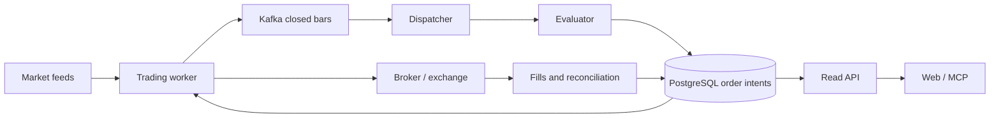

**QuantDinger is useful as a reference for trading operations, strategy contracts, and experiment reporting. I would adopt selected patterns, not its platform architecture or its strategy-promotion rules.** Its infrastructure addresses a multi-user trading product; QuantAgent’s immediate problem is demonstrating that a small number of strategies survive honest validation and work with a USD 2,500 account.

This is a static, read-only review of checkout **`6a07389`**, version **`5.6.1`**. I did not execute repository code, install dependencies, run tests, or change files. Paths below refer to QuantDinger unless prefixed **`QuantAgent:`**.

## 1) What it is and maturity

QuantDinger is a self-hosted trading platform combining market research, AI-assisted Python strategy development, backtesting, optimization, virtual trading, broker execution, monitoring, and SaaS administration.

| Aspect | Evidence and assessment |
|---|---|
| Public interest | GitHub displayed approximately **13.3k stars, 2.7k forks, and 754 commits** when checked. These indicate visibility, not trading performance. [Repository](https://github.com/OpenByteInc/QuantDinger) |
| Snapshot activity | The checked-out commit is dated **2026-10-30**, with a merged PR reference, `#332`. Local history is shallow, so it does not establish development cadence or contributor concentration. |
| Version | `VERSION` declares **5.6.1**. The MCP package has its own version, **0.6.2**, and declares Beta status in `mcp_server/pyproject.toml`. |
| Size | Approximately **49 MB including `.git`**, with 18 MB under the backend and 14 MB under documentation. The application contains **531 Python files and roughly 188,000 lines**, including comments and blank lines. |
| Tests | **373 Python files** under `backend_api_python/tests/`, plus MCP tests. There is targeted coverage for execution, ownership, snapshots, fundamentals, optimization, and contracts. I inspected tests but did not verify that they pass. |
| Delivery practices | CI definitions cover linting, tests, OpenAPI, security, licensing, and container publishing. Deployment files include production restrictions and optional observability. |
| Backend license | Apache-2.0: `LICENSE`. |
| Frontend availability | Web and mobile source are **outside this checkout**. The README points to separate repositories under their own **source-available licenses**. The backend’s license should not be assumed to cover them. |

Sources: `VERSION`, `README.md:830`, `mcp_server/pyproject.toml`, `.github/workflows/`, `docker-compose.yml:626`.

**Maturity judgment:** substantial engineering breadth, with concrete implementation of difficult execution problems. That is different from demonstrated research validity or production reliability. I found no independently verified trading track record in the material inspected.

Its own hyperscale plan is candid: **100,000 concurrent strategies is a target, not certified capacity**. Several isolation, execution, and failover boundaries remain future work.

Source: `docs/architecture/V6_HYPERSCALE_ARCHITECTURE_PLAN.md:13`.

## 2) Features

| Area | What exists | Important boundary |
|---|---|---|
| AI research | Company research, filings, news, macro context, technical analysis, bounded tool use, evidence collection, and report generation. | A research report is not a validated trading strategy. |
| Strategy authoring | Natural-language generation and editing of Python strategies; indicator-to-strategy conversion; source validation and versioning. | Compiler checks establish contract compatibility, not economic merit. |
| Strategy API V2 | A shared strategy contract for instruments, subscriptions, schedules, history, portfolio state, orders, and protection. | Supporting arbitrary user Python creates considerable execution and isolation complexity. |
| Backtesting | Multi-asset and multi-frequency simulation, warmup, benchmark comparisons, costs, order ledgers, liquidity constraints, and extensive metrics. | Data and execution assumptions still determine result quality. |
| Strategy evolution | Random, grid, and custom TPE-style parameter search; chronological validation; holdout; robustness diagnostics. | It optimizes an existing strategy, rather than operating a complete scientific hypothesis funnel. |
| Factor research | IC, rank IC, quantile returns, normalization, factor comparisons, and fundamental dependencies. | Historical universe and fundamental quality remain limiting factors. |
| Virtual trading | Signal-only accounts with virtual orders, fills, positions, P&L, and equity. | Fixed simulation costs are not a complete small-account execution model. |
| Broker execution | Crypto exchange adapters and traditional broker integrations, including Alpaca. | Live support is narrower than data/backtest support. |
| Operational controls | Durable commands, position ownership, reconciliation, leases, fencing, order intents, audit records, emergency stops. | Strong concepts, but distributed deployment adds failure modes of its own. |
| Product platform | Web/mobile clients, Agent Gateway, MCP, tenant isolation, billing, payments, referrals, and marketplace functions. | Much of this is outside QuantAgent’s intended scope. |

Useful implementation locations:

- Research: `app/services/research_agent.py`, `app/research/`, `app/professional_report/`.
- Authoring: `app/services/strategy_ai_generation.py`, `strategy_ai_capabilities.py`.
- Strategy execution: `app/services/strategy_v2/`.
- Evolution: `app/services/strategy_evolution/`.
- Factor diagnostics: `app/services/factors/research.py`.
- Virtual accounts: `app/services/virtual_trading.py`, `virtual_execution_costs.py`.

All those paths are under `backend_api_python/`.

Two features deserve particular attention:

1. **The source owns its execution contract.** Instruments, frequency, schedules, and direction are declared in code and compiled into a manifest. Backtest forms cannot casually override them.
2. **Simulation has an execution ledger.** It records rejected, deferred, partial, and filled orders, rather than reporting only a return curve. That is directly relevant to QuantAgent’s small-account work.

Sources: `docs/trading/STRATEGY_DEV_GUIDE.md`, `app/services/strategy_v2/runtime.py`.

## 3) Architecture

### Modules and process ownership

The backend is a large Python application deployed across several specialized processes. Most processes share the same codebase and image.

| Module/process | Responsibility |
|---|---|
| Flask/Gunicorn API | Authentication, validation, queries, command submission. |
| `data_sources/` | Provider adapters for prices, bars, and market metadata. |
| `data_providers/` | Research/dashboard aggregation and contextual data. |
| `services/strategy_v2/` | Strategy compilation, data access, simulation, persistence, deployment, and live integration. |
| Trading worker | Broker sessions, execution, reconciliation, realtime controls, grid actors. |
| Dispatcher | Routes closed-bar events into strategy evaluation batches. |
| Evaluator | Runs strategies and writes order intents. |
| Scheduler | Periodic operational workflows. |
| Celery workers | Finite background jobs, including research and optimization. |
| PostgreSQL | Durable business state and coordination. |
| Kafka | Versioned runtime event transport. |
| Cache Redis | Evictable cached data. |
| Jobs Redis | Celery broker/results, configured separately for durability. |
| MCP package | Client-facing tools backed by `/api/agent/v1`. |

Sources: `docs/architecture/README.md`, `docs/architecture/PROCESS_ROLES_AND_TASKS.md`, `docker-compose.yml`.

The live strategy flow is approximately:

Backtests and evolution jobs follow a separate path: load historical data, compile strategy code, run the simulator, calculate diagnostics, and persist results.

### What is good

- **HTTP does not own trading loops.** API restarts and worker scaling should not independently start duplicate schedulers.
- **Evaluators do not submit exchange orders.** Strategy calculation and financial side effects have separate owners.
- **Business idempotency lives in durable state.** Kafka offsets alone are not treated as proof that an order was handled once.
- **Position ownership is explicit.** A strategy should not absorb another strategy’s or a human’s holdings.
- **Research and execution have different privileges.**

Concrete examples: `app/services/event_inbox.py`, `strategy_runtime/order_intents.py`, `live_trading/position_ownership.py`, `live_trading/alpaca_ownership.py`.

### How complex is it?

**Very complex relative to QuantAgent’s current workload.** It combines a large application with distributed ownership, multiple queues, event transport, broker adapters, and multi-tenant product concerns.

The abstraction boundaries are also incomplete. Its own module-boundary document identifies mixed-responsibility hotspots. For scale, `strategy_v2/runtime.py` alone is approximately **2,935 lines**, and the `live_trading/*.py` files total approximately **28,000 lines**.

Sources: `docs/architecture/MODULE_BOUNDARIES.md`, `app/services/strategy_v2/runtime.py`.

This complexity may be justified for a trading SaaS. It would be excessive for five hypotheses per month and a few daily portfolios.

**For QuantAgent:** preserve clear ownership and durable order identity. Neither requires Kafka, evaluator shards, two Redis instances, or a separate audit consumer.

## 4) Historical and live data sources

### Provider coverage

| Data | Sources visible in implementation | Keys and cost implications |
|---|---|---|
| US historical prices | Yahoo chart endpoints, `yfinance`, Finnhub fallback. | Yahoo paths are keyless; Finnhub requires a key. Paid endpoint availability depends on the account. |
| US quotes | Finnhub, Yahoo chart/`yfinance`, additional public fallbacks. | Keyless fallback does not guarantee exchange-grade realtime delivery. |
| Crypto bars and prices | Native public APIs for Binance, Bitget, Bybit, OKX, Gate, HTX; CoinGecko for broader market context. | Public market endpoints can be keyless; authenticated trading requires credentials. |
| China/Hong Kong prices | Twelve Data, Tencent, Yahoo, AkShare-backed sources. | Mix of keyed services and public endpoints. |
| FX | Twelve Data → Tiingo → Yahoo fallback. | Twelve Data/Tiingo require configuration and suitable entitlements. |
| Traditional futures | Twelve Data → Yahoo → Tiingo for selected precious-metal mappings. | A continuous futures series and an FX metal proxy are different datasets. |
| Russian market | MOEX ISS public data. | Public access; product-specific coverage still matters. |
| Fundamentals/research | Yahoo, SEC EDGAR, Finnhub; HKEX and regional sources for Hong Kong. | Some public sources; optional commercial enrichment. |
| Macro | FRED, BLS, BEA; Trading Economics for calendar functionality. | FRED/BEA keys; BLS can work without registration with lower limits; commercial calendar access is separate. |
| News and web evidence | Provider news, GDELT, search services, company filings and public documents. | Optional search services introduce quotas and usage costs. |
| Crypto research enrichment | CoinGlass, CryptoQuant and other optional integrations. | Separate keys and potentially paid plans. |

Sources:

- `app/data_sources/{us_stock,native_crypto,cn_stock,hk_stock,forex,futures,moex}.py`
- `app/data_providers/{macro_series,company_research,us_research}.py`
- `app/config/data_sources.py`
- `docs/architecture/AI_RESEARCH_PIPELINE.md`

These are **configured capabilities**, not evidence that every installation has access to every feed. The repository does not establish a single all-inclusive data subscription or operating cost.

AI generation, research, and optional pre-trade model calls add a separate inference cost.

### Historical data and live execution are distinct

The ordinary US historical adapter uses Yahoo/Finnhub paths. Alpaca has its own broker client and historical-data clients.

Therefore, **connecting Alpaca does not imply that every US backtest uses the same feed as paper/live execution**.

Source: `app/services/alpaca_trading/client.py`, `app/data_sources/us_stock.py`.

That distinction matters for close prices, sessions, adjustments, and apparent backtest-to-paper divergence.

### Caching and reproducibility

There are several cache layers:

- Thread-safe TTL/LRU caches for quotes, bars, and stock information.
- Quote batching and duplicate-request coalescing.
- Process-local and optional Redis-backed backtest bar caching.
- Shared public price subscriptions within a process.
- An evolution evaluator that loads market data once and reuses in-memory slices.

Sources: `app/data_sources/cache_manager.py`, `app/services/backtest_cache.py`, `shared_market_price_feed.py`, `strategy_evolution/evaluator.py`.

**Caching is supplemented by actual snapshots.** `strategy_v2/snapshot.py` saves canonical OHLCV data as gzip-compressed JSON, names it by SHA-256, and verifies the hash when loading. This is a useful reproducibility mechanism.

It is not a complete research-data snapshot, however: the canonical serializer selects only **open, high, low, close, volume**. It does not freeze all fundamental observations, macro vintages, or corporate-action evidence used by a strategy.

### Quality caveats

**1. Price-adjustment consistency needs scrutiny.**

The direct Yahoo chart path extracts OHLCV from `quote`. The `yfinance` fallback calls `Ticker.history()` without explicitly setting `auto_adjust`.

That creates a potential difference in adjustment semantics between fallback paths. Provider switching should not silently change a strategy’s price basis.

Source: `app/data_sources/us_stock.py:777`.

**2. Historical fundamentals are only partly point-in-time.**

There are good foundations:

- `period_end` and `available_at` are separate.
- Historical enrichment only exposes observations after `available_at`.
- Missing market capitalization is not fabricated from price alone.

But the Yahoo historical importer reconstructs availability from earnings dates, or uses a **91-day lag**. It retrieves financial history today; that does not prove the values are the original, unrevised filings.

The upsert also updates an existing observation on conflict. This is not an immutable archive of every version as originally known.

Source: `app/services/fundamental_data.py`, particularly `_availability_date()` and `upsert()`.

**3. The macro client is not an ALFRED vintage archive.**

`MacroSeriesProvider.fetch_fred_series()` requests observations by series and observation dates. It does not specify historical vintage boundaries.

Using that response in a historical macro strategy could expose later revisions. QuantAgent’s ALFRED-oriented approach is more appropriate for that requirement.

Source: `app/data_providers/macro_series.py:41`.

**4. Universe history has explicit limitations.**

Universe members have validity intervals, and some public histories can be backfilled. The documentation carefully distinguishes observed historical membership from current constituents.

However, community-maintained constituent histories and current public snapshots do not provide a complete survivorship-free, delisted-security dataset.

Sources: `app/services/universe.py`, `docs/trading/PUBLIC_UNIVERSE_AND_FUNDAMENTALS_CN.md`.

**5. Missing data is not handled uniformly.**

Research documentation says optional missing capabilities should be exposed rather than replaced with synthetic values. Yet the market dashboard returns neutral/default values for some failed sentiment queries—for example, Fear & Greed `50`.

That may be acceptable presentation fallback, but it must not become research evidence or a trading input.

Source: `app/services/global_market_data.py::compute_market_sentiment()`.

**6. Historical request limits are material.**

The application encodes provider-specific limits, including ten years for US daily data and much shorter intraday ranges. These are application policies, not guarantees of complete upstream availability.

Source: `app/services/backtest_limits.py`.

**Implication for QuantAgent:** these adapters do not replace the roadmap’s requirement for immutable data, original publication dates, ALFRED vintages, or properly licensed historical fundamentals.

## 5) Hypothesis/strategy generation and testing loop

### How ideas become strategies

The visible workflow is mainly:

1. A user or agent describes a strategy or converts an indicator.
2. An LLM generates or edits Python.
3. The compiler checks Strategy API V2 compatibility.
4. Additional semantic checks compare the result with the requested market, direction, frequency, and capabilities.
5. The strategy is backtested and reviewed.
6. Optional evolution searches declared parameters.
7. A stopped deployment is created, then observed in signal/paper mode before live use.

Sources: `app/services/strategy_ai_generation.py`, `strategy_ai_capabilities.py`, `docs/product/STRATEGY_WORKFLOW.md`.

A useful detail: narrow edits can be performed deterministically—for example, changing a single declared timeframe—without asking an LLM to rewrite the entire strategy.

### Backtesting implementation

This is a **custom engine**, rather than a thin wrapper around vectorbt, Backtrader, or Backtesting.py.

It includes:

- A clock-controlled data portal that limits visible history.
- Multi-frequency subscriptions.
- Next-open execution for ordinary signals, with separate scheduled execution semantics.
- Fees, slippage, cash/exposure constraints, lot rounding, and some partial-fill/liquidity behavior.
- Execution and accounting checks.
- Benchmark-relative and risk metrics.

Sources: `app/services/strategy_v2/{data,runtime,service}.py`, `docs/product/BACKTEST_CENTER.md`.

These are meaningful safeguards against common simulation mistakes. They do not remove uncertainty about data quality or execution realism.

### What evolution actually does

The implementation contains:

- Random search, bounded grid search, and a **custom lightweight TPE-style sampler**.
- At most eight tunable parameters.
- Chronological expanding training windows and later validation windows.
- Observation-count-based splits and configurable embargo bars.
- An optional final blind holdout.
- Rejection of invalid, inactive, and some highly concentrated results.
- Deflated Sharpe, PBO, block-bootstrap Monte Carlo, and cost stress.
- Persisted asynchronous job history.

Sources: `app/services/strategy_evolution/{models,search,walk_forward,engine,statistics}.py`.

**Walk-forward is present. Anti-overfitting diagnostics are present.** It would be inaccurate to describe this as a platform with only a simple in-sample backtest.

### Important limitations

**A. Selection uses validation returns.**

Despite computing a weighted composite quality score, the engine ranks candidates by **compounded validation return**:

- `score = components["oosReturn"]`
- `selectionObjective = "oosCompoundedReturn"`

Those validation windows are therefore part of the selection process. Calling their winning result “out-of-sample” does not make it an untouched performance estimate.

Source: `strategy_evolution/engine.py::_evaluate_trial()`.

**B. This is not a full nested walk-forward refitting process.**

The prepared evaluator runs each parameter candidate once over the development period, then slices that result into train/validation windows.

It does not independently select parameters using each training window and deploy that selection into the next validation window. Portfolio state also continues through the full simulation; the embargo separates scored windows rather than restarting state.

Source: `strategy_evolution/evaluator.py::evaluate_plan()`.

This can be useful segmented robustness analysis, but its interpretation should be narrower than “the complete research process was tested out-of-sample.”

**C. Multiple-testing accounting is local and incomplete.**

Deflated Sharpe receives `trials=len(completed)`, where completed candidates exclude pruned trials. It does not account for previous jobs, earlier strategy variants, prompt changes, or repeated searches.

That is materially weaker than QuantAgent’s intended cumulative attempts registry.

Source: `strategy_evolution/engine.py::run()`.

**D. “Recommended” does not require statistical robustness checks to pass.**

The flag principally checks search sample sufficiency, positive validation return, and positive holdout performance when a holdout exists.

It does **not** require passing thresholds for Deflated Sharpe, PBO, bootstrap loss probability, or cost stress.

The holdout can also be disabled or omitted for insufficient observations, while recommendation remains possible.

Sources: `strategy_evolution/engine.py`, `walk_forward.py`, `models.py`.

**E. A robustness grade can conceal missing evidence.**

The grade averages whichever checks are available. Missing checks are counted separately, but do not automatically prevent a high letter grade.

For QuantAgent, promotion should have explicit required checks, with unavailable evidence treated as unresolved.

Source: `strategy_evolution/engine.py::_robustness_grade()`.

**F. Repeated holdout exposure is not controlled globally.**

Within a job, the holdout is not used to choose the winner—a positive feature. I found no equivalent of QuantAgent’s persistent reserve-access budget across repeated jobs and strategy revisions.

**G. Mathematical verification remains uncertain.**

Tests check behavior, selection, boundaries, and that statistics remain bounded. That does not independently establish the calibration of the statistical implementations.

Source: `backend_api_python/tests/test_strategy_evolution.py`.

### What is absent from the inspected workflow

I found no implemented equivalent of the full post-M5 cycle:

- Monthly generation of five economically justified hypotheses.
- Cross-cycle idea-family budgets and cumulative testing accounting.
- A persistent promotion ladder through shadow incubation and final broker rehearsal.
- A required three-month incubation gate.
- A small-account gate against SPY under matched account assumptions.
- A six-cycle stop-and-reassess policy.
- Generator feedback restricted to structural failure causes.

There **is** automated reflection and calibration, so “no learning loop” would also be inaccurate. These services score historical AI decisions and tune decision thresholds.

However, directional correctness thresholds are not a substitute for net portfolio returns, account feasibility, or protected validation.

Sources: `app/services/reflection.py`, `ai_calibration.py`.

## 6) Reusable community components/libraries

The most useful finding is how much QuantAgent already shares with this ecosystem.

| Component | QuantDinger use | Recommendation for QuantAgent |
|---|---|---|
| **TA-Lib** | Technical indicators and factor calculations. | Already in QuantAgent. Consolidate its use rather than building another indicator implementation. [Upstream](https://github.com/TA-Lib/ta-lib-python) |
| **alpaca-py** | Official broker and data clients. | Already present. Extend the existing adapter for account constraints and reconciliation. |
| **yfinance** | Keyless historical and research fallback. | Already present. Keep it behind immutable snapshots and explicit adjustment metadata. |
| **exchange-calendars** | Trading-session semantics. | QuantAgent already has `pandas_market_calendars`; avoid adding a second calendar authority without a specific gap. [Upstream](https://github.com/gerrymanoim/exchange_calendars) |
| **LiteLLM** | Optional common model-provider interface. | Consider only if it replaces substantial provider-routing code. QuantAgent already has LangChain provider integrations; another overlapping layer may increase complexity. [Documentation](https://docs.litellm.ai/docs/) |
| **MCP Python SDK + HTTPX** | Tool transport and API client. | A strong fit for the planned small, read-only MCP server. Use the SDK directly rather than importing QuantDinger’s broad trading tool surface. |
| **AkShare** | Chinese/Hong Kong public data adapters. | Useful if those markets become a requirement; little immediate value for the current US ETF/Alpaca scope. |
| **Prometheus client** | Runtime metrics. | Useful when an operational question requires it. A full Grafana stack is optional. |
| **Flask-Smorest/Marshmallow** | HTTP validation and OpenAPI. | QuantAgent already has FastAPI/Pydantic. Preserve that choice. |
| **Celery/Redis/Kafka clients** | Jobs and distributed runtime. | Established libraries, but currently unnecessary infrastructure for QuantAgent’s research cadence. |

Dependency evidence: `backend_api_python/requirements.txt`, `mcp_server/pyproject.toml`; comparison: **`QuantAgent: pyproject.toml`**.

There are also useful examples of **what not to rebuild**:

- QuantDinger implements its own TPE sampler. If QuantAgent eventually needs adaptive optimization, **Optuna** provides established sampling, pruning, study, and visualization machinery. It is **not a QuantDinger dependency**. It would automate optimization, not solve research validity. [Optuna documentation](https://optuna.readthedocs.io/en/stable/)
- QuantDinger’s custom simulator is not an obvious replacement for QuantAgent’s engine. QuantAgent already uses vectorbt for filtering and Backtesting.py for independent comparison. Preserve that independent verification rather than undertaking another engine migration.
- Its `qlib:` factor identifiers should not be read as evidence that the platform uses the complete Microsoft Qlib research stack.

Small application components worth studying directly:

- `app/services/factors/research.py`: compact IC/rank-IC and quantile diagnostics.
- `app/services/strategy_v2/snapshot.py`: canonical content hashing and load-time verification.
- `app/services/virtual_execution_costs.py`: explicit, inspectable cost policy.
- `mcp_server/src/quantdinger_mcp/security.py`: bounded streams, error handling, redaction.
- `app/services/strategy_evolution/engine.py`: structured failure diagnostics and job reporting.

Copying individual functions would still require checking their assumptions and adding QuantAgent-specific validation. Their best value is as concrete design references.

## 7) Comparison with QuantAgent’s post-M5 roadmap

I used the requested [October 28 roadmap](docs/02_planning/2026-10-28_roadmap_post_m5.md), while checking what has subsequently appeared in the checkout.

That distinction matters:

- **FastAPI already exists:** `QuantAgent: apps/api/app.py`.
- **React/TypeScript already exists:** `QuantAgent: web/package.json`.
- **The Cuenta screen already exists:** `QuantAgent: web/src/screens/Cuenta.tsx`.
- **The English manual already exists:** `QuantAgent: docs/manual/`.
- The roadmap chooses PostgreSQL for operational state, but the current account registry explicitly reads **per-account SQLite databases**: `QuantAgent: apps/api/accounts.py`, `docs/manual/api.md`.

Therefore, creating an API, choosing React, or starting the manual are no longer proposed quick wins. The remaining work is integration, completeness, and consistency.

### M-ciclos: continuous research

**Adopt**

- Persisted job states, progress, failure categories, and per-run history.
- Parameter constraints checked before expensive simulation.
- Loading a dataset once per research job.
- Explicit displays of unavailable diagnostics and evidence counts.

**Retain QuantAgent’s stronger research design**

QuantAgent already separates hypothesis admission, fast filtering, detailed simulation, and statistical verdicts. Its generator receives structural postmortems and attempt counts.

Sources: **`QuantAgent: quantagent/fabrica/{admision,investigador,postmortem,validacion}.py`**, `quantagent/backtesting/verdict.py`.

Do not replace that with “generate code → optimize until profitable → recommended.”

**Avoid overengineering in us**

Five hypotheses per month do not require a general distributed research orchestrator. A resumable cycle runner, a durable registry, and clear reports are sufficient initially.

Also, hiding numerical results from the generator reduces one feedback path; it does not eliminate researcher-level adaptive selection. Family changes and revisions still need honest accounting.

### M-cuenta: small-account feasibility

**Adopt**

QuantDinger’s execution diagnostics provide useful categories:

- Minimum trade unit.
- Insufficient cash.
- Partial execution.
- Minimum notional.
- Quantity rounding.
- Position ownership mismatch.

Sources: `app/services/strategy_v2/runtime.py`, `instrument_rules.py`.

**Do not assume it solves the roadmap gate**

The inspected backtester does not provide a complete Alpaca cash-account model combining fractional eligibility, settlement restrictions, dividend withholding, funding costs, and the roadmap’s matched SPY comparison.

Its default non-crypto instrument rules use whole-share increments, while the broker client separately checks fractional eligibility. That is a reminder that backtest and broker feasibility must be aligned.

Sources: `instrument_rules.py::default_rules_for_symbol()`, `alpaca_trading/client.py`.

**Concrete QuantAgent priority**

Run the existing engine at **USD 1,000 / 2,500 / 5,000**, applying the roadmap’s account assumptions, and report:

- Planned versus executable positions.
- Positions rounded to zero.
- Uninvested cash.
- Turnover and modeled costs.
- Benchmark-relative results.
- Why each infeasible order failed.

This should precede expanding a screener into dozens of positions.

### M-web: account and funnel visibility

**Adopt**

- Explicit timestamps and freshness.
- Explained rejection and reconciliation states.
- Experiment history linked to exact strategy versions.
- OpenAPI alignment checks.
- MCP tools that call the same application services as the UI.

**Avoid**

- A browser strategy IDE.
- Marketplace, subscriptions, payments, and tenant administration.
- A custom chat product.
- Separate desktop/mobile applications.
- Broker-write tools in the initial MCP surface.

QuantDinger’s MCP includes order submission, cancellation, strategy stopping, and emergency operations. QuantAgent’s read-only assistant should simply omit those tools.

Sources: `mcp_server/src/quantdinger_mcp/server.py`, `security.py`.

**Concrete current opportunity:** finish trustworthy account status before adding screens. In `QuantAgent: apps/api/app.py`, an active summary currently returns `stale=False` and `alarms=[]`. Freshness and alarms should reflect actual evidence before the screen becomes an operational authority.

The existing FastAPI dependency already enforces read-only database transactions. Preserve that boundary.

### M-datos: storage and point-in-time semantics

**Adopt**

- Content hashes checked when loading snapshots.
- Separate business state from cached data.
- Distinct reporting-period and availability dates.
- Universe membership intervals.
- Provider failures reported with structured reasons.

**Retain QuantAgent’s planned approach**

Immutable Parquet snapshots, explicit manifests, and DuckDB when the stock universe warrants it fit the workload better than QuantDinger’s online provider/cache architecture.

QuantDinger’s fundamentals and macro handling do not replace the roadmap’s original-publication and vintage requirements.

**Avoid overengineering in us**

Keep the roadmap’s simplified monthly full refresh for the small ETF universe. Do not implement the reference daily corporate-action ingestion system before there is a demonstrated need.

There is also a conceptual correction worth making: PostgreSQL can enforce append-only/versioned data, and Parquet files can be overwritten. Reproducibility comes from version identity, integrity checks, and write policy—not from file format alone.

**Resolve the current storage discrepancy explicitly.** The roadmap’s PostgreSQL decision and the implemented per-account SQLite arrangement should have an updated architectural explanation. Do not migrate working paper accounts solely to make an old plan internally consistent.

### M-manual: current operational knowledge

QuantDinger offers useful distinctions between strategy workflow, developer contract, execution safety, and deployment operations.

QuantAgent should adopt that **clarity**, while keeping its smaller manual. It already has generated CLI references and an API operations page.

Sources: **`QuantAgent: docs/manual/{README,api,funnel,criteria}.md`**.

Two gaps deserve attention:

1. The roadmap’s revised incubation description places three months in local shadow, but its C3 decision paragraph still says three months in Alpaca. Resolve the conflict before implementing promotion.
2. The manual still identifies shadow-stage commands/thresholds as undefined. That is a real missing workflow, not a documentation wording problem.

Source: **`QuantAgent: docs/manual/funnel.md`**.

### What I would explicitly avoid copying

| QuantDinger pattern | Why avoid it in QuantAgent |
|---|---|
| Kafka dispatch/evaluation infrastructure | Designed for a scale far beyond the planned research cadence. |
| Broad broker/asset abstraction | Every venue and product adds accounting and execution semantics to maintain. |
| Arbitrary Python strategy IDE and sandbox | A major platform commitment compared with controlled hypothesis templates. |
| Custom TPE implementation | Established optimization libraries exist if the need arises. |
| Return-ranked validation labeled OOS | Encourages overstating the independence of selected results. |
| Aggregate robustness letter grades | Can hide missing checks and compensate for failed evidence. |
| Automatic numerical threshold calibration | Can create an untracked optimization loop. |
| Optional AI filter as a safety authority | It is explicitly fail-open on some provider/billing failures; deterministic risk rules must remain authoritative. |
| SaaS/product breadth | Billing, referrals, payments, and marketplaces do not help prove the first portfolio works. |

The fail-open behavior is explicit in `app/services/ai_decision_filter.py`. This does not mean all order safeguards fail open; it means the optional AI filter should not be mistaken for a mandatory authorization gate.

### Highest-value next steps

1. **Make existing account monitoring truthful.** Calculate freshness, surface reconciliation issues, and explain rejected orders.
2. **Build the small-account report around the existing engine.** Use the roadmap’s three capital levels and matched SPY assumptions.
3. **Give cycles and stage transitions durable identities.** Record hypothesis/family, source/config/data hashes, attempts, rejection reasons, and promotion decisions; expose them through the existing API.
4. **Keep statistical checks as separate gates.** Required evidence should not be averaged into a reassuring grade.
5. **Complete the dataset catalog.** Prioritize availability dates, adjustment basis, source/license, snapshot identity, and known limitations.
6. **Resolve roadmap-versus-implementation conflicts.** Especially incubation location and operational database ownership.
7. **Add a small read-only MCP surface after the API is dependable.** Account summary, orders, cycle status, hypothesis history, and dataset provenance are sufficient.

QuantDinger’s strongest contribution to QuantAgent is a set of concrete operational patterns. QuantAgent already has a more appropriate research-funnel design for its objective; the priority is making that design executable, observable, and economically realistic.