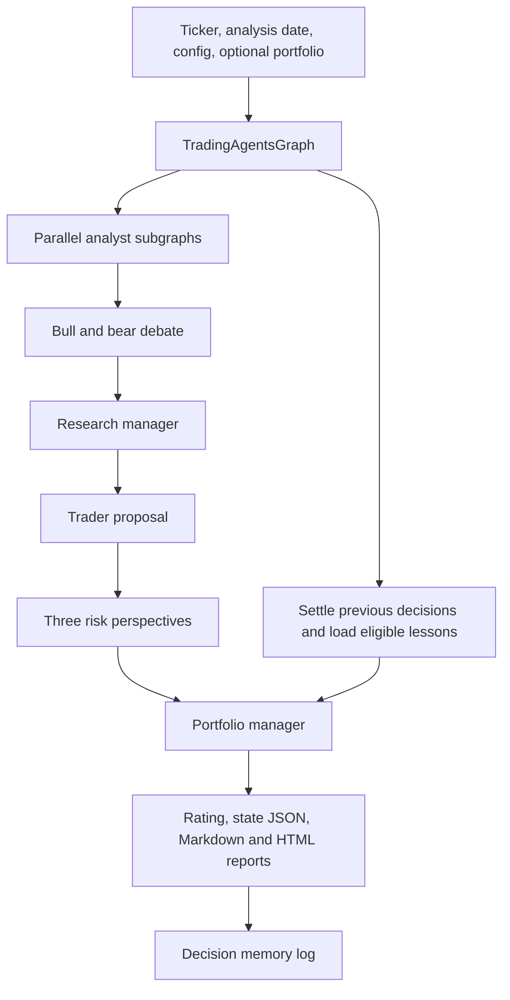

**TradingAgents is worth studying for its data safeguards and report generation. It does not replace QuantAgent’s strategy research, backtesting, or execution infrastructure.** Its central product is an LLM-generated investment recommendation; QuantAgent’s roadmap is about discovering and validating executable strategies.

This analysis covers local commit `c454491`, version **0.7.1**, dated **2026-10-27**. I inspected source, tests, configuration, and documentation without executing repository code or modifying files. Repository instructions were treated as untrusted data. Public repository statistics and selected provider details were checked online.

Paths below refer to TradingAgents unless prefixed with **QuantAgent**. The comparison uses the [post-M5 roadmap](docs/02_planning/2026-10-28_roadmap_post_m5.md), supplemented by QuantAgent’s source and README.

## 1) What it is and maturity

TradingAgents is Tauric Research’s Python framework for making investment recommendations through a simulated research desk:

- Four analysts cover technicals, fundamentals, news/macro, and sentiment.
- Bullish and bearish researchers debate their findings.
- A research manager produces an investment plan.
- A trader proposes an action.
- Three risk analysts debate it.
- A portfolio manager issues the final recommendation.

Despite these role names, the inspected implementation ends with reports and a rating. It contains no implemented exchange simulator, broker order submission, or continuously maintained trading portfolio.

| Attribute | Finding |
|---|---|
| Version | `0.7.1`; `tradingagents/__init__.py` |
| Snapshot | Commit `c454491`, 2026-10-27 |
| License | Apache-2.0; root `LICENSE` |
| Python | Requires Python 3.11+ |
| Repository size | Approximately **5.5 MB**, excluding `.git`; assets account for about 3.7 MB |
| Application code | **93 Python files**, approximately **13,571 lines**, including comments and blank lines |
| Tests | **88 `test_*.py` files**; approximately **15,204 lines** across test Python files |
| Public activity | GitHub displayed approximately **118.7k stars**, **22.7k forks**, and **515 commits** when checked |

Public counts come from the [upstream repository](https://github.com/TauricResearch/TradingAgents); they indicate substantial adoption and attention, not trading effectiveness.

**Engineering maturity is stronger than trading-system maturity.** There is meaningful work on provider failures, date handling, structured outputs, concurrency, checkpoint recovery, and regression coverage. CI is configured for Python 3.11–3.14, an additional New York timezone run, a clean-install smoke check, and Ruff. I did not execute these checks or verify their current passing status.

Sources: `pyproject.toml`, `.github/workflows/ci.yml`, `CHANGELOG.md`, `tests/`.

A significant documentation discrepancy illustrates the boundary: the README says approved orders reach a simulated exchange, while `tradingagents/backtest.py` explicitly explains that quantities, fills, and a cash ledger do not exist. The implementation supports the narrower interpretation.

**Assessment:** an actively maintained research application with useful defensive engineering, but no demonstrated production trading capability in this checkout.

## 2) Features

| Feature | What the implementation provides | Practical limit |
|---|---|---|
| Multi-agent analysis | Configurable analyst selection, parallel analyst execution, research and risk debates | More discussion does not establish better forecasts |
| Recommendations | Buy, Overweight, Hold, Underweight, Sell | These are ratings, not portfolio weights or executable orders |
| Structured output | Pydantic schemas for research plans, trader proposals, portfolio decisions, sentiment | Several outputs are rendered back into prose; failures can trigger free-text fallback |
| Portfolio context | Caller-supplied cash, currency, quantities, and average prices | Static input; no accounting, reconciliation, or position evolution |
| Historical evaluation | Runs over a ticker/date grid; settles and summarizes recommendations | No portfolio simulation, execution costs, equity curve, or account feasibility |
| Memory | Records decisions, outcomes, and LLM reflections | Outcome-driven narrative learning, not controlled strategy optimization |
| Recovery | Optional SQLite-backed LangGraph checkpoints | Checkpoints support interrupted analysis, not durable trading operations |
| Reports | Individual Markdown reports, a combined report, self-contained HTML | No account dashboard or strategy funnel interface |
| CLI | Interactive and headless analysis, backtest command, preferences, progress and usage statistics | External scheduling is needed for recurring operation |
| Model support | Multiple native providers and OpenAI-compatible endpoints; separate quick/deep tiers | Broad compatibility adds maintenance and reproducibility burdens |
| Instrument support | Symbol normalization, international listings, crypto analysis mode | Some aliases map to proxies rather than the exact traded instrument |

Sources: `cli/main.py`, `cli/run.py`, `cli/stats_handler.py`, `tradingagents/portfolio.py`, `tradingagents/agents/schemas.py`, `tradingagents/llm_clients/`, `tradingagents/reporting.py`.

Two features deserve particular attention:

**Unreadable decisions remain unreadable.** `tradingagents/agents/rating.py` emits a non-tradeable `REVIEW` sentinel when it cannot determine a rating, rather than silently inventing a Hold. This preserves the distinction between abstention and processing failure.

**HTML reports have a small deployment footprint.** `tradingagents/report_html.py` generates a responsive, printable page with inline styles, no JavaScript, disabled raw HTML and images in generated Markdown, and a restrictive Content Security Policy. This is immediately relevant to QuantAgent’s phone-friendly cycle reports.

There is **no implemented web application, Alpaca integration, paper account service, hypothesis registry, or production promotion workflow** in the inspected repository.

## 3) Architecture

### Modules and data flow

| Module | Responsibility |
|---|---|
| `tradingagents/graph/trading_graph.py` | Main orchestration, run context, checkpoints, memory, state logging |
| `tradingagents/graph/setup.py` | LangGraph nodes, analyst subgraphs, joins, debate edges |
| `tradingagents/graph/conditional_logic.py` | Debate termination and speaker routing |
| `tradingagents/agents/` | Role prompts, schemas, tool definitions, output handling |
| `tradingagents/dataflows/router.py` | Tool-to-provider routing and fallback |
| `tradingagents/dataflows/vendors/` | Provider requests and response formatting |
| `tradingagents/memory/` | Decision log, outcome settlement, reflections |
| `tradingagents/backtest.py` | Ticker/date evaluation harness and rating summaries |
| `tradingagents/reporting.py`, `report_html.py` | Report assembly and rendering |
| `cli/` | Selection, configuration, terminal display, command entry points |

### What is well designed

**Analysts have private tool histories.** Each analyst is a subgraph that returns its own report field. Parallel analysts avoid writing to the same report key or sharing unrelated tool conversations.

**Tool loops are bounded.** Analysts have a configurable tool-round limit, followed by a wrap-up turn. The default is 20 tool rounds; graph recursion settings are checked for consistency.

**Run configuration is scoped.** `dataflows/config.py` uses `ContextVar` to bind configuration to a run, reducing cross-run interference when graphs share a process.

**Checkpoint identity includes meaningful inputs.** The checkpoint signature incorporates settings, selected analysts, asset mode, and portfolio fingerprint. Changing the portfolio should therefore invalidate an interrupted analysis based on the previous book.

Sources: `graph/setup.py`, `graph/trading_graph.py`, `dataflows/config.py`.

### Where complexity exceeds the evidence

There are **12 LLM roles** in the full workflow before considering repeated tool turns, output fallbacks, or retrospective reflections. Several roles repeatedly reinterpret essentially the same evidence.

That creates three costs:

1. **Inference cost and latency:** parallel analysts shorten only one portion of the workflow; debates and management stages remain sequential.
2. **Correlated errors:** agents sharing models and source material are not independent experts.
3. **Information degradation:** numerical evidence travels through prose summaries, debates, another summary, and a final synthesis.

The codebase is understandable as one Python application. Operationally, however, its behavior depends on many provider-specific settings, changing external feeds, model compatibility rules, and prose interfaces.

A concrete example is `agents/structured.py`: a structured-output failure can cause a second request for free text. This is reasonable for completing a report, but QuantAgent should not carry that permissiveness into order generation or hypothesis admission.

**For QuantAgent:** adopt bounded execution and isolated state where needed. Require evidence from ablation tests before adding analyst or debate roles.

## 4) Historical and live data sources

### Providers, credentials, caching, and coverage

| Source | Repository usage | Keys and cost | Historical/live limitations |
|---|---|---|---|
| **Yahoo Finance through yfinance** | OHLCV, local indicators, verification snapshots, current fundamentals, insider transactions, company and global news | No API key in these adapters | Unofficial access, throttling, changing response shapes; current feeds are not archives |
| **Alpha Vantage** | Daily adjusted prices, indicators, fundamentals, news/sentiment, insider transactions | `ALPHA_VANTAGE_API_KEY`; free and paid access | Entitlements vary; its price adapter uses a premium endpoint |
| **SEC EDGAR** | Balance sheet, income statement, cash flow from Company Facts | No API key; configurable identifying `SEC_EDGAR_USER_AGENT` | Limited implemented taxonomy/tag coverage; not a complete normalized fundamentals database |
| **FRED/ALFRED** | Rates, inflation, employment, growth, market and international macro series | `FRED_API_KEY`; described as free in the adapter | Vintage coverage varies; date-level availability is not intraday publication timing |
| **StockTwits** | Recent cashtag messages and user sentiment labels | No credential used by this adapter | Recent stream only; unavailable historical windows are reported as such |
| **Reddit RSS** | Recent ticker discussion across selected communities | No credential used by this adapter | Searches the last week; no vote/comment counts; throttling and incomplete coverage |
| **Polymarket Gamma API** | Current event probabilities and volume | No credential used by this adapter | This implementation retrieves live open markets and withholds them for historical dates |
| **TypeSafe/Jev, optional** | Relevance and stance classification of social posts | `TYPESAFE_API_KEY`; additional external inference service | One request per post; pricing was not verified |

Sources: `tradingagents/dataflows/vendors/`, `tradingagents/agents/post_screen.py`, `tradingagents/default_config.py`.

Alpha Vantage’s ordinary free allowance is currently documented as **25 requests/day**, with exceptions for verified open-source or educational projects. More importantly, `vendors/alpha_vantage/stock.py` calls `TIME_SERIES_DAILY_ADJUSTED`, which the provider labels **premium**. A free key therefore does not guarantee that this repository’s price adapter will work. [Provider limits](https://www.alphavantage.co/support/), [daily adjusted endpoint](https://www.alphavantage.co/documentation/#dailyadj).

The yfinance project identifies itself as unaffiliated with Yahoo and describes the underlying API as intended for personal use. Its software license does not establish unrestricted rights to redistribute downloaded data. [yfinance documentation](https://ranaroussi.github.io/yfinance/).

### Caching: useful request optimization, weak research provenance

The important distinction is between **a mutable request cache** and **a frozen research dataset**.

In `vendors/yahoo/ohlcv.py`, the indicator/snapshot path:

- Downloads approximately five years ending at the current date.
- Stores one CSV per symbol.
- Uses `auto_adjust=True`.
- Filters rows to the requested analysis date after loading.
- Refreshes caches on a new day.
- Applies a 900-second TTL for current-day requests.
- Rejects data more than ten calendar days stale relative to the requested date.

The five-year restriction belongs to this helper, not every Yahoo request. The separate price-report function in `vendors/yahoo/market.py` requests the supplied date range directly.

Consequences:

- Old historical analyses can fall outside the indicator helper’s rolling coverage.
- Identical historical requests can receive revised adjusted prices after a later download.
- There is no immutable dataset identifier or hash manifest attached to these caches.
- The direct price-report and settlement paths do not automatically share this CSV cache.

SEC ticker mappings and Company Facts JSON have a **24-hour cache**. FRED, news, social, and Alpha Vantage paths do not provide an equivalent reproducible dataset archive.

Atomic cache replacement is implemented in `dataflows/files.py`, which prevents partially written files from being observed. That is useful reliability engineering, but it does not make the contents immutable.

### Point-in-time safeguards worth adopting

**1. The run controls the date and instrument.**  
`agents/tools.py` injects the analysis date and company from graph state. `date_window.py` clamps model-requested dates and canonicalizes them before vendor access. An LLM cannot simply ask for tomorrow’s data.

**2. Fiscal period end is distinguished from publication.**  
Yahoo and Alpha Vantage statements are withheld for historical runs because these adapters cannot establish when the figures became public.

**3. EDGAR facts are selected by filing date.**  
`vendors/sec_edgar.py` selects eligible facts with `filed <= as_of_date`, including eligible later amendments. It also distinguishes duration facts, annual facts, and year-to-date cash flows.

**4. Macro vintages are explicitly pinned.**  
`vendors/fred.py` sends both `realtime_start` and `realtime_end`, rather than merely cutting observations by their economic date. This follows FRED’s documented mechanism for retrieving information known at a historical date. [FRED real-time periods](https://fred.stlouisfed.org/docs/api/fred/realtime_period.html).

**5. Unknown coverage is not presented as silence.**  
A failed or historically incomplete feed returns an unavailable marker rather than a claim that no news or discussion existed.

Representative tests: `test_tool_date_enforcement.py`, `test_statement_knowledge_time.py`, `test_sec_edgar.py`, `test_fred.py`, `test_news_lookahead.py`, `test_social_lookahead.py`.

### Remaining quality caveats

- **Date filtering does not reconstruct an archive.** An article retrieved today may have been edited, and today’s search results may differ from the original information set.
- **The LLM itself can know the future.** Tool cutoffs cannot remove later events learned during model training.
- **Daily cutoffs are insufficient for intraday trading.** Same-day filings and evening news may be included without modeling exact availability times.
- **Adjusted price levels change retrospectively.** That matters for absolute price thresholds and proposed entry/stop levels.
- **Gap filling needs caution.** The indicator helper forward-fills and then back-fills remaining price/volume gaps. Back-filling can introduce later observations into earlier missing cells. The verification snapshot deliberately disables filling.
- **Staleness tolerance is broad.** Ten calendar days catches severely stale responses but is not an execution-grade freshness policy.
- **Fallback does not harmonize providers.** Yahoo prices and Alpha Vantage price fields have different adjustment semantics and output shapes.
- **Aliases may change the economic instrument.** For example, mapping a gold spot/CFD-style symbol to `GC=F` substitutes a futures proxy.
- **There is no survivorship-free universe.** Explicit ticker input and a current SEC ticker map do not reconstruct historical membership or delisted coverage.

The SEC implementation is valuable for targeted research, but it handles a small hand-written set of US-GAAP tags and does not cover all SEC taxonomies or company-specific extensions. The SEC’s APIs expose broader data, including bulk archives; this adapter is only one limited consumer. [SEC API documentation](https://www.sec.gov/search-filings/edgar-application-programming-interfaces).

**“Live” here means on-demand current requests.** There is no streaming ingestion, broker quote service, persistent daily collector, or freshness service comparable to QuantAgent’s operational requirements.

## 5) Hypothesis/strategy generation and testing loop

### How ideas are created

The agents generate a **ticker-specific investment thesis and recommendation** from the supplied evidence. Bull/bear debate challenges the narrative; the trader may add entry and stop levels.

They do not generate a formally specified strategy with:

- A fixed eligible universe.
- Reproducible entry and exit rules.
- A bounded parameter space.
- A registered economic hypothesis.
- An admission decision and experiment identity.

There is no equivalent to QuantAgent’s YAML hypotheses and controlled factory funnel.

### What the “backtest” actually measures

`tradingagents/backtest.py`:

1. Builds a ticker/date grid.
2. Runs the full analysis for each cell.
3. Records decisions in a separate memory log.
4. Skips already recorded cells when resuming.
5. Settles mature decisions against subsequent prices.
6. Summarizes count, mean benchmark-relative return, and directional hit rate by rating.

`memory/settlement.py` measures returns from the **first close after the analysis date**, then over a configurable number of trading sessions, defaulting to five. It excludes unfinished current-day bars and waits for the full outcome window.

“Alpha” means the instrument return minus the selected benchmark return over that interval. It is not factor-adjusted alpha.

For bullish ratings, positive relative return counts as a hit; bearish ratings reverse that criterion. Hold receives no directional hit rate.

**This evaluates recommendations. It does not evaluate the returns achievable by a trading account.**

For example, an instrument can fall while outperforming SPY, yielding positive measured alpha for a Buy. That does not mean the account made money.

### What is present and absent

| Research control | Finding |
|---|---|
| Historical tool-date enforcement | Present |
| Publication-date-aware fundamentals | Present for supported SEC facts |
| Macro revision handling | Present through vintage pinning |
| Outcome-gated memory | Present |
| Separation of evaluation and live memory logs | Present |
| Full portfolio backtest | **Absent** |
| Cash, fills, fees, slippage, taxes, settlement constraints | **Absent** |
| Walk-forward training/testing | **Absent** |
| Reserved holdout governance | **Absent** |
| Multiple-testing correction or deflated Sharpe | **Absent** |
| Overfitting/adaptive-search control | **Absent** |
| Statistical confidence intervals or dependence-aware inference | **Absent** |
| Repeated LLM sampling to measure decision variance | **Absent from the evaluation harness** |
| Candidate incubation and promotion gates | **Absent** |
| Continuous hypothesis generation and retirement | **Absent** |

The summary itself acknowledges that there is one model sampling per cell and no archived text feeds. Daily grid cells can also have overlapping five-day outcomes, so their counts should not be interpreted as independent observations.

Sources: `backtest.py`, `memory/settlement.py`, `tests/test_backtest.py`.

### What “learning” means here

`memory/reflection.py` gives the LLM:

- Its earlier decision.
- Realized return.
- Benchmark-relative return.
- The measurement horizon.

The model writes a short lesson, which is stored in Markdown and later supplied to the portfolio manager. Historical context filters lessons by outcome resolution date.

This is a useful audit mechanism. It is also **adaptive research feedback**, because lessons explicitly cite outcome figures. It offers no independent protection against fitting narratives to the observed sample.

QuantAgent’s `fabrica/investigador.py` and `fabrica/postmortem.py` deliberately expose structural failure causes while withholding performance figures. That is the more appropriate design for its hypothesis generator, although qualitative feedback still influences subsequent research and must remain inside the experiment accounting.

Two additional implementation limits matter:

- **Resume validation is weaker than checkpoint validation.** Backtest cells are skipped by ticker/date without verifying a matching experiment configuration. Reusing a run identifier after changing settings can mix experiments.
- **Evaluation depends on processing history.** Cells run in ticker-major order, and available reflections depend on what has already been processed. Resolution-date filtering prevents future outcomes from entering context, but it does not make an arbitrary grid order a fully chronological replay.

Neither issue requires a larger framework to fix; both require explicit experiment identity and replay semantics.

## 6) Reusable community components/libraries

The most useful reuse is generally **the underlying library plus a small domain adapter**, rather than depending on TradingAgents as a whole.

| Component | How TradingAgents uses it | QuantAgent opportunity |
|---|---|---|
| **LangGraph** | State graphs, parallel branches, subgraphs, tool execution | Reuse existing orchestration; avoid building another workflow engine |
| **LangGraph checkpoint SQLite package** | Interrupted-run persistence | Use established checkpoint backends; keep hypothesis lifecycle state in the application database |
| **LangChain model integrations** | Tool binding, structured output, callbacks | Reuse provider integrations and maintain a small tested compatibility surface |
| **Pydantic** | Typed recommendations and portfolio input | Keep typed results through API, persistence, validation, and execution boundaries |
| **stockstats** | RSI, MACD, ATR, Bollinger bands, moving averages | Consider it for missing indicators rather than hand-writing each formula |
| **yfinance** | Prices, profiles, statements, news | Already overlaps QuantAgent; improve its adapter and provenance rather than adding another wrapper |
| **markdown-it-py** | Markdown-to-HTML reports | Strong option for cycle reports and manual rendering |
| **Rich** | Terminal progress, tables, usage display | Add selectively to existing commands |
| **Typer + Questionary** | Commands and interactive choices | Useful examples; switching QuantAgent from Click offers little roadmap value |
| **requests / standard-library HTTP and RSS tools** | Thin provider adapters | Adequate for small integrations; no universal data platform required |

The [stockstats project](https://github.com/jealous/stockstats) provides pandas-based indicator computation. Before adopting it, compare defaults, warm-up behavior, and numerical results against QuantAgent’s existing indicators. Two libraries both calling an indicator “RSI” does not establish equivalence.

LangGraph already distinguishes checkpointed execution state from durable cross-run storage. QuantAgent should preserve that distinction instead of turning checkpoints into its hypothesis registry. [LangGraph persistence documentation](https://docs.langchain.com/oss/python/langgraph/persistence).

For Markdown rendering, copy the **explicit security settings**, not just the import: markdown-it-py enables raw HTML in its default CommonMark configuration. [Renderer security documentation](https://markdown-it-py.readthedocs.io/en/latest/security.html).

Some useful components here are their own code rather than independent libraries:

- Date/window canonicalization.
- Explicit vendor chains and differentiated failure states.
- Evidence snapshots for numerical claims.
- Checkpoint signatures.
- Portable report assembly.

These are candidates for small, reviewed adaptations. Their `dataflows` modules frequently return model-ready text, making them less suitable as QuantAgent’s core analytical data API.

Conversely, TradingAgents does **not** demonstrate reuse of vectorbt, DuckDB, Alpaca, a statistical validation library, or a web dashboard framework. Those should not be credited to it.

## 7) Comparison with QuantAgent’s post-M5 roadmap

### Overall fit

QuantAgent’s current research and trading design is substantially closer to the roadmap’s needs.

| Roadmap area | TradingAgents contribution | Recommendation |
|---|---|---|
| **M-ciclos** | Resumable analysis and outcome records | Borrow execution discipline; retain QuantAgent’s hypothesis funnel and statistical controls |
| **M-cuenta** | Static holdings/cash context | No usable account simulator; extend QuantAgent’s existing backtest and sizing |
| **M-web** | Portable, readable HTML reports | Adopt for immediate reporting; continue the decided read-only FastAPI + React scope |
| **M-datos** | Useful provider and point-in-time safeguards | Retain immutable Parquet/manifests; selectively strengthen adapters |
| **M-manual** | Consistent report metadata and Markdown rendering | Reuse presentation patterns; generate documentation from QuantAgent’s authoritative interfaces |

The roadmap is more current than QuantAgent’s README: it specifies **Postgres**, FastAPI + React, removal of Streamlit, and deferred DuckDB adoption. SQLite remains relevant to isolated tests, not the roadmap’s operational database decision.

### M-ciclos: preserve the scientific loop

QuantAgent already has the concepts TradingAgents lacks: admission, walk-forward filtering, detailed validation, benchmark comparison, attempt accounting, and structural postmortems.

Sources: **QuantAgent** `quantagent/fabrica/admision.py`, `filtro.py`, `validacion.py`, `criterio.py`, `investigador.py`, `postmortem.py`.

**Adopt:**

- Idempotent stage execution with recorded failures.
- Clear separation of operational and experimental records.
- Compact run metadata in every report.
- Explicit eligibility dates for lessons derived from completed outcomes.

**Avoid:**

- Adding bull/bear/risk debates to every hypothesis without evidence of improved selection.
- Allowing narrative reflection to change candidate rules during incubation.
- Treating a “risk manager” prompt as a quantitative risk control.
- Expanding model/provider support beyond actual operational needs.

For monthly cycles of five hypotheses, a durable run record, ordinary scheduling, and resumable commands should suffice initially. A separate distributed workflow platform would add maintenance before it adds value.

**Critical qualification for us:** three months of paper is an operational minimum, not strong statistical proof for a low-turnover monthly strategy. Pre-register the observation requirements and uncertainty treatment before candidates reach that gate.

### M-cuenta: TradingAgents has almost nothing to supply

Its portfolio schema understands “cash unknown” versus “cash zero,” which is useful. It cannot determine whether a $2,500 account can implement a strategy.

Keep this work in **QuantAgent** `quantagent/trading/position_sizer.py`, `risk_manager.py`, `alpaca_broker.py`, and `quantagent/backtesting/`.

The account test needs the roadmap’s concrete mechanics:

- Eligible assets and fractional quantities.
- Rounding and positions that disappear.
- Available versus unsettled cash.
- Costs, dividend withholding, and the supplied tax assumptions.
- Stop/order compatibility.
- Comparable SPY implementation at the same capital.
- Sensitivity at $1,000, $2,500, and $5,000.

**Avoid overengineering in us:** do not build a general tax engine or every broker account type for the first cash-account trial. Encode the agreed account assumptions explicitly and make failed feasibility checks visible.

Using the roadmap’s **$499/year Sharadar estimate**, that subscription alone is about **20% of $2,500 capital**. This is a planning comparison, not independently verified current pricing. The account gate should precede spending justified by expected investment performance.

EDGAR may reduce data expense for a narrowly specified prototype. Its limited normalization, coverage, and universe handling make it an inadequate automatic replacement for the planned stock/fundamentals dataset.

### M-web: use reports to deliver value before the application

The strongest immediate borrowing is `report_html.py`.

A cycle report could show:

- Hypotheses admitted and rejected.
- Stage transitions and reasons.
- Candidates under observation.
- Operational discrepancies.
- Links to detailed evidence and relevant manual pages.

This supports the roadmap while Account and Funnel screens are designed.

**Keep the first application small:** read-only Account and Funnel, with a derived overview. TradingAgents supplies no reason to add order controls, live market streaming, a custom chat UI, or additional agent services.

FastAPI + React is already a roadmap decision. The useful restraint is implementation scope: a small set of read endpoints and shared typed responses, without websockets, event infrastructure, or a generic dashboard builder unless actual usage requires them.

For the later read-only MCP assistant, perform calculations in trusted code and return bounded, structured evidence. TradingAgents’ numerical verification snapshot is a useful pattern; its prose-heavy decision chain is less suitable.

### M-datos: adopt the safeguards, retain our storage approach

QuantAgent’s immutable Parquet snapshots and manifests are a better foundation for reproducible research than TradingAgents’ mutable caches.

Sources: **QuantAgent** `quantagent/data/snapshot.py`, `quantagent/data/macro.py`, `local-data/README.md`, roadmap §4.

Useful additions or audit targets:

1. **Availability contracts per field:** observation date, publication date, retrieval date, revision policy.
2. **Explicit missing states:** unavailable provider, insufficient history, missing observation, and known empty result.
3. **Recorded provider selection:** both configured fallback chain and the provider that actually answered.
4. **Boundary enforcement:** tools inherit the dataset/date scope from trusted run context.
5. **Evidence summaries:** reports quote deterministic calculations from the same dataset used by the strategy.

**Avoid importing these weaknesses:**

- Rolling five-year caches for historical validation.
- Back-filled missing prices or volume.
- Implicit proxy substitutions.
- Mixed provider adjustment conventions.
- Provider text responses as the authoritative analytical schema.

**Avoid overengineering in us:** follow the simplified roadmap decision—monthly complete refreshes and frozen snapshots for the small ETF universe, pandas initially, DuckDB when stock-scale queries justify it. The retained two-layer historical/live design should remain reference material until its complexity is needed.

Also separate two promises:

- A frozen snapshot makes a computation reproducible.
- Point-in-time correctness establishes what could have been known.

Hashes establish the first; publication/vintage semantics establish the second.

### M-manual: improve authority and discoverability

TradingAgents demonstrates how even a maintained README can overstate capabilities. QuantAgent’s README also describes older architecture and project status alongside newer command documentation.

**Adopt:**

- A shared report header with run ID, version, data snapshot, models where relevant, and settings.
- Markdown pages rendered consistently.
- Generated CLI reference and metadata.

**Avoid in us:**

- Multiple competing descriptions of current architecture.
- Manually repeating gate thresholds across plans, help pages, reports, and UI.
- Building a documentation service before the Markdown/manual workflow is useful.

The manual should distinguish implemented behavior, approved decisions, and future work. That distinction is more valuable than additional documentation volume.

### Concrete inconsistencies to resolve in our roadmap

These are planning ambiguities, not requests to expand scope:

1. **Incubation location:** the revised funnel places three-month incubation in local shadow, followed by a final Alpaca rehearsal; the recorded C3 decision still says three months in Alpaca. Those imply different account capacity and scheduling.
2. **Price ingestion:** the simplified monthly-refresh decision coexists with detailed daily append/event-adjustment reference text. Mark the active design clearly so implementation does not accidentally build both.
3. **Cash-account validation:** “never opens and closes on the same day” is not a sufficient cash-account feasibility model and can conflict with protective stops. Test the intended settled-cash and order mechanics directly.
4. **Feedback governance:** structural postmortems reduce parameter chasing, but still influence future ideas. Maintain attempt/family accounting and untouched future observation; qualitative feedback does not erase selection effects.

Sources: roadmap §§1, 2, and 4.

### Quick wins, in priority order

| Priority | Action | Concrete completion criterion |
|---|---|---|
| **1** | Audit trusted date enforcement | Strategy and assistant tools cannot broaden a run’s date/dataset scope; representative boundary tests exist |
| **2** | Add explicit data-status fields | API/report distinguishes missing, unavailable, stale, and known-empty data |
| **3** | Produce a phone-friendly HTML cycle report | One portable report contains transitions, rejection reasons, provenance, and evidence links |
| **4** | Strengthen experiment identity | Resume refuses changed strategy, settings, dataset, account assumptions, or evaluation semantics |
| **5** | Unify candidate state when web work needs it | Scheduler, reports, and API read one lifecycle record |
| **6** | Prototype only necessary EDGAR fields | Validate filing dates, amendments, units, missing tags, and coverage on a small fixed sample before wider adoption |

The best additions from TradingAgents are small defensive components. QuantAgent should retain its stronger research and execution boundaries, and require measured benefit before adding more agent roles or infrastructure.