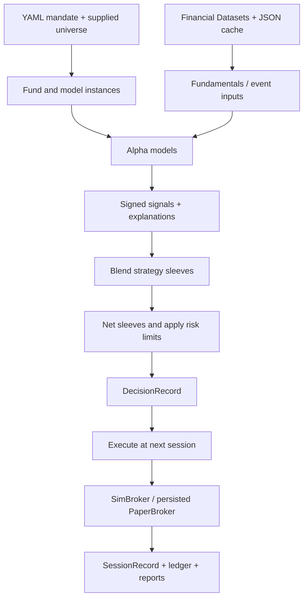

**AI Hedge Fund is worth studying for its execution contracts and audit records. It is not a replacement for QuantAgent’s research factory, validation process, or small-account simulator.** Its interface is polished relative to the engine’s financial realism, and several capabilities advertised in its vision remain unimplemented.

This analysis covers local commit `d3a2b6b2bc3579cf0f5bde9cebeea9754f1eae15`, packaged as `aihf 2.6.3`. I only read files and Git metadata; I did not import the package, execute repository code, or run tests. I also read the [QuantAgent post-M5 roadmap][qa-roadmap] and inspected selected QuantAgent modules. Public GitHub metrics and provider prices were checked separately.

## 1) What it is and maturity

AI Hedge Fund combines LLM investor personas and a deterministic earnings model into portfolios that can be backtested or advanced through local simulated trading sessions.

**This snapshot is the v2 Python rewrite.** It should be evaluated separately from older descriptions of the project involving a LangGraph engine and web application.

| Aspect | Findings |
|---|---|
| Purpose | Educational research and simulated portfolio management. The root README explicitly describes it as a proof of concept. |
| Package | `aihf`, version `2.6.3`, Python 3.11+. |
| License | MIT. Copied code must retain the applicable notice. Market-data licensing is separate. |
| Popularity | The public GitHub page displayed approximately **64.4k stars**, **11.3k forks**, and **948 commits** when checked. These measure attention, not trading validity. [GitHub repository](https://github.com/virattt/ai-hedge-fund). |
| Local activity evidence | The checked-out commit is dated **2026-10-30**, with message “Bump version to 2.6.3.” The checkout is shallow, so its local history cannot establish development cadence. |
| Size | Approximately **2.4 MB**, **141 files**, and **20,029 Python lines**, including tests and docstrings. Approximately **12,158 lines** remain after excluding test files and `conftest.py`. |
| Tests visible | **39 `test_*.py` files**, with approximately **436 test-function definitions**. Parametrization can increase the actual test count. Their execution status was not verified. |
| Deployment scope | A local CLI/TUI application. No real brokerage adapter ships in this snapshot. |

Sources: [pyproject.toml][project], `LICENSE`, `README.md`, and static file counts.

**Maturity assessment:** a substantial research application with thoughtful engine contracts, but incomplete statistical validation and simplified execution economics.

Some documentation has already fallen behind the implementation:

- `hedge_fund/README.md` says v2 is being developed alongside `src/` and `app/`; those directories are absent here, and packaging points directly to `hedge_fund`.
- `ROADMAP.md` describes the scheduler as upcoming, but `paper/runner.py` already implements unattended daily and intraday loops.
- The roadmap mentions a web frontend scaffold on the v1 engine; no such application is included in this checkout.

This matters for QuantAgent: a concise README can still be misleading if implementation status is maintained in several places.

## 2) Features

| Capability | What actually exists | Main limitation |
|---|---|---|
| Investor personas | Buffett, Munger, Graham, Lynch, Druckenmiller | Mostly different system prompts over the same fundamentals snapshot. |
| Quantitative signals | Post-Earnings Announcement Drift, or PEAD | The only registered deterministic alpha model. |
| Strategy library | Deep Value, Earnings Drift, Fundamental L/S, Inflections | Handwritten compositions; no evidence that these recipes produce investment edge. |
| Portfolio construction | Weighted signal blending; long-only, long/short, dollar-neutral modes | Conviction is not calibrated to expected return or uncertainty. |
| Multiple strategies | Static capital slices, combined into one net portfolio | No implemented adaptive allocator or risk-parity allocation. |
| Risk | Position, gross, optional net, drawdown and trading-volume limits | Simplified portfolio controls; no complete broker/account constraint model. |
| Backtesting | Daily valuation, configurable rebalance cadence, costs, SPY or another benchmark, saved results | Minute mandates are replayed at daily closes. |
| Local paper trading | Persistent book, session history, reconciliation, halt/resume, unattended runner | A persisted simulator, not Alpaca paper. |
| Auditability | Decisions, theses, targets, clamps, orders, fills, code/mandate hashes | Data and model dependencies are not fully frozen by the session record. |
| Reporting | Equity curves, return, Sharpe, drawdown, excess return, analyst and strategy scorecards | Diagnostic statistics are not a validation gate. |
| Interface | Textual terminal app, fund builder, backtest board, history, model/key setup | No reusable React/FastAPI application in this snapshot. |
| Autonomous research | Described in the vision | Strategy generation and automatic promotion remain planned. |

Sources: [fund/spec.py][spec], `strategies/*.yaml`, [portfolio/construction.py][construction], [risk/limits.py][risk], and [ROADMAP.md][external-roadmap].

Two distinctions are especially important:

**An investor agent generates an opinion, not a strategy hypothesis.** It returns a signed conviction and explanation for a ticker. It does not write a causal hypothesis, define an experiment, or decide whether the evidence supports deployment.

**“Paper” means local simulated fills.** `PaperBroker` inherits `SimBroker` and persists its book to JSON. It does not exercise broker authentication, order acceptance, partial fills, dividend processing, or reconciliation against an independent brokerage system. [brokers/paper.py][paper-broker].

## 3) Architecture

The core architecture is straightforward:



**The most valuable design is the shared session operation.**

`advance()` performs:

1. Reconcile the broker book against expected state.
2. Execute the pending decision from an earlier session.
3. Mark positions and calculate NAV.
4. Assess new targets if a rebalance is due.
5. Return a versioned `SessionRecord`.

Backtesting loops over this operation. Paper trading calls it as sessions become due. [pipeline/session.py][session].

The principal modules are:

| Module | Responsibility |
|---|---|
| `fund/` | Validated YAML mandates, strategy composition, model construction, saved definitions |
| `data/` | Provider protocol, Financial Datasets client, response cache, session handling |
| `features/` | Fundamentals snapshots, intraday context, market-cap breakpoints |
| `signals/`, `llm/` | Alpha-model interface, personas, PEAD, provider adapters, prompt persistence |
| `portfolio/`, `risk/` | Signal blending, sleeve netting, target validation, exposure reductions |
| `pipeline/`, `brokers/` | Session sequencing, clocks, target-to-order conversion, simulated fills |
| `paper/` | Deployment snapshots, ledger, replay, reconciliation, runners, kill switch |
| `backtesting/`, `scorecard/` | Historical replay, saved artifacts, metrics and attribution |
| `tui/` | Presentation and interactive workflows |

### What is simple and good

- **No graph framework is required for this pipeline.** It is ordinary Python control flow with protocols and Pydantic records. LangChain is used for model transports; LangGraph is absent from the declared dependencies.
- **The LLM’s authority ends at its signal.** Deterministic code constructs portfolios, enforces limits and creates orders.
- **Assessment and execution have separate records.** This makes information cutoffs and execution prices inspectable.
- **Strategy definitions are separate from deployment state.** A mandate contains no tickers; the universe is supplied for a backtest or fixed when deploying.
- **Neutrality and abstention are distinct.** A neutral analyst participates in blending; an abstaining analyst is excluded.

These are useful boundaries for QuantAgent without requiring a rewrite.

### Where the simplicity becomes a limitation

**Shared code does not establish shared real-world behavior.** Their parity test uses deterministic fake data and an analyst stub. Moreover, normal backtest entry points instantiate personas with `blind=True`, while paper uses unblinded prompts. The same pipeline therefore does not guarantee the same signals. See `pipeline/test_session.py::test_step_by_step_advance_matches_the_backtest_exactly`, [run.py][run], and [signals/llm_agent.py][agent].

**Execution remains optimistic.** Orders are fully filled at a reference price adjusted by deterministic costs. Cash may become negative; there is no modeled margin enforcement. Target quantities are calculated using execution-session prices and equity—an idealized rebalance whose exact sizing is not automatically achievable through a real closing auction. [pipeline/stages.py][stages], [brokers/sim.py][sim].

**Persistence is not transactional across the whole session.** Each fill updates the broker JSON, then the session record is appended later. A failure can leave a partially executed book; subsequent reconciliation halts it. That is preferable to silently continuing, but it requires recovery procedures. Atomic file replacement also does not provide a transaction or general protection against concurrent tick writers.

**Hash chaining adds maintenance obligations.** Several serializers preserve old hashes by conditionally excluding new fields. This is understandable, but it means schema evolution is already coupled to historical serialization details. A database-backed application should not copy this entire persistence design casually. [paper/ledger.py][ledger], `paths.py`, [fund/spec.py][spec].

Overall, this is a **moderately sized application with a relatively small engine**, rather than a large trading platform. Approximately 4,465 production Python lines—about 37%—are in the terminal UI.

## 4) Historical and live data sources

### Providers and actual consumption

| Dataset | Source and implementation | Important boundary |
|---|---|---|
| Historical OHLCV | Financial Datasets `/prices/` through `FDClient.get_prices()` | No independent adjustment or corporate-action processing in the engine. |
| Current prices | Financial Datasets `/prices/snapshot/` | A last-trade observation, not an executable bid/ask quote. |
| Financial metrics | Financial Datasets `/financial-metrics/` with `filing_date_lte` | Filing-date filtering is valuable, but does not establish every other PIT property. |
| Earnings | Financial Datasets `/earnings/` | Recent filing-based history; PEAD filters eligible events locally. |
| News | Financial Datasets `/news/` | Requested limits are clamped to ten items. |
| Insider trades | Financial Datasets, filtered by filing date | Available through the interface; not a major input to the shipped daily personas. |
| Company metadata | Financial Datasets `/company/facts/` | Latest sector/industry are used in historical snapshots. |
| Market-cap breakpoints | Kenneth French Data Library | Used to anonymize company size in blind prompts. |

The only concrete market-data provider is Financial Datasets. The `YFinanceClient` shown in `data/protocol.py` is an example, not an implemented fallback. There are no implemented Alpaca, FRED/ALFRED, Sharadar or alternative-data adapters here. [data/client.py][client], `data/protocol.py`, [features/breakpoints.py][breakpoints].

### Historical versus live behavior

Daily sessions deliberately exclude the current New York date, even after market close. The daily runner first checks shortly after midnight and catches up completed sessions in order.

Intraday paper funds poll current price snapshots at bar boundaries. Their runner records missed intervals as gaps rather than fabricating historical observations.

**Crucially, the shipped backtest does not reproduce intraday trading.** `backtesting/fund.py::replay_grid()` converts minute mandates into a daily replay and labels the result accordingly. `BarClock` exists, but the normal backtest path does not use it. This matches the provider’s documented historical intervals: day, week, month and year. [backtesting/fund.py][backtest], [pipeline/clock.py][clock], [Financial Datasets historical prices](https://docs.financialdatasets.ai/api/prices/historical).

### Caching

Two separate caches exist:

**Market-data cache:** JSON response files keyed by method and parameters.

- Completed historical responses are reused.
- Answers about unfinished dates generally receive a ten-minute freshness window.
- Same-day daily bars receive stricter treatment.
- Date-less “latest” answers expire in live mode.
- Current price snapshots bypass disk caching.
- Provider errors propagate rather than being stored as successful empty responses.

**LLM cache:** exact prompts, responses and parsed judgments keyed by agent, model and prompt content.

- Fundamentals prompts omit the assessment date.
- Identical inputs between filings can reuse the same judgment.
- Parse failures retain their raw responses for inspection.

Sources: [data/cached.py][data-cache], [llm/cache.py][prompt-cache], [features/snapshot.py][snapshot].

This is effective application caching. **It is not an immutable research dataset.** There is no run-level manifest enumerating all input files, provider versions and content hashes. Refreshing responses or changing provider behavior can change a future reconstruction.

### Costs and keys

The application requires `FINANCIAL_DATASETS_API_KEY`. Persona strategies also require a supported model-provider key; PEAD itself does not require an LLM.

The provider’s published prices when checked were:

| Plan | Published price | Included requests |
|---|---:|---:|
| Credits | $20 one-time | 1,000 |
| Personal | $200/month | 100,000 |
| Professional | $2,000/month | 2,000,000 |

History access differs by plan and endpoint. The provider lists approximately one year of L1 history for Credits and three-plus years for Personal, while core fundamentals have longer coverage. **“Thirty years of fundamentals” must not be interpreted as thirty years of stock prices.** [Financial Datasets pricing](https://www.financialdatasets.ai/pricing).

For QuantAgent’s $2,500 account, a $200 monthly subscription is $2,400 annually—96% of starting capital—before model costs. It would need a separate research justification.

The application does not impose a complete experiment budget. Prompt caching reduces model calls, but different assessment-date queries can still create many data requests.

### Quality caveats

1. **Point-in-time filtering is partial.** The client correctly requests metrics by filing date; the provider documents that filter. However, historical snapshots explicitly use latest sector/industry metadata, and fundamentals requests truncate intraday cutoffs to a date. Date-only filtering is insufficient to establish intraday availability. [snapshot.py][snapshot], [Financial Datasets metrics](https://docs.financialdatasets.ai/api/financial-metrics/historical).

2. **Restatement handling is not demonstrated end to end.** A filing cutoff alone does not prove that every metric is reconstructed from the appropriate historical version. There is no local versioned fundamentals archive comparable to QuantAgent’s planned as-reported snapshots.

3. **Universe survivorship is left to the user.** A fixed supplied ticker list does not reconstruct historical membership, delisted holdings or the universe that could actually have been selected at the time.

4. **Corporate-action accounting is missing.** The broker has no dividend cashflows, withholding, split processing or explicit delisting settlement. If supplied prices are adjusted, the code does not make their economic interpretation sufficiently explicit for a cash-account simulation.

5. **PEAD has a live freshness problem.** It caches each ticker’s earnings history inside the model indefinitely. The unattended runner retains the same `Fund` and model instances, so refreshing the outer data cache does not make that model discover later earnings. Historical coverage is also bounded by the requested recent-history limit. [signals/pead.py][pead], [paper/runner.py][runner].

6. **News coverage can truncate historical context.** Only ten recent headlines are requested. Filtering those down to an earlier intraday cutoff can miss relevant older headlines already displaced by later ones. [features/intraday.py][intraday].

7. **Size labels overstate their reference population.** The code describes French breakpoints as percentiles of US stocks. The published construction uses qualifying **NYSE** stocks and excludes REITs and closed-end funds. [French methodology](https://mba.tuck.dartmouth.edu/pages/faculty/ken.french/Data_Library/det_me_breakpoints.html).

These gaps make QuantAgent’s data catalog, availability timestamps and immutable snapshots materially valuable.

## 5) Hypothesis/strategy generation and testing loop

### The implemented loop

The current workflow is human-directed:

1. Select existing analysts and blend policies.
2. Set capital slices, risk limits, cadence and universe.
3. Run a backtest.
4. Inspect curves, metrics, explanations and scorecards.
5. Modify the mandate or deploy it into the local paper simulator.
6. Observe subsequent sessions.

The YAML recipes constitute a compositional strategy library. They are not a hypothesis registry with causal claims, experiment budgets and promotion criteria.

### What is present—and explicitly absent

| Research capability | Status |
|---|---|
| LLM judgments about individual securities | Implemented |
| Manual composition of strategies | Implemented |
| Historical backtesting and saved reports | Implemented |
| Forward-running local simulation | Implemented |
| Automatic hypothesis generation | **Absent; planned** |
| Automated recurring research cycles | **Absent; planned** |
| Walk-forward parameter selection/testing | **Absent** |
| Purged cross-validation / CPCV | **Absent; planned** |
| Probability of backtest overfitting | **Absent; planned** |
| Deflated Sharpe / multiple-testing correction | **Absent** |
| Protected holdout with access accounting | **Absent** |
| Hypothesis attempt registry | **Absent** |
| Parameter-stability or robustness campaign | **Absent** |
| Statistical promotion gate | **Absent** |
| Defined minimum incubation and retirement rules | **Absent** |

`hedge_fund/validation/__init__.py` contains a docstring naming CPCV and PBO, with no implementation. The research lab, generator and promotion system are unchecked roadmap items. [ROADMAP.md][external-roadmap].

### Useful protections already present

- Decisions normally execute in a later session.
- Fundamental queries use filing dates rather than fiscal period ends.
- Backtest prompts conceal ticker, dates, industry and identifying dollar values.
- Data infrastructure errors fail loudly.
- Risk enforcement is deterministic.
- Records preserve prompts, decisions, clamps and fills.

**Blind prompts are an interesting mitigation for LLM historical recall.** The implementation itself acknowledges that distinctive financial profiles can still identify a company. They also change the information available between backtest and paper, so blind testing should be treated as an experimental condition rather than proof of clean historical inference. [features/snapshot.py][snapshot].

### Why the scorecards do not validate alpha

Analyst scorecards include benchmark-relative directional hit rates, payoff ratios and cross-sectional rank information coefficients. Views are evaluated at declared horizons, with immature observations counted as pending.

That is useful reporting, but:

- Forward-return windows can overlap.
- The IC t-statistic uses a simple mean/standard-error calculation without an explicit dependence correction.
- Available prices affect which views can be scored.
- Multiple experiments are not accounted for.

Strategy attribution uses target sleeve weights rather than actual whole-share holdings and reports the unexplained difference separately. That is transparent, but it cannot establish precise sleeve-level realized performance. [scorecard/analysts.py][analyst-score], [scorecard/strategies.py][strategy-score].

**QuantAgent already contains more of the research machinery:** hypothesis admission, proposal/refutation workflows, attempt recording, deflated Sharpe, protected research periods and walk-forward tooling. Those capabilities should be preserved, while their statistical assumptions continue to be scrutinized. Relevant files include `quantagent/fabrica/investigador.py`, `admision.py`, `validacion.py`, `backtesting/verdict.py`, and `cli/walkforward.py`.

## 6) Reusable community components and libraries

The repository’s useful dependencies are mostly general Python application libraries. It does not conceal a mature third-party trading engine that QuantAgent could simply adopt.

| Component | Its role here | Implication for QuantAgent |
|---|---|---|
| **Pydantic** | Mandates, API responses, signals, decisions and session records | Reuse existing schemas and validation practices. Good fit for API contracts and experiment records. |
| **PyYAML** | Strategy and fund definitions | Supports declarative composition without generating Python code. QuantAgent already uses this approach. |
| **pandas / NumPy** | Features, return series, metrics and calculations | Existing building blocks; avoid duplicating elementary calculations across modules. |
| **SciPy** | Declared scientific dependency | QuantAgent already uses it for statistical functions. The external project does not supply a validation package through it. |
| **LangChain provider adapters** | Common access to several model vendors | Reuse transport adapters where they reduce maintenance. A graph framework is unnecessary for sequential calls. |
| **Requests** | Financial Datasets client and downloads | Adequate for small integrations; provider correctness still requires explicit pagination, failures and availability contracts. |
| **Textual / Rich** | Terminal UI, progress and reports | Rich can help CLI output. Textual would introduce another interface to maintain alongside the planned web app. |
| **Matplotlib** | Declared plotting dependency | Useful for exported research figures; not a substitute for interactive web charts. |
| **pytest / Textual testing support** | Contract and application tests | The valuable reuse is the test scenarios: timing, book mismatch, missing marks, failure propagation and replay parity. |
| **Kenneth French data** | Historical market-cap breakpoints | Potentially useful research input, with accurately documented population and timing. |

Source: [pyproject.toml][project], `pipeline/test_timing.py`, `pipeline/test_session.py`, and `data/test_client_contract.py`.

Notably absent from the shipped dependency list are LangGraph, vectorbt, Backtrader, LEAN, a brokerage SDK, and an implemented specialist validation library.

The best material to adapt is therefore **small contracts and test cases**, especially:

- Assessment records separated from execution records.
- Explicit abstention metadata.
- Persisted reasons for risk reductions.
- Provider errors separated from genuine missing data.
- Prompt reuse based on unchanged information.

The `hedge_fund` package itself is tightly connected enough that importing it wholesale would create a second trading stack.

## 7) Comparison with QuantAgent and the post-M5 roadmap

The roadmap’s actual baseline is more specific than “Python, SQLite and Streamlit”:

- **M5** means the top-down engine.
- First real capital is a **$2,500 cash account**.
- Historical data stays in **Parquet**, with **DuckDB when equity-universe scale warrants it**.
- Operational and eventually funnel state remain in **Postgres**.
- **FastAPI + React** replaces Streamlit.
- The first web scope emphasizes read-only account and funnel views.

I also found an existing read-only FastAPI application in [apps/api/app.py][qa-api] and the new `docs/manual/` directory. Those are current assets to build on, rather than capabilities to restart from the roadmap alone.

### Roadmap-by-roadmap assessment

| Roadmap area | What to adopt | What to avoid |
|---|---|---|
| **M-ciclos** | An immutable deployed specification, explicit session records, pending versus mature observations | Treating persona combinations or the best backtest as validated hypotheses |
| **M-cuenta** | Visible target-to-order rounding, explicit cost parameters, audit records of constraints | Their whole-share-only, permissive-cash simulator and absent settlement/tax accounting |
| **M-web** | A thin presentation layer over domain functions; explanations attached to decisions | Porting the TUI or building an additional conversational control plane |
| **M-datos** | Provider contracts, failure semantics, information-based LLM caching | Replacing reproducible snapshots with mutable response caches |
| **M-manual** | Compact data-flow explanations and inspectable records | Multiple overlapping documents claiming different implementation states |

### M-ciclos: borrow the deployment discipline

QuantAgent’s stronger foundation is its research funnel. Preserve the distinction between:

- A proposed idea.
- An admitted, versioned experiment.
- A tested candidate.
- A deployed shadow candidate.
- A candidate approved for brokerage rehearsal.

AI Hedge Fund’s useful contribution is the **deployment snapshot**: the mandate, universe and execution assumptions become inspectable historical artifacts.

A QuantAgent candidate record should bind at least:

`hypothesis version + code version + dataset manifest + universe + costs + execution policy + account assumptions`

Use that record across reports, shadow operation and the web API. It can live in the existing persistence architecture; a separate event-sourcing platform is unnecessary.

**Do not copy its aspirational “feed winners” allocator.** Changing allocation based on recent research outcomes creates more selection decisions to account for. Static allocation remains easier to evaluate until evidence supports additional machinery.

There is also a roadmap inconsistency to resolve: the revised funnel puts three-month incubation in local shadow, while C3 still states three months in Alpaca. The accepted critical revision explicitly supports shadow incubation and a final Alpaca rehearsal. Reconcile those statements before automating transitions. [roadmap §1][qa-roadmap], `2026-10-28_revision_critica_roadmap_post_m5.md` §4.

Three months should be an operational minimum, not an automatic statistical pass: a monthly strategy may produce only three rebalance observations.

### M-cuenta: their simulator is insufficient

Their sizing calculation is transparent:

```text
target_shares = int(target_weight × equity / price)
```

It exposes untradeable small allocations, which is useful. But it does not address QuantAgent’s intended account:

- Fractional versus integer-quantity eligibility.
- Available and settled cash.
- Broker-specific order constraints.
- Rejections and partial execution.
- Dividend cashflows and modeled withholding.
- Funding costs and other account-specific costs.
- Short eligibility and financing.

For example, a 10% allocation in a $2,500 account is $250. At a hypothetical $600 share price, their simulator purchases zero shares. Fractional support could change the result materially.

Implement the roadmap’s **$1,000 / $2,500 / $5,000 sensitivity runs in QuantAgent’s existing engine** and compare each against SPY under matching account and cost assumptions. Their engine provides no shortcut to that gate. [pipeline/execution.py][execution], [brokers/sim.py][sim].

### M-datos: QuantAgent’s plan is stronger

Keep the roadmap’s practical division:

- Parquet snapshots and manifests for reproducible research.
- pandas while the universe is small.
- DuckDB when larger equity datasets require it.
- Postgres for concurrent operational and funnel state.

AI Hedge Fund’s response cache is useful at the provider boundary, but would weaken reproducibility if adopted as the research source of truth.

QuantAgent already has a provider protocol in `quantagent/data/sources/base.py`; adding another generic data framework would duplicate it. Extend existing contracts where needed to distinguish publication time, observation time and retrieval time.

The best immediate data work remains the **catalog**: source, license, units, availability column, snapshot location and consumers.

The roadmap’s simplified monthly full-history refresh is also proportionate. Its larger daily ingestion/corporate-action design should remain conditional reference material, rather than accidentally becoming the implementation scope.

### M-web and M-manual: reuse concepts, not their interface

Useful interface concepts are:

- One place to inspect a deployed strategy and its history.
- Benchmark comparison next to portfolio performance.
- Visible reasons for risk reductions and skipped trades.
- Links from summary figures to underlying decisions.

Translate these into the existing API and approved React design.

For initial delivery, keep the focus on **Account, Funnel and a compact Home view**. The external repository does not justify adding a terminal UI, a custom chat application, a live analyst theatre, or strategy editing to the web.

For the manual, its documentation drift is a cautionary example. QuantAgent’s generated command reference and linked criteria/decision tables are a better approach, provided those checks remain focused and inexpensive.

### Overengineering risks in both projects

| In AI Hedge Fund | In QuantAgent |
|---|---|
| Many personas over substantially identical inputs can create apparent diversity without independent signals. | More agents or research stages can create complexity without increasing independent evidence. |
| A fund/pod/CIO hierarchy precedes validated alpha. | Multiple allocators and elaborate incubation states could precede one economically viable candidate. |
| Intraday clocks, runners and checkpoints coexist with daily-only backtesting. | Adding frequencies before data and execution validation would multiply incompatible paths. |
| Hash-chained JSON requires custom compatibility and recovery logic. | Copying that design alongside Postgres would create two operational truth systems. |
| Paid data and potentially expensive models lack a full experiment budget. | Data subscriptions and infrastructure must remain proportionate to the first $2,500 operational trial. |

One concrete issue on our side deserves attention before broader unification: `quantagent/fabrica/validacion.py::correr_motor()` contains both subprocess-driven engine runs and a target-weight branch that computes shifted close-to-close returns directly. **Do not assume every stage-2/3 route already shares fill and cost semantics.** Verify those routes against the intended execution contract before adding more orchestration.

### Prioritized quick wins

1. **Reconcile the roadmap contradictions.** Clarify shadow versus Alpaca incubation and identify the simplified monthly data workflow as the current scope. Reflect the existing API/manual work in implementation status.

2. **Create one candidate deployment receipt.** Record hypothesis, universe, dataset hashes, code, costs, fill policy and account assumptions. Reuse it across shadow, reports and API responses.

3. **Check execution parity where it matters.** Adapt their timing and failure scenarios to QuantAgent: next-session execution, missing marks, weekend/holiday handling, cost application and book mismatch. Include the alternative validation routes identified above.

4. **Run the small-account gate early.** Measure zero-sized positions, concentration after rounding, cash feasibility and net performance against SPY before committing to additional data subscriptions.

5. **Improve caching and reporting without expanding infrastructure.** Reuse unchanged LLM inputs, preserve exact prompts/responses, distinguish abstention from neutral signals, and expose risk/skip reasons through the existing API. Keep research outcomes and protected-period metrics out of generator feedback according to QuantAgent’s current policy.

**Adoption decision:** retain QuantAgent’s research funnel, historical snapshots and broker integration. Adapt AI Hedge Fund’s explicit decision/execution records, failure contracts and focused parity scenarios. Its persona catalog, local paper broker and planned autonomous research system offer little acceleration for the post-M5 priorities.

[project]: ext/ai-hedge-fund/repo/pyproject.toml
[external-roadmap]: ext/ai-hedge-fund/repo/ROADMAP.md
[spec]: ext/ai-hedge-fund/repo/hedge_fund/fund/spec.py
[construction]: ext/ai-hedge-fund/repo/hedge_fund/portfolio/construction.py
[risk]: ext/ai-hedge-fund/repo/hedge_fund/risk/limits.py
[session]: ext/ai-hedge-fund/repo/hedge_fund/pipeline/session.py:131
[stages]: ext/ai-hedge-fund/repo/hedge_fund/pipeline/stages.py:114
[execution]: ext/ai-hedge-fund/repo/hedge_fund/pipeline/execution.py:16
[clock]: ext/ai-hedge-fund/repo/hedge_fund/pipeline/clock.py
[sim]: ext/ai-hedge-fund/repo/hedge_fund/brokers/sim.py
[paper-broker]: ext/ai-hedge-fund/repo/hedge_fund/brokers/paper.py
[ledger]: ext/ai-hedge-fund/repo/hedge_fund/paper/ledger.py
[runner]: ext/ai-hedge-fund/repo/hedge_fund/paper/runner.py
[backtest]: ext/ai-hedge-fund/repo/hedge_fund/backtesting/fund.py:172
[client]: ext/ai-hedge-fund/repo/hedge_fund/data/client.py
[data-cache]: ext/ai-hedge-fund/repo/hedge_fund/data/cached.py
[prompt-cache]: ext/ai-hedge-fund/repo/hedge_fund/llm/cache.py
[snapshot]: ext/ai-hedge-fund/repo/hedge_fund/features/snapshot.py
[breakpoints]: ext/ai-hedge-fund/repo/hedge_fund/features/breakpoints.py
[intraday]: ext/ai-hedge-fund/repo/hedge_fund/features/intraday.py
[pead]: ext/ai-hedge-fund/repo/hedge_fund/signals/pead.py:104
[agent]: ext/ai-hedge-fund/repo/hedge_fund/signals/llm_agent.py
[run]: ext/ai-hedge-fund/repo/hedge_fund/run.py:221
[analyst-score]: ext/ai-hedge-fund/repo/hedge_fund/scorecard/analysts.py
[strategy-score]: ext/ai-hedge-fund/repo/hedge_fund/scorecard/strategies.py
[qa-roadmap]: docs/02_planning/2026-10-28_roadmap_post_m5.md
[qa-api]: apps/api/app.py