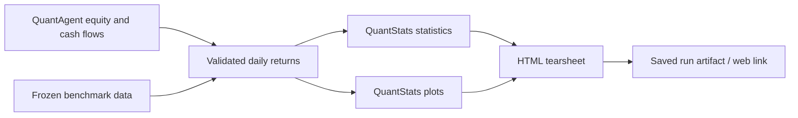

# QuantStats assessment for QuantAgent

**Recommendation: adopt QuantStats as an optional reporting dependency over QuantAgent’s existing equity curves. Keep strategy evaluation, execution accounting, and promotion criteria in QuantAgent.** Its tearsheets could save substantial reporting work, but several statistical and data-handling conventions need an adapter around them.

This is a **static, read-only review** of checkout `9ef4c6d`, version **0.0.86**. I did not import the package, execute repository code, install dependencies, or run tests. Findings described as implementation problems come from reading source.

External-repository paths below are relative to the supplied checkout. `QA/` denotes QuantAgent’s project root. The comparison follows the [post-M5 roadmap](docs/02_planning/2026-10-28_roadmap_post_m5.md), with the [README](README.md) treated as background where it differs from that roadmap.

## 1. What it is and maturity

QuantStats is a Python library for **analyzing an already-produced portfolio return series**. It calculates performance statistics, draws charts, and generates HTML tearsheets.

It does not determine positions, simulate orders, maintain a portfolio ledger, or operate a broker account.

| Aspect | Finding |
|---|---|
| Popularity | Approximately **7.8k stars**, **1.3k forks**, and **601 commits** visible on GitHub when checked. |
| Visible backlog | GitHub displayed **7 issues** and **25 pull requests**. These counts alone do not establish maintenance quality. |
| History | PyPI release history extends to **May 2019**. |
| Reviewed release | **0.0.86**, released **September 27, 2026**; the local checkout identifies the same version. |
| Ownership | Ran Aroussi; PyPI lists **one maintainer**, suggesting concentrated maintenance responsibility. |
| License | **Apache-2.0**, in `LICENSE.txt` and `pyproject.toml`. |
| Local size | **44 tracked files**; approximately **460 KiB** in `quantstats/`, **104 KiB** in tests, and **2.1 MiB** in documentation. Whole checkout: approximately **4.2 MiB**, including Git metadata. |
| Source volume | Approximately **12,830 Python lines** in the package, including comments/docstrings, and **2,217 test lines** across eight test modules. |
| Packaging | Python **3.10+**, Hatchling build, pure-Python wheel. Published 0.0.86 wheel is approximately **96.8 kB**. |

Public metadata: [GitHub repository](https://github.com/ranaroussi/quantstats), [PyPI release history and distribution files](https://pypi.org/project/quantstats/).

**Maturity judgment:** established and useful, with recent maintenance, but its numerical outputs should be versioned and checked.

The strongest evidence is the local `CHANGELOG.md`. Releases 0.0.82–0.0.86 corrected material issues involving:

- Drawdown calculations and missing prices.
- Probabilistic Sharpe calculations.
- Risk-free-rate handling.
- Benchmark statistics with missing observations.
- Strategy statistics depending on other DataFrame columns.
- Rolling alpha using full-sample information.
- Cache collisions involving time-varying risk-free rates.
- Kelly calculations that were changed and subsequently reverted.

These are changes to reported numbers, not just presentation fixes. Pinning the dependency and preserving its version with every report is warranted.

## 2. Features

| Capability | What exists | Practical value |
|---|---|---|
| Return statistics | Compounding, CAGR, period returns, averages, best/worst periods | Standardized descriptive reporting |
| Risk measures | Volatility, drawdowns, VaR/CVaR, tail measures, Ulcer Index | Portfolio risk summaries |
| Performance ratios | Sharpe, Sortino, Calmar, Omega, and several composite ratios | Comparison and diagnostics |
| Benchmark analysis | Alpha, beta, correlation, R², information and Treynor ratios | Context for portfolio performance |
| Rolling analysis | Rolling volatility, Sharpe, Sortino, beta/alpha helpers | Detecting changes in behavior |
| Calendar analysis | Monthly heatmaps, yearly comparisons, return aggregation | Readable performance history |
| Reporting | Basic/full console or notebook reports, standalone HTML | Immediate QuantAgent integration opportunity |
| Multiple strategies | DataFrame inputs supported in many APIs | Useful conceptually; HTML implementation needs caution |
| Monte Carlo | Return permutations, path charts, drawdown summaries | Limited ordering sensitivity analysis |
| Convenience helpers | Yahoo downloads, synthetic index and portfolio construction | Convenient for notebooks; unsuitable as execution accounting |
| Pandas extension | Optional `qs.extend_pandas()` | Convenience, with global monkey-patching consequences |

Sources: `quantstats/stats.py`, `quantstats/utils.py`, `quantstats/reports.py`, `quantstats/_plotting/`.

**Absent:** hypothesis generation, technical-signal strategies, event-driven backtesting, transaction-cost modeling, order execution, live market ingestion, portfolio persistence, experiment tracking, and strategy promotion workflows.

## 3. Architecture

### Modules and responsibilities

| Module | Responsibility |
|---|---|
| `quantstats/__init__.py` | Public imports and optional Pandas extension |
| `quantstats/stats.py` | Statistical calculations |
| `quantstats/utils.py` | Input preparation, aggregation, conversions, downloads, preparation cache |
| `quantstats/reports.py` | Report orchestration, formatting, tables, HTML rendering |
| `quantstats/plots.py` | Public re-export of plotting functions |
| `quantstats/_plotting/wrappers.py` | User-facing plotting APIs and data preparation |
| `quantstats/_plotting/core.py` | Matplotlib/Seaborn rendering |
| `quantstats/_montecarlo.py` | Permutation simulations and result container |
| `quantstats/_compat.py`, `_numpy_compat.py` | Dependency compatibility helpers |
| `quantstats/report.html` | Built-in HTML template |

Primary source files: [reports.py](ext/quantstats/repo/quantstats/reports.py), [stats.py](ext/quantstats/repo/quantstats/stats.py), [utils.py](ext/quantstats/repo/quantstats/utils.py).

### Data flow



Internally, a report generally:

1. Prepares the strategy returns.
2. Prepares or downloads the benchmark.
3. Aligns dates.
4. Calculates statistics.
5. Generates Matplotlib figures.
6. Converts tables to HTML.
7. Inserts tables and figures into a template.

There is **no database, service framework, task queue, or application state machine**. This makes it easy to attach to another system.

### How simple or complex is it?

**Simple public interface; moderately tangled internals.**

The main functions are straightforward, but `reports.py` contains approximately 2,622 lines and the plotting implementation another 4,271. HTML generation and display-report plotting repeat substantial orchestration logic.

Maintenance complications include:

- Lazy imports used to manage circular dependencies.
- Global plotting styles set during import.
- Global preparation caching.
- Functions that modify input names or indexes.
- Optional monkey-patching of Pandas.
- Heuristics that infer whether supplied numbers are prices or returns.
- Statistical defaults that are not consistently propagated through every report component.

For QuantAgent, this supports using a **small integration boundary**, rather than exposing QuantStats throughout the application.

## 4. Historical and live data sources

### Providers and inputs

| Source | Implementation | Keys/cost | Limitations |
|---|---|---|---|
| Caller-supplied return series | Main API input | No provider required | Quality depends entirely on the caller |
| Yahoo Finance through `yfinance` | `utils.download_returns()` and ticker benchmarks | No API key configured by QuantStats; no paid subscription required by this path | Unofficial data access and provider-dependent availability |
| Caller-supplied benchmark | Pandas Series, or a single-column DataFrame | Uses QuantAgent’s existing data | Preferred for reproducibility |
| Live market feed | **Absent** | — | No streaming, polling service, or broker feed |
| Fundamentals/macroeconomics | **Absent** | — | No FRED, ALFRED, Sharadar, or point-in-time fundamental handling |

`utils.download_returns()` at line 758 requests Yahoo data with:

```python
auto_adjust=True
multi_level_index=False
progress=False
```

It takes adjusted `Close`, calculates simple percentage changes, fills missing returns with zero, and removes timezone information.

The wrapper is geared toward daily historical returns; it does not expose the broader provider’s full interval and data-selection capabilities.

The yfinance documentation describes the project as unaffiliated with Yahoo and its access as intended for research/education, with Yahoo data usage subject to applicable terms. An open-source library license does not grant unrestricted rights to the market data. [Official yfinance documentation](https://ranaroussi.github.io/yfinance/).

### Caching

QuantStats has an **in-memory cache for prepared return series**, not a historical-data store:

- Maximum nominal size: **100 entries**.
- Evicts older entries in batches.
- Uses a lock.
- Returns copies of cached results.

Source: `quantstats/utils.py:104–185`.

It does **not** provide durable dataset caching, immutable snapshots, manifests, download provenance, data revision history, or dataset licensing controls. Any caching performed internally by yfinance is separate.

### Quality and reproducibility caveats

1. **Ticker benchmarks introduce network access during reporting.**  
   `html(returns, benchmark="SPY")` can download the benchmark for both its original history and prepared representation. A report can therefore depend on provider availability and revised historical data.

2. **Adjusted prices do not implement account-specific taxation.**  
   An adjusted SPY series is not automatically equivalent to the roadmap’s USD 2,500 SPY account after withholding, execution costs, and funding costs.

3. **Benchmark alignment can backfill future prices.**  
   `_prepare_benchmark()` uses `reindex(..., method="bfill")` when indexes differ. That can introduce inappropriate information when calendars or observations are missing.

4. **Missing observations can become zero returns.**  
   Although recent standalone-statistic preparation preserves NaNs, downloads and report-table construction still contain zero-filling paths.

5. **No survivorship or point-in-time protections.**  
   Downloading a ticker does not provide historical universe membership, delisted-stock completeness, publication timestamps, or economic-data vintages.

**For QuantAgent:** provide validated return and benchmark series from existing snapshots. Report generation should require no market-data credentials or downloads.

## 5. Hypothesis/strategy generation and testing loop

### What is absent

| Research-loop capability | QuantStats |
|---|---|
| Creating hypotheses or strategies | **Absent** |
| LLM generation or critique | **Absent** |
| Signals, orders, fills, position sizing | **Absent** |
| Historical execution simulation | **Absent** |
| Parameter search or optimization | **Absent** |
| Walk-forward training/testing | **Absent** |
| Purged cross-validation or embargo | **Absent** |
| Attempt registry / multiple-testing accounting | **Absent** |
| Holdout access controls | **Absent** |
| Paper incubation and retirement rules | **Absent** |

Its role begins **after another system has produced returns**.

### Statistical helpers are not strategy validation

QuantStats includes:

- **Probabilistic Sharpe Ratio:** uncertainty around whether Sharpe exceeds zero, using higher moments.
- **Smart Sharpe/Sortino:** autocorrelation penalties.
- **Monte Carlo:** shuffled historical return paths.

These can support diagnostics, but they do not implement QuantAgent’s anti-overfitting process.

In particular, **Probabilistic Sharpe Ratio is not Deflated Sharpe Ratio**. The implementation has no input for the number of attempted strategies or the dispersion of their Sharpes.

Sources: `quantstats/stats.py:875`, `:1297–1403`.

### Monte Carlo: important limitations

`_montecarlo.run_montecarlo()` creates simulations using:

```python
rng.permutation(returns_array)
```

Every simulation therefore contains **the same returns, in a different order**.

Consequences, derived directly from the implementation:

- All paths have the same compounded terminal wealth, apart from numerical rounding.
- CAGR has no meaningful distribution under these permutations.
- Terminal-goal probability is effectively all-or-nothing.
- Drawdown can vary because ordering matters.
- Serial dependence and volatility clustering are destroyed.
- This is neither a block bootstrap nor a model of future regimes.

There is also an implementation concern in `montecarlo_sharpe()`: reconstructing returns from cumulative paths with `pct_change().dropna()` discards each path’s first return. Apparent Sharpe dispersion can therefore reflect which observation was discarded.

Sources: `quantstats/_montecarlo.py:218–294`; `quantstats/stats.py:3482–3616`.

**QuantAgent already has a more relevant component:** `QA/quantagent/backtesting/verdict.py` implements overlapping-block bootstrap sampling through `montecarlo_bloques()`, alongside deflated Sharpe and attempt accounting. Keep those facilities.

## 6. Reusable community components and libraries

The main reuse opportunity is **QuantStats itself**, rather than reproducing its entire metric and chart collection.

| Component | What it supplies | What QuantAgent could reuse |
|---|---|---|
| Pandas / NumPy | Time-series alignment, aggregation, numerical operations | Existing foundation; avoid bespoke equivalents |
| SciPy | Normal probabilities, regression, statistical primitives | Existing dependency; suitable building blocks for audited research statistics |
| Matplotlib | Static financial-performance charts and image export | Report artifacts generated without a frontend |
| Seaborn | Heatmaps, boxplots, distribution styling | Calendar and distribution views |
| Tabulate | Console and HTML tables | Simple exported reports without another template framework |
| python-dateutil | Relative calendar windows | Date-window utilities |
| yfinance | Convenient historical data access | Already present in QuantAgent; keep behind its data layer |
| QuantStats | Bundled analytics, charting, HTML reporting | Strongest direct adoption candidate |
| Plotly extra | Matplotlib conversion helper | Avoid relying on this particular integration |

QuantStats does **not** rely on a backtesting framework, LLM framework, ORM, or portfolio ledger that QuantAgent could extract.

It also does not outsource its statistical formulas to Empyrical or PyFolio: much of that numerical maintenance belongs to QuantStats itself.

### Avoid its Plotly conversion route

`quantstats/_plotting/wrappers.py:83` calls `plotly.tools.mpl_to_plotly()` and then `plotly.plotly.iplot()`. The latter is a legacy hosted-plotting route, inconsistent with the helper’s advertised role as a simple figure conversion.

For M-web, use the roadmap’s frontend chart libraries directly over numerical API responses. QuantStats HTML should remain a downloadable or viewable report artifact.

## 7. Comparison against QuantAgent’s post-M5 roadmap

### Roadmap alignment

| Roadmap area | Adopt | Keep in QuantAgent / avoid |
|---|---|---|
| **M-ciclos** | Performance appendix for surviving hypotheses; consistent backtest, shadow, and paper views | Hypothesis state, attempt counts, DSR, holdout permissions, incubation and retirement decisions |
| **M-cuenta** | Charts and descriptive statistics for USD 1,000 / 2,500 / 5,000 runs | Fractional eligibility, rounding, spreads, settlement, tax, funding costs, and executable SPY comparison |
| **M-web** | Link existing reports from Account and Hypothesis screens | Avoid rebuilding all tearsheet charts immediately; retain operational views for orders, stops, rejections, and reconciliation |
| **M-datos** | Consume return series derived from approved snapshots | Avoid Yahoo downloads inside reports and treating an in-memory cache as data infrastructure |
| **M-manual** | Metric definitions, conventions, and examples | Avoid dumping unexplained ratios into the app or maintaining separate definitions in multiple places |

### Concrete integration points already exist

**Backtests:**  
`QA/quantagent/backtesting/export.py` exports:

- `timestamp`
- `equity`
- `cash`
- `positions_value`
- `drawdown_pct`

This is almost the required input. Build returns from the full-precision equity curve, with the initial-capital baseline preserved.

**Hypothesis reporting:**  
`QA/quantagent/fabrica/informe.py` already produces HTML containing stage outcomes, reasons, DSR-related information, benchmark diagnostics, and hypothesis context.

Keep that report as the decision record. Add a QuantStats performance appendix or link.

**Paper portfolios:**  
`QA/quantagent/models.py:525` defines `EquitySnapshot`; `QA/quantagent/cli/reconcile.py` has a command that records Alpaca equity, cash, and invested value. These are useful starting points for paper reporting.

Two details deserve attention:

- The inspected snapshot command explicitly writes to a selected **SQLite file**, while the roadmap’s approved shared operational store is **Postgres**. The integration needs to handle the actual source rather than assuming persistence is already uniform.
- `EquitySnapshot.snapshot_date` is globally unique and the model has no account identifier. Multiple accounts sharing this table would need account-aware identity, typically account plus date. Separate databases can currently provide separation.

### What to avoid in QuantStats

- Importing the entire statistical catalogue into promotion criteria.
- Treating PSR as DSR.
- Using shuffled-return CAGR distributions as validation.
- Using `make_index()` as a portfolio simulator: its `rebalance` argument does not implement a realistic scheduled-rebalancing process; the code largely constructs weighted daily returns.
- Letting date matching remove legitimate initial cash periods.
- Depending on multi-strategy HTML until its embedding behavior is checked.
- Globally extending Pandas in the application.

### What to avoid in QuantAgent

**Avoid writing another general performance-reporting library.**  
Retain account-specific accounting and research safeguards, but reuse generic charting and descriptive analytics.

**Avoid turning reporting into another research milestone.**  
A saved HTML artifact can be useful before a complete Account screen, report service, or interactive analytics workspace exists.

**Avoid calculating the same metric under several unnamed conventions.**  
The inspected code already exposes differences:

- Backtest Sharpe defaults to a 2% annual risk-free rate.
- QuantStats defaults to zero.
- QuantAgent’s `sharpes_en_exceso()` uses point-in-time DGS3MO and actual calendar-day accrual.
- QuantStats generally uses equal-period annualization.

Source: `QA/quantagent/backtesting/backtest.py:1564`; `QA/quantagent/fabrica/criterio.py:45`.

A single adapter and metric-definition record would prevent disagreements presented as identical “Sharpe” values.

**Respect the roadmap’s deferred infrastructure.**  
For ETFs, pandas over immutable snapshots remains sufficient. DuckDB arrives with the stock universe; funnel migration to Postgres happens when the web needs it. QuantStats creates no reason to accelerate either.

**Resolve the incubation wording before implementing reporting gates.**  
The roadmap’s revised funnel puts three-month incubation in local shadow and Alpaca at the final execution rehearsal. Its C3 decision text still says three months in Alpaca. Reports should not silently choose between those definitions.

### Quick wins, in order

1. **Create one validated equity-to-returns adapter**, reused by backtest, shadow, and paper reporting.
2. **Generate one HTML report for each promoted candidate**, plus periodic paper reports—not every rejected screening run.
3. **Attach metadata:** run/account ID, hypothesis version, snapshot hashes, evaluation phase, costs, currency, metric conventions, and package versions.
4. **Link the artifact from existing reports and later FastAPI/React screens.**
5. **Add a short manual page defining the displayed metrics**, especially trade versus period statistics.

Before adoption, validate the adapter with a few meaningful accounting and numerical cases: known compounded returns/drawdowns, preserved initial losses, deposits, missing dates, and agreement between standalone and benchmark-inclusive statistics.

## 8. Report and tearsheet output

### 8.1 Public APIs

| API | Output |
|---|---|
| `qs.reports.metrics(..., mode="basic")` | Basic metric table |
| `qs.reports.metrics(..., mode="full")` | Full metric table |
| `qs.reports.plots(..., mode="basic")` | Snapshot plus monthly heatmap |
| `qs.reports.plots(..., mode="full")` | Full chart suite |
| `qs.reports.basic(...)` | Basic metrics and basic plots |
| `qs.reports.full(...)` | Full metrics, worst-five-drawdown tables, full plots |
| `qs.reports.html(...)` | HTML with full metrics, yearly table, worst-ten-drawdown tables, full plots |

Sources: `quantstats/reports.py:206`, `:828`, `:1053`, `:1193`, `:1939`.

`basic()` and `full()` are display-oriented functions. They do not return structured report objects. Setting `display=False` does not turn them into clean numerical APIs or suppress their plotting orchestration.

For integration, use `html()` for artifacts and selected `stats.*` calls for typed numerical responses.

### 8.2 Inputs and generation

The intended input is a **Pandas Series of simple periodic returns**:

- A DatetimeIndex.
- Decimal units: `0.01` means 1%.
- Preferably daily observations for the built-in reports.
- Portfolio-level returns after accounting for costs and cash movements.

A DataFrame can represent several strategies, but a Series per report is the safer initial integration.

The benchmark can be:

- A return Series.
- A single-column DataFrame.
- A ticker string, which triggers downloading.
- `None`.

Useful parameters include `rf`, `periods_per_year`, `compounded`, `match_dates`, strategy/benchmark titles, grayscale, figure format, custom template, and additional header parameters.

**Proposed usage—not executed:**

```python
import quantstats as qs

# Both series have already been validated and aligned by QuantAgent.
qs.reports.html(
    strategy_returns.copy(),
    benchmark=spy_returns.copy(),
    output=report_path,
    title="QuantAgent Portfolio Performance",
    strategy_title=portfolio_name,
    benchmark_title="SPY — comparable net account",
    periods_per_year=252,
    rf=0.0,
    compounded=True,
    match_dates=False,
    parameters={
        "Run": run_id,
        "Phase": evaluation_phase,
        "Snapshot": snapshot_id,
    },
)
```

Using zero RF here is an explicit illustrative convention. QuantAgent’s authoritative excess-return statistics should retain their existing rate policy until the conventions are reconciled.

Always provide `output`: without it, `html()` may create a temporary file and open a browser, or initiate a notebook download.

Internally, `html()`:

1. Loads `quantstats/report.html`.
2. Calls `metrics(mode="full", display=False, ...)`.
3. Produces yearly and drawdown tables.
4. Calls plotting functions separately.
5. Embeds SVG directly, or raster images as base64.
6. Writes the resulting HTML.

The template has fixed desktop-oriented columns, inline CSS, and print styling. It is a useful static artifact, not a mobile application layout.

### 8.3 Every metric in the basic report

The following lists all substantive row names, grouping related rows. Percentage markers are normalized for readability; separator rows are omitted.

| Group | Metrics present in **basic**, **full**, and HTML |
|---|---|
| Period and context | **Start Period; End Period; Risk-Free Rate; Time in Market** |
| Overall returns | **Cumulative Return**—or **Total Return** when `compounded=False`; **CAGR** |
| Risk-adjusted ratios | **Sharpe; Prob. Sharpe Ratio; Sortino; Sortino/√2; Omega** |
| Drawdowns | **Max Drawdown; Max DD Date; Max DD Period Start; Max DD Period End; Longest DD Days; Avg. Drawdown; Avg. Drawdown Days** |
| Gain/pain | **Gain/Pain Ratio; Gain/Pain (1M)** |
| Return-period ratios | **Payoff Ratio; Profit Factor; Common Sense Ratio; CPC Index; Tail Ratio; Outlier Win Ratio; Outlier Loss Ratio** |
| Recent returns | **MTD; 3M; 6M; YTD; 1Y** |
| Annualized history | **3Y (ann.); 5Y (ann.); 10Y (ann.); All-time (ann.)** |
| Recovery/persistence | **Recovery Factor; Ulcer Index; Serenity Index** |

**HTML difference:** it removes the Start Period and End Period table rows and puts the date range in the header.

Source: `quantstats/reports.py:1193–1936`, with drawdown rows supplied by `_calc_dd()` at line 2289.

### 8.4 Every additional metric in full and HTML reports

| Group | Additional metrics |
|---|---|
| Autocorrelation-adjusted ratios | **Smart Sharpe; Smart Sortino; Smart Sortino/√2** |
| Volatility | **Volatility (ann.)** |
| Other risk/performance measures | **Calmar; Skew; Kurtosis; Ulcer Performance Index; Risk-Adjusted Return; Risk-Return Ratio** |
| Average return-period results | **Avg. Return; Avg. Win; Avg. Loss; Win/Loss Ratio; Profit Ratio** |
| Expected-return summaries | **Expected Daily; Expected Monthly; Expected Yearly** |
| Capital/tail measures | **Kelly Criterion; Risk of Ruin; Daily Value-at-Risk; Expected Shortfall (cVaR)** |
| Streaks | **Max Consecutive Wins; Max Consecutive Losses** |
| Extremes | **Best Day; Worst Day; Best Month; Worst Month; Best Year; Worst Year** |
| Monthly results and win frequencies | **Avg. Up Month; Avg. Down Month; Win Days; Win Month; Win Quarter; Win Year** |
| Only when benchmark supplied | **R²; Information Ratio; Beta; Alpha; Correlation; Treynor Ratio** |

“Expected” returns here are summaries estimated from historical observations, not forecasts.

### 8.5 Additional report tables

| Report | Table | Fields |
|---|---|---|
| `full()` | Worst **5** drawdowns, per strategy | Start, Valley, End, Days, Max Drawdown, 99% Max Drawdown |
| HTML | Worst **10** drawdowns, per strategy | Started, Recovered, Drawdown, Days |
| HTML with benchmark, single strategy | EOY returns versus benchmark | Year, benchmark return, strategy return, Multiplier, Won |
| HTML without benchmark, single strategy | EOY returns | Year, Return, Cumulative |

For multiple strategies, the yearly comparison changes its column layout.

Two interpretation details:

- The “99% Max Drawdown” field is an outlier-trimmed drawdown statistic, **not** a 99% confidence bound.
- HTML’s “Recovered” column comes from drawdown end dates. An unfinished drawdown can end at the final observation, so the label does not establish actual recovery.

Sources: `quantstats/reports.py:432–514`, `:929–955`; `quantstats/stats.py:3301`.

### 8.6 Every chart in HTML and full reports

Both use the same **14 chart types when a benchmark is present**, with two benchmark-dependent charts omitted otherwise.

| # | Chart | API / behavior |
|---|---|---|
| 1 | Cumulative performance | `qs.plots.returns()`; strategy and optional benchmark |
| 2 | Log-scale performance | `qs.plots.log_returns()` |
| 3 | Volatility-matched performance | `returns(match_volatility=True)`; **benchmark required** |
| 4 | Yearly returns | `qs.plots.yearly_returns()` |
| 5 | Monthly return histogram/distribution | `qs.plots.histogram()`; defaults to monthly aggregation |
| 6 | Daily return time series | `qs.plots.daily_returns()`; optionally active returns |
| 7 | Rolling beta | `qs.plots.rolling_beta()`; **benchmark required** |
| 8 | Rolling volatility | `qs.plots.rolling_volatility()` |
| 9 | Rolling Sharpe | `qs.plots.rolling_sharpe()` |
| 10 | Rolling Sortino | `qs.plots.rolling_sortino()` |
| 11 | Performance with highlighted drawdown periods | `qs.plots.drawdowns_periods()` |
| 12 | Underwater/drawdown curve | `qs.plots.drawdown()` |
| 13 | Monthly return heatmap | `qs.plots.monthly_heatmap()`; optionally active returns |
| 14 | Return-quantile boxplots | `qs.plots.distribution()`; daily, weekly, monthly, quarterly, yearly |

Implementation details that matter:

- Rolling windows generally use half-year periods; beta also uses a full-year window. With 252 periods/year, these are **126 and 252 observations**.
- The highlighted drawdown chart selects the **five longest** episodes by duration, despite its “Worst” wording.
- The final `distribution()` chart is a **boxplot**, despite a wrapper docstring describing histograms/density.
- Some strategy-specific plots repeat for each DataFrame column.
- Monte Carlo charts are **not automatically included** in these reports.

Sources: `quantstats/reports.py:517–808`, `:2070–2286`; `quantstats/_plotting/core.py:1273`, `:1444`.

### 8.7 Every chart in the basic report

The basic report produces two figures:

1. **Snapshot**, containing three time-series panels:
   - Cumulative return.
   - Drawdown.
   - Daily return.
2. **Monthly return heatmap**.

The snapshot includes a date-range/Sharpe subtitle. It does not provide a benchmark performance overlay through this report path.

Source: `quantstats/reports.py:2038–2068`; `quantstats/_plotting/wrappers.py:115–408`.

### 8.8 Interpretation and implementation issues

These should shape the adapter:

**Period statistics are not trade statistics.**  
Win days, average wins/losses, payoff, profit factor, and streaks operate on return observations. Win rate excludes zero-return periods. Keep QuantAgent’s trade-log metrics separately labeled.

**“Time in Market” is only a proxy.**  
It counts nonzero-return periods and rounds upward to the nearest percentage point. A held position can have zero return; cash can earn interest. This does not measure actual exposure.

**Default tail statistics assume a normal distribution.**  
VaR and the report’s default CVaR are parametric. Historical CVaR is available through the statistics API, but is not selected by the standard report.

**“Risk of Ruin” is not account-failure analysis.**  
Its formula depends on win frequency and observation count, not account size, payout distribution, margin rules, or executable position sizes. It cannot establish M-cuenta safety.

**Risk-free settings are not consistently propagated.**  
Rolling Sharpe/Sortino report calls omit `rf`, so their default remains zero even when table metrics use a nonzero rate. The HTML header also formats `rf` as a scalar, despite some lower-level APIs supporting a Series.

**Non-daily inputs need special care.**  
Some full-report plotting calls omit the report’s annualization setting. Changing `periods_per_year` alone does not make every chart frequency-consistent.

**Missing-data policies differ across layers.**  
Report metrics build a frame and fill missing values with zero. Validate coverage before entering the library.

**Multi-strategy HTML has visible embedding defects.**  
Several loops reuse a figure buffer; `_embed_figure()` returns immediately for the first SVG in a list and does not correctly accumulate raster-image strings. Prefer one strategy Series per report initially.

**The returned metrics table is presentation-oriented.**  
It contains formatting, mixed types, and rounding. Use selected numerical statistics calls for machine-readable API fields.

**Short histories still receive long-horizon labels.**  
A three-month paper account can show “3Y,” “5Y,” and “10Y” rows calculated from available data. Hide or qualify these in QuantAgent.

Sources: `quantstats/stats.py:514`, `:564`, `:1968`, `:2014`, `:2086`; `quantstats/reports.py:378`, `:1363`, `:2575`.

### 8.9 Serving QuantAgent backtest and paper reporting

**Backtests:** derive returns from net portfolio equity, retaining initial capital so first-period losses are counted. Do not feed trade P&Ls directly into return-series analytics.

**Paper portfolios:** use daily account equity after consistent valuation and reconcile deposits, withdrawals, dividends, withholding, and fees. Simple equity percentage changes are valid only when external cash flows do not distort them.

**Benchmarks:** maintain separate comparisons for:

- The research process’s **1/N benchmark**.
- The roadmap’s executable, cost- and tax-comparable **SPY account**.
- Shadow versus broker-paper performance.

QuantStats accepts one benchmark directly. Separate reports or a small QuantAgent comparison panel are clearer than combining these meanings.

**Early paper history:** show actual days observed, return, drawdown, account value, and reconciliation differences first. Half-year rolling charts will be empty during the proposed three-month incubation; annualized metrics will be unstable.

**Web integration:** generate the report after a completed evaluation or daily close, save it as a versioned artifact, and expose a link. Account screens should separately display positions, stops, orders, rejected orders, dividends, and alarms.

## 9. Dependency weight and maintenance

### Declared runtime dependencies

`pyproject.toml` declares:

| Dependency | Minimum |
|---|---:|
| pandas | 2.0.0 |
| numpy | 1.24.0 |
| scipy | 1.11.0 |
| matplotlib | 3.7.0 |
| seaborn | 0.13.0 |
| tabulate | 0.9.0 |
| yfinance | 0.2.40 |
| python-dateutil | 2.8.0 |

Plotly is optional. Test/lint/type-check tools are development extras.

The README still advertises an older Pandas floor; use package metadata as the dependency contract.

### Weight for QuantAgent

**The package is small; its scientific and plotting stack carries most of the weight.**

QuantAgent already declares Pandas, NumPy, SciPy, Matplotlib, Tabulate, and yfinance. Incremental cost is therefore much smaller than adding QuantStats to an empty Python service, although compatible minimum versions still need checking.

Remaining concerns:

- Seaborn adds a mandatory plotting dependency.
- yfinance is mandatory even for fully offline reporting.
- There is no separate lightweight `stats-only` extra.
- Importing the package pulls in plotting modules and modifies plotting defaults.
- Dependency lower bounds are broad, without a tested upper-bound policy.
- No runtime, memory, or installation-size benchmarks were performed in this review.

A reporting command or worker that imports QuantStats only when needed would keep these effects away from the trading process.

### Maintenance evidence

The checked-in CI configuration includes:

- Ruff linting and formatting.
- Python **3.10–3.13** compatibility jobs.
- Selected Pandas/NumPy combinations.
- A latest-dependencies job.
- Tests before publishing.

Tests include numerical regressions as well as report-generation checks. However, generating an HTML file does not prove every embedded chart is complete or every displayed statistic correct.

Sources: `.github/workflows/test-compatibility.yml`, `.github/workflows/python-publish.yml`, `tests/test_regressions.py`, `tests/test_reports.py`.

**Adoption boundary:** pin an audited version, keep reporting offline, validate inputs before calling it, preserve QuantAgent’s authoritative accounting and research criteria, and review numerical changes explicitly on upgrades.