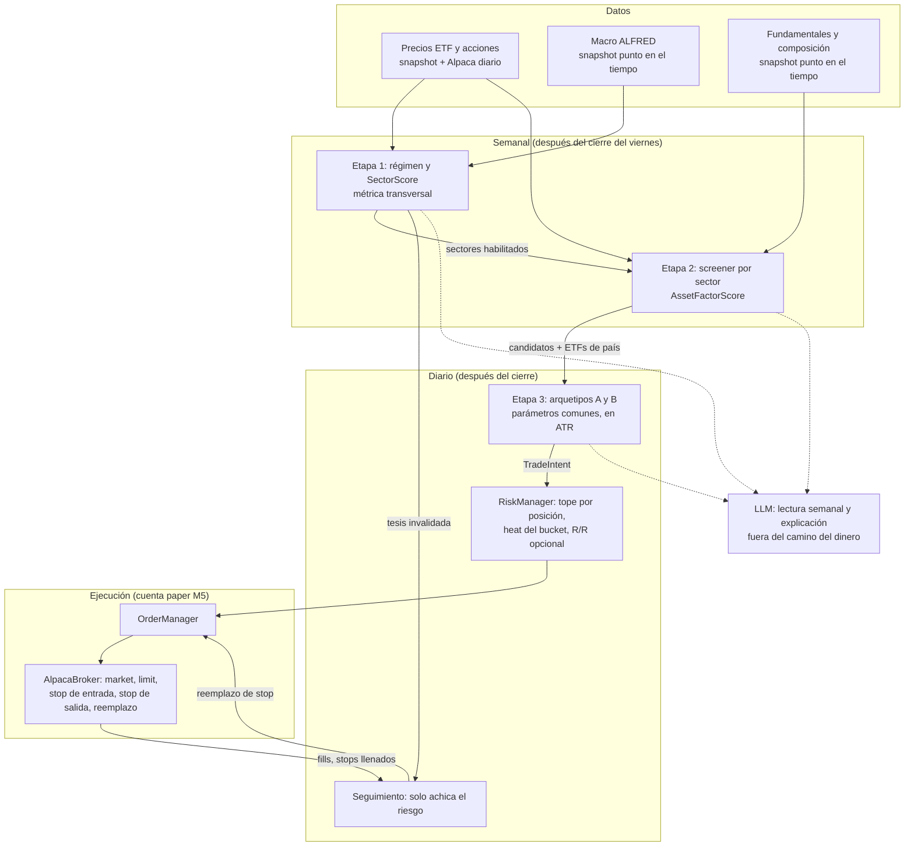

# QuantAgent-M5 — Diseño de detalle: motor top-down (macro → sectores → acciones → técnico → riesgo)

**Estado:** propuesta para revisión de Fede (2026-10-25). Sin tickets en Beads: los IDs `M5-xx` son provisorios hasta que el PM los cree.
**Fuente:** propuesta de Fede, copiada sin cambios en [`docs/02_planning/2026-10-25_propuesta_motor_jerarquico_fede.md`](../02_planning/2026-10-25_propuesta_motor_jerarquico_fede.md) (en este documento: "la propuesta").
**Plan:** [`docs/02_planning/QuantAgent-M5-PL-motor-top-down.md`](../02_planning/QuantAgent-M5-PL-motor-top-down.md).
**Código comparado:** `lote/paper-alpaca` @ `e1db3ed` (2026-10-25), que es lo más nuevo de M4.
**Cuándo:** después de los hitos definidos hasta hoy (M4 con L20 y L21 cerrados).

## 1. Decisiones de Fede sobre la propuesta (2026-10-25)

Tomadas en la conversación del proyecto, después de una revisión crítica de la propuesta:

| # | Tema | Decisión |
|---|---|---|
| F1 | Alcance | **Completo**, incluidas las acciones individuales con fundamentales. Si faltan datos, se buscan fuentes; no se recorta el alcance. |
| F2 | Macro | La lectura macro entra como en la propuesta. Se registra la recomendación de medir por separado "momentum + filtro de caída" y "momentum + macro", y se evalúa durante la construcción, el backtest y paper. |
| F3 | Sizing | Los números de la propuesta (1–2 % de riesgo por trade, 20 % por posición, 6 % de riesgo abierto) son un análisis inicial, **no una definición**. Se deciden antes de paper (§8.4). |
| F4 | Cuenta | Esta rama opera en una **cuenta paper de Alpaca aparte**. |

Las demás desviaciones de la propuesta (§2) son recomendaciones de diseño; cada una indica si requiere el OK de Fede.

## 2. Qué cambia respecto de la propuesta y por qué

| Punto de la propuesta | Cambio propuesto | Motivo | ¿OK de Fede? |
|---|---|---|---|
| ADR-02: `TradeIntent` como contrato único para todos los motores | `TradeIntent` es el contrato de la **vía por trade** (este motor y las estrategias sueltas). Las carteras de M4 siguen con su vía por pesos. Las dos vías se juntan en `OrderManager` + `RiskManager`. | Las carteras de L21 operan sin stop (decisión 2 del plan L21); un contrato con stop obligatorio no las representa. | No (diseño) |
| ADR-03: buckets dentro de una sola cuenta | En paper, **un bucket = una cuenta paper + una base de datos + un proceso** (F4). No hace falta la tabla `portfolio_buckets` para paper. | Alpaca suma las posiciones por símbolo: con dos motores en la misma cuenta, la reconciliación (`y62`) no sabe de quién es cada acción. Es el mismo patrón que L21 ya usa (una base y un proceso por cartera). | Ya decidido (F4) |
| ADR-06 + ticket 2.2: `OverfittingGate` y DSR nuevos | **No se construyen.** Se usa el embudo existente: etapas 0–3, `intentos.csv`, DSR contra intentos, criterio C0 + M1 (DC R01). | Ya existe y está auditado (L10, L16, L19). Un segundo registro de intentos partiría N en dos. | No |
| Exigir `DSR ≥ 0,95` para pasar a paper | Paper sigue siendo prueba del sistema (R01 #4); el DSR se informa y no bloquea paper. | El DC del 2026-10-19 mostró que DSR ≥ 0,95 sobre 4 años pide un Sharpe de ~1,4. | No (aplica R01) |
| Filtro R/R ≥ 2 con objetivo obligatorio | El objetivo es **opcional**. El filtro R/R solo se aplica cuando el objetivo sale de la estructura del gráfico (máximo previo, ancho del rango). | Si stop y objetivo son múltiplos de ATR, el cociente es constante (por ejemplo 4 ATR / 2 ATR = 2) y el filtro no filtra nada. En seguimiento de tendencia con stop móvil no hay objetivo fijo. | Sí (D3 del plan). Decidido: **v1 sin filtro R/R**, porque los arquetipos no tienen objetivo. |
| Validación del pipeline completo de una vez | **Escalera de cuatro hipótesis** (§7): cada capa se mide contra la anterior. | Con hipótesis encadenadas, el error de cada eslabón se multiplica (ljoj §2). Hay que saber qué capa suma. | No (implementa F2) |
| Arquetipo A como estrategia nueva | Es una variante de `triple_screen_strategy.py` y cuenta en el cupo de 2 variantes por idea (R01 #8). | Misma idea (Elder), distintos parámetros. | No |
| Países (`EWZ`, `EEM`) y `SPY` en la Etapa 2 | `EEM`, `EWZ` y `SPY` **saltean la Etapa 2**: pasan a la Etapa 3 como activo. `ARGT` queda fuera del universo (Fede: invertir en EE. UU.). | No hay fundamentales punto en el tiempo accesibles de empresas de esos países, y `SPY` no tiene un sector propio. Abrir acciones por país es una extensión aparte. | Sí (D5 del plan, decidido) |
| LLM ausente | El LLM escribe la lectura semanal y explica cada trade; **no decide ni dimensiona nada** (§6.6). | El objetivo del proyecto es un sistema con LLM; los números tienen que seguir siendo reproducibles. | No |

## 3. Mapa de la propuesta contra el código actual

| Pieza | En la propuesta | Hoy en el repo | Brecha |
|---|---|---|---|
| Precios diarios de ETFs | Data layer | `quantagent/data/sources/{yahoo,alpaca}.py`, snapshots con manifiesto (`data/snapshot.py`) | Ninguna para ETFs. |
| Precios de acciones, incluidas las que dejaron de cotizar | (implícito) | Yahoo no tiene las que dejaron de cotizar | **Fuente nueva** (§5). |
| Macro punto en el tiempo | `MacroSeriesProvider` | `data/macro.py`: snapshot ALFRED (`macro-2026-10`, 10 series), `valor_conocido`, `serie_punto_en_el_tiempo` | Faltan series (§5.1). Faltan las transformaciones (YoY, Δ, z-score). |
| Régimen de mercado | Crash Avoidance Gate | `fabrica/regimen.py` (`clasificar_regimen`: volatilidad 20 días contra mediana, precio contra media de 200) | Agregar la pendiente de la media larga. |
| Ranking entre activos | `SectorScore` | `fabrica/transversal.py`: métricas de panel (fecha × activo), "mayor es mejor", sin mirar el futuro | `SectorScore` se registra como métrica transversal. |
| Fundamentales | `FundamentalFactorScreener` | Nada | **Fuente y módulo nuevos** (§5.2, §6.2). |
| Composición de cada sector por fecha | (implícito) | Nada | **Fuente nueva** (§5.3). |
| Estrategias técnicas | Arquetipos A y B | `strategy/`: `triple_screen` (EMA 13 semanal + estocástico), `fifty_two_week_high`, `sma_cross`, etc. Registro en `registry.py` | Arquetipos nuevos; ATR, Force Index, SafeZone, Chandelier, Donchian, ancho de Bollinger. |
| Señal | `TradeIntent` | `strategy/base.py: TradingSignal` (decisión, entrada, stop, objetivo, política de salida, trailing %, velas máximas) | `TradeIntent` extiende `TradingSignal` (§6.4). |
| Sizing | Fixed fractional | `PositionSizer` regla `riesgo`: `capital × riesgo% / |entrada − stop|`, tope `max_position_pct`, piso 0,5 % de distancia | Igual a la propuesta. Falta el redondeo a acciones enteras cuando el activo no admite fracciones. |
| Riesgo previo al trade | `RiskGatekeeper` | `RiskManager.validate_trade` (efectivo, tope por posición, pérdida diaria, corte de emergencia) | Faltan el riesgo abierto total ("heat") y el filtro R/R opcional. |
| Broker | Adaptador Alpaca | `AlpacaBroker`: solo órdenes market y limit, vigencia "day" | Faltan órdenes stop (de salida y de entrada) y su reemplazo. |
| Stop | Stop físico en el broker desde t = 0 | El scheduler revisa los stops localmente (`check_intrabar_stops`) | **Stop en el broker** (§6.5). |
| Seguimiento | `PositionTracker` | `PositionMonitor` + `ActivePosition` (stop, objetivo, trailing %, máximo visto) | Acciones que solo achican el riesgo, con invariante (§6.5). |
| Agenda | Semanal (Etapas 1–2) y diaria (3–4) | `trading/scheduler.py`: ciclo diario por velas y rebalanceo de carteras | Job semanal y job previo a la apertura. |
| Embudo y DSR | `OverfittingGate` | `fabrica/` + `cli/hipotesis.py` + `intentos.csv` + `backtesting/verdict.py` | Universo que cambia con la fecha (§7.2). |
| Reconciliación | Reconciliación de fills | `PositionMonitor.reconcile_alpaca_positions`, `cli/reconcile.py` | Cerrar posiciones cuando el stop se llenó en el broker. |

## 4. Arquitectura



Código nuevo en un paquete `quantagent/topdown/` (régimen, screener, pipeline). Los arquetipos van en `quantagent/strategy/` y se registran en `registry.py` como cualquier estrategia. Las fuentes de datos nuevas van en `quantagent/data/sources/`, con el mismo patrón de snapshot + manifiesto que `data/macro.py`.

## 5. Datos

Regla general, igual que para la macro: todo dato entra por un **snapshot versionado con manifiesto** y se consulta "lo que se sabía en la fecha t". Un test por fuente verifica que una consulta en `t` no devuelve nada publicado después de `t`.

### 5.1 Macro (Etapa 1)

| Tema | Serie de la propuesta | ¿Está en `macro-2026-10`? | Fuente / sustituto |
|---|---|---|---|
| Crecimiento | ISM Manufacturing New Orders | No | **ISM no está en FRED** (lo retiró en 2016, según lo que sé; a confirmar). Sustitutos gratis: nuevos pedidos de las encuestas regionales de la Fed (Filadelfia, Nueva York) o el índice de actividad CFNAI. Elegir uno **antes** de correr. |
| Crecimiento | `INDPRO` | Sí | — |
| Crecimiento | Pedidos iniciales de desempleo (invertido) | No | `ICSA` (FRED/ALFRED). |
| Inflación | CPI YoY | Sí (`CPIAUCSL`) | — |
| Inflación | Breakeven 10 años | No | `T10YIE` (FRED; empieza en 2003). Los breakeven de 5 años también están (`T5YIE`). |
| Política y curva | Tasa real 10 años | No | `DFII10` (FRED; empieza en 2003). |
| Política y curva | Pendiente 10–2 | Sí (`T10Y2Y`) | — |
| Condiciones financieras | High yield OAS | No | `BAMLH0A0HYM2` está **recortado en FRED a una ventana de 3 años desde abril de 2026**, por licencia de ICE. Sustituto: `BAA10Y` (ya en el snapshot). |
| Condiciones financieras | VIX | No | `VIXCLS` (FRED). |
| Condiciones financieras | DXY | No | DXY no está en FRED. Sustituto: `DTWEXBGS` (dólar amplio, desde 2006). |

Las series de mercado (breakevens, tasas, VIX, dólar) no se revisan; ALFRED solo importa para las series económicas (INDPRO, ICSA, CPI, encuestas). Ticket `M5-01` baja un snapshot nuevo (`macro-2026-11` o el nombre que toque) con todas las series de la tabla.

### 5.2 Acciones y fundamentales (Etapa 2)

Necesidades, en orden de importancia para que el backtest no mienta:

1. **Precios diarios ajustados de acciones, incluidas las que dejaron de cotizar.** Sin ellas el backtest solo ve empresas que sobrevivieron.
2. **Composición de cada sector en cada fecha** (§5.3).
3. **Fundamentales con la fecha en que se publicaron** (ROIC, margen operativo, ingresos, EPS), no solo el período que cubren.
4. **Revisiones de EPS de analistas.**

| Opción | Cubre | Costo | Contras |
|---|---|---|---|
| **Sharadar Core US Equities Bundle** (Nasdaq Data Link): precios `SEP`, fundamentales `SF1`, tabla de altas y bajas del S&P 500, `TICKERS` con sector | 1, 2 (vía S&P 500), 3; también precios de ETFs (`funds`) | Bundle con historia completa: USD 69/mes o 499/año (10 años: 49/399, no llega a 2007). Capa gratuita: solo una muestra de ~30 empresas (tipo Dow Jones), útil para desarrollo y tests | Sector actual por empresa; los cambios de SIC están en `actions`, no los de GICS (ver §5.3). Licencia solo personal; al cancelar hay que borrar los datos en 30 días (vale para backtests propios, no para guardarlos y dejar de pagar) |
| **SEC EDGAR (XBRL, API `companyfacts`)** | 3 | Gratis, sin clave; límite de pedidos por IP | Hay que armar ROIC, márgenes y aceleraciones a mano. Ante una restatación se usa el **último valor presentado hasta la fecha** (M5-31): con el primer valor, el EPS mezclaba datos antes y después de un split. Mucho trabajo y casos raros. No cubre 1 ni 2. |
| **Norgate Data** (Platinum) | 1, 2 (incluye composición histórica de índices) | ~USD 630 por año según un blog de 2024 (a verificar) | No trae fundamentales. Hasta donde sé, su cliente corre en Windows: choca con la VM y WSL. |
| **EODHD** | 1, 3, composición del S&P 500 desde 2012 | Plan pago de fundamentales | Composición solo desde 2012: corta el período 2007–2011. |
| Lista pública de cambios del S&P 500 (por ejemplo, armada desde Wikipedia) | 2 | Gratis | Calidad variable; no resuelve 1. |
| **Intrinio** (estimaciones de EPS con 20+ años) | 4 | A cotizar | Probablemente caro para el tamaño del proyecto. |
| **FMP / Twelve Data** (consenso de EPS) | 4, solo desde hoy | Planes bajos | No guardan historia de revisiones: hay que sacar fotos diarias desde ahora. |

Detalle verificado en `sharadar.com/llms.txt`, FAQ y términos (2026-10-25): API propia (`api.sharadar.com`), descarga masiva por tabla; fundamentales con dimensión `ARQ`/`ART` = tal como se presentaron, indexados por la fecha de presentación a la SEC y sin reescribir por restataciones (lo que pide el backtest); tabla `sp500` con altas y bajas históricas; acciones que dejaron de cotizar en las mismas tablas. No trae estimaciones de analistas.

**Recomendación:** Sharadar como fuente principal de acciones (cubre 1, 2 y 3 con un solo proveedor y un formato), EDGAR como control cruzado de una muestra de empresas, y para las revisiones de EPS:

- en el backtest, reemplazar "revisiones" por **crecimiento del EPS publicado** (sale de `SF1`); es lo que la propuesta ya permite ("crecimiento/revisiones");
- desde ya, **guardar una foto diaria del consenso** (FMP o similar, plan bajo) para tener historia propia cuando esta rama llegue a paper.

Esto choca con R01 #14 ("nada pago hasta que una familia pase la etapa 2 con datos gratis"). Por F1, Fede decide si Sharadar se paga antes (D1 del plan). Sin pago, la alternativa es EDGAR + lista pública del S&P 500 + **precios sin las acciones que dejaron de cotizar**, con el sesgo de supervivencia declarado en el informe; en ese caso el resultado de la Etapa 2 no vale como evidencia y solo sirve como prueba del sistema.

**Decisión (D1, Fede 2026-10-25):** fuentes gratuitas, sin Sharadar. Precios de acciones: Yahoo para los símbolos vivos y Quandl WIKI (espejo de Kaggle, con las que dejaron de cotizar hasta 2018-03-27) para las que salieron. Composición: `fja05680/sp500` más la tabla manual de GICS (§5.3). Fundamentales: EDGAR (M5-31). Revisiones de EPS: foto diaria de Yahoo desde 2026-10 (M5-05b). Una hipótesis de L28 que pase la etapa 2 se confirma con Sharadar pago antes de paper.

### 5.3 Composición de los sectores

Los Select Sector SPDR (`XLK`, `XLF`, etc.) contienen las empresas del S&P 500 agrupadas por sector GICS. Por eso, "empresas del sector X en la fecha t" = miembros del S&P 500 en t (tabla de Sharadar o lista pública) con el sector GICS de cada empresa en t.

El sector histórico es el punto débil: los proveedores accesibles dan el sector **actual**. Los cambios grandes de GICS son pocos y conocidos: la creación de Comunicaciones en 2018 (salieron empresas de Tecnología y Consumo discrecional hacia `XLC`) y la reclasificación de 2023 (empresas de pagos pasaron de Tecnología a Financiero). Propuesta: una tabla manual versionada con esos cambios, y un test que verifique que en 2017 `GOOGL` cuenta como Tecnología y en 2019 como Comunicaciones.

Además, `XLRE` empieza en 2015 y `XLC` en 2018. Entran al universo de la Etapa 1 con la misma regla fechada que los ETFs ampliados de R01 (#14): un activo entra cuando tiene la historia mínima que pide la métrica.

### 5.4 Datos en vivo (paper)

- Precios diarios: Alpaca (`AlpacaSource`, ya existe), con la salvedad conocida del provider diario que puede no liberar la última vela hasta la medianoche UTC.
- Macro: ALFRED en vivo para la lectura semanal (pendiente `av1p.4.7` de M4 resuelve lo mismo; reusar).
- Fundamentales: actualización de EDGAR, leída por el job semanal.
- Activos fraccionables: Alpaca expone el atributo `fractionable` por activo; el sizing lo consulta (§6.5).

## 6. Diseño por componente

### 6.1 Etapa 1 — régimen y `SectorScore` (semanal)

- **Universo:** los 11 Select Sector SPDR más `SPY`, `EEM` y `EWZ` (desde que tienen historia suficiente). `ARGT` queda fuera (D5).
- **Transformaciones:** cada serie macro se pasa a variación interanual (niveles: INDPRO, CPI, ICSA) o diferencia de 12 meses (tasas, spreads, VIX), y luego a z-score con **ventana fija de 36 meses**, elegida antes de correr. La propuesta deja la ventana entre 12 y 36: elegirla después de mirar el resultado sería un parámetro libre más.
- **Tema:** promedio de los z-scores de sus series (con el signo invertido donde corresponde, por ejemplo ICSA).
- **Matriz de signos (`catalogo/m5-priors.yaml`, versionada antes de correr):** −1, 0 o +1 por tema y ETF. `MacroThemeScore_i = Σ_tema signo(i, tema) × z_tema / cantidad de temas con signo ≠ 0`. Borrador para discutir (con citas obligatorias en el YAML antes de usarlo):

  | Tema ↑ | `+` | `−` |
  |---|---|---|
  | Crecimiento | XLY, XLI, XLB, XLK, XLF | XLU, XLP, XLV |
  | Inflación | XLE, XLB | XLK, XLU, XLY |
  | Tasa real | XLF | XLK, XLRE, XLU |
  | Pendiente de la curva | XLF | XLU |
  | Estrés financiero (spread, VIX) | XLP, XLU, XLV | XLF, XLY, EEM, EWZ |
  | Dólar | — | EEM, EWZ, XLB, XLE |

- **`PriceMomentumScore`:** retorno de 1, 3 y 6 meses dividido por la volatilidad de 60 sesiones, promediado.
- **`SectorScore = 0,5 × MacroThemeScore + 0,5 × PriceMomentumScore`**, ambos llevados a z-score entre los activos de la fecha. Se implementa como métrica transversal en `fabrica/transversal.py` (panel fecha × activo, mayor es mejor).
- **Filtro de caída:** bloquea compras nuevas en el activo si su `PriceMomentumScore < 0` **y** `SPY` está bajo su media de 200 sesiones con pendiente negativa (media de hoy menor que la de hace 20 sesiones). Extiende `fabrica/regimen.py`.
- **Salida:** `regimen_semanal` (fecha, versión de la matriz, z-scores por tema, score por activo, habilitados, bloqueados, estado general risk-on / neutral / risk-off). Habilitados: los **3** mejores con score > 0 y sin bloqueo. El estado general limita la exposición del bucket: risk-off = sin compras nuevas.
- **Variante sin macro** (para la escalera, §7): `SectorScore = PriceMomentumScore`. Mismo código con el peso macro en 0.

### 6.2 Etapa 2 — screener por sector (semanal)

- **Universo:** miembros del S&P 500 en la fecha, del sector de cada ETF habilitado (§5.3). `EEM`, `EWZ` y `SPY` pasan directo a la Etapa 3 (D5).
- **Métricas** (cada una con la fecha de publicación del dato; solo datos publicados hasta la fecha):
  - Calidad (35 %): ROIC de los últimos 4 trimestres y cambio interanual del margen operativo. En el sector Financials, ROE de 4 trimestres y cambio interanual del margen antes de impuestos (D8): los bancos no reportan resultado operativo y el ROIC no aplica con depósitos como deuda. En los demás sectores, si falta el resultado operativo se usa el resultado antes de impuestos.
  - Impulso (35 %): aceleración del crecimiento de ingresos (crecimiento interanual del último trimestre menos el del anterior) y crecimiento interanual del EPS publicado.
  - Fuerza relativa (30 %): retorno de 3 y 6 meses menos el retorno del ETF del sector en la misma ventana. Uso la **diferencia** de retornos, no el cociente de la propuesta, porque el cociente se rompe cuando el retorno del ETF es cercano a cero o negativo.
- **Normalización:** z-score dentro del sector y la fecha, recortado a ±3 para que un dato raro no domine.
- **Exclusión:** fuera el cuartil inferior de fuerza relativa; fuera las empresas con datos faltantes en más de una métrica.
- **Salida:** `candidatos_semanales` (fecha, sector, símbolo, score, componentes). **Top 3 por sector** (la propuesta dice 3 a 5; fijar 3 antes de correr). Con 3 sectores habilitados son hasta 9 acciones más los ETFs de país habilitados.

### 6.3 Etapa 3 — arquetipos (diario)

Parámetros fijos, iguales para todos los activos, escritos en el YAML de la hipótesis antes de correr. Los indicadores nuevos (ATR, Force Index, SafeZone, Chandelier, Donchian, ancho de Bollinger, volumen relativo) van en un módulo compartido con tests contra un cálculo independiente.

**Arquetipo A — pullback en tendencia (variante de Triple Screen):**
- Pantalla 1 (semanal): pendiente de la EMA 26 semanal > 0 e histograma MACD semanal subiendo.
- Pantalla 2 (diaria): Force Index 2 < 0 o RSI 3 < 30, con cierre ≥ EMA 22 diaria.
- Entrada: orden **stop de compra** en el máximo de la vela anterior + 0,1 ATR; vence a las 3 velas sin llenarse.
- Stop inicial: el más alto entre el mínimo del swing − 2 ATR y el SafeZone. El SafeZone tiene parámetros propios; si suma un parámetro libre, usar solo ATR.

**Arquetipo B — ruptura después de compresión:**
- Condición: ancho de Bollinger 20 en el 20 % inferior de las últimas 60 sesiones, y precio > EMA 50 > EMA 200.
- Gatillo: cierre sobre el máximo de Donchian 20 con volumen > 1,5 × promedio de 20. Entrada en la apertura siguiente (llenado por defecto del motor, F01).
- Stop inicial: entrada − 2,5 ATR.

**Combinación:** si los dos disparan sobre el mismo activo, se toma la señal con el stop más cercano (menos riesgo). Sin "puntaje combinado" con umbral: sería otro parámetro.

**Salida:** stop móvil Chandelier (máximo desde la entrada − 3 ATR), paso a breakeven a +1,5 R e invalidación de tesis (§6.5). Sin objetivo fijo salvo que el arquetipo declare uno estructural.

**Motor de backtest:** el arquetipo A necesita **entradas con orden stop y vencimiento**, que hoy no existen (el motor llena en la apertura siguiente). Hay que agregarlas al motor propio y al filtro `vbt_filter`, con la misma semántica intravela que los stops de salida (`intrabar_stops.py`: si la apertura salta por encima del stop, se llena en la apertura). Ticket `M5-21`.

### 6.4 `TradeIntent`

`TradeIntent` extiende `TradingSignal` (pydantic), para que las estrategias actuales y el scheduler lo acepten sin cambios:

```python
class TradeIntent(TradingSignal):
    bucket_id: str                    # en paper = nombre del perfil de la cuenta M5
    strategy_id: str                  # p. ej. "arquetipo-a-pullback"
    symbol: str
    order_type: Literal["market", "stop", "limit"] = "market"
    entry_expires_bars: Optional[int] = None   # p. ej. 3 para el arquetipo A
    atr_at_signal: float
    target_is_structural: bool = False          # habilita el filtro R/R
    invalidation_rules: Dict[str, Any] = {}     # p. ej. {"require_sector_enabled": True}
    reasoning_metadata: Dict[str, Any] = {}     # SectorScore, AssetFactorScore, indicadores
```

`stop_loss` pasa a ser obligatorio para `TradeIntent` (validador). Persistencia: tabla nueva `trade_intents` (id, timestamps, bucket, estrategia, símbolo, el intent en JSON, estado `aprobado` / `rechazado_<motivo>` / `vencido` / `llenado`, orden asociada). No se amplía `signals`, que está pensada para la salida del grafo de agentes (RSI, MACD, patrón, modelo LLM).

### 6.5 Riesgo, ejecución y seguimiento

**`RiskManager`, chequeos nuevos** (antes de los actuales, solo para entradas nuevas):
1. R/R: **no entra en v1** (D3): los arquetipos A y B no tienen objetivo de precio, así que el filtro nunca actuaría. Se agrega si aparece una estrategia con objetivo estructural.
2. Heat del bucket: `Σ max(0, (entrada − stop) × cantidad)` de las posiciones abiertas (largos; espejo para cortos) + riesgo del trade nuevo ≤ `heat_max_pct × equity del bucket`. Una posición con el stop en breakeven o más arriba aporta 0. Rechazo con motivo `max_heat`.

**Sizing:** `PositionSizer` regla `riesgo` sin cambios de fórmula. Se agrega: si el activo no es fraccionable, redondear hacia abajo a acciones enteras; si da 0, rechazo con motivo `tamano_cero`. Los valores (`riesgo_por_trade_pct`, `max_position_pct`, `heat_max_pct`) salen del perfil del bucket M5: 0,25 %, 10 % y 2 % (D2), con capital inicial de USD 3.000 (D6).

**`AlpacaBroker`:**
- Órdenes `stop` (`StopOrderRequest`) de salida y de entrada, cancelación y **reemplazo** del precio stop (`replace_order_by_id`).
- Vigencia: **GTC** para cantidades enteras. Para cantidades con fracción, Alpaca solo acepta stops con vigencia **day**: el stop se vuelve a enviar todos los días antes de la apertura (job previo a la apertura). Durante el tiempo entre la apertura y el reenvío no hay stop: el job tiene que correr antes de las 9:30 ET y fallar ruidosamente si no puede.

**Stop en el broker (velocidad 1):**
1. Al detectar el llenado de la entrada (`refresh_order` o reconciliación), se envía la orden stop por la cantidad llenada y se guarda su id en `ActivePosition` (columna nueva `broker_stop_order_id`).
2. **El chequeo local de stops (`check_intrabar_stops` en el scheduler) se apaga para las posiciones con stop en el broker.** Si no, la posición se vende dos veces o queda un corto involuntario. Test obligatorio.
3. Si el stop se llena en Alpaca, la reconciliación cierra la `ActivePosition` con motivo `stop_broker` y registra el `Trade`.
4. En backtest, `intrabar_stops.py` ya simula el mismo comportamiento: el resultado es comparable.

**Seguimiento diario (velocidad 2), extensión de `PositionMonitor`:**
- Una sola función decide el nuevo stop: `nuevo_stop(actual, propuesto, lado)`. Para largos devuelve `max(actual, propuesto)` y registra un evento si el propuesto era más bajo. Ninguna otra ruta del código modifica el stop. Test de propiedad: para cualquier secuencia de propuestas, el stop de un largo nunca baja.
- Acciones: mantener; breakeven a +1,5 R; Chandelier (máximo − 3 ATR); invalidación de tesis.
- Invalidación de tesis (job semanal): si el sector del activo dejó de estar habilitado o el estado general pasó a risk-off, el stop sube al mínimo de las 2 últimas velas; si el cierre ya está bajo la EMA 10, se cierra la posición en la apertura siguiente.
- Cada cambio de stop reemplaza la orden en Alpaca (o la próxima reenviada, si es fraccionaria).

### 6.6 Rol del LLM

- **Lectura macro semanal:** con el contenido de `regimen_semanal` y los z-scores, el LLM escribe una nota corta en castellano (qué cambió, qué sectores entraron o salieron y por qué según la matriz). Reusa el borrador `2026-09-17_borrador_skill_revision_macro_semanal.md`.
- **Explicación de cada trade:** a partir de `reasoning_metadata`, una explicación de 3–5 líneas guardada junto al intent y mostrada en el digest diario.
- **Fuera de alcance en M5:** que el LLM vete o pondere señales. Si se quiere, es una hipótesis aparte (meta-labeling) que tiene que mejorar a la escalera (§7) y cuenta como intento.

### 6.7 Agenda

| Job | Cuándo | Hace |
|---|---|---|
| Semanal | Sábado, sobre el cierre del viernes | Etapa 1 → `regimen_semanal`; Etapa 2 → `candidatos_semanales`; invalidación de tesis; nota del LLM |
| Diario post-cierre | Cuando la vela diaria está disponible | Etapa 3 sobre candidatos + ETFs de país habilitados → `TradeIntent` → riesgo → órdenes; seguimiento de stops |
| Previo a la apertura | Antes de las 9:30 ET | Reenviar stops con vigencia "day"; vencer entradas stop sin llenar; verificar que toda posición tenga stop |
| Reconciliación | Como en M4 | Posiciones, órdenes y stops llenados contra Alpaca |

## 7. Validación: la escalera de cuatro hipótesis

Cada escalón es una hipótesis del embudo actual (YAML en `hipotesis/`, etapas 0–3, intentos contados, criterio C0 + M1) y se compara contra el escalón anterior con el mismo período y costos. Así se ve qué capa suma y cuál no, que es lo que pidió Fede en F2.

| Escalón | Hipótesis | Se compara contra | Qué responde |
|---|---|---|---|
| H1 | Rotación semanal: los 3 ETFs con mejor `PriceMomentumScore`, con filtro de caída, pesos por igual riesgo | 1/N de los ETFs del universo | ¿El momentum sectorial con filtro suma? |
| H2 | H1 con `SectorScore` 50/50 macro + momentum | H1 | ¿La macro suma sobre el momentum? (F2) |
| H3 | Top 3 acciones por sector habilitado por H1 (D9: H2 no mejoró a H1), mantenidas una semana, sin timing técnico | Los ETFs de esos mismos sectores | ¿El screener elige mejores acciones que el ETF? |
| H4 | H3 + arquetipos A y B con stops y seguimiento | H3 | ¿El timing técnico suma o solo agrega costos? |

- **H5, posterior a la implementación de M5 (Fede, 2026-10-25):** pierna corta. Vender en corto los activos que el filtro de caída bloquea y que tienen `PriceMomentumScore < 0`, con versiones espejo de los arquetipos (por ejemplo, ruptura a la baja), y compararla contra H4. No entra en v1 porque el filtro es una regla de defensa (no comprar), no una señal de venta. Además, el filtro se activa con el mercado bajista, donde los rebotes castigan al momentum (Daniel y Moskowitz, "Momentum crashes"), y pasar a efectivo tiene mejor evidencia que darse vuelta (ljoj §2). Por eso v1 en risk-off queda en efectivo. Antecedente: F2 `tendencia-larga-corta` (R01 #8, cortos solo en paper). Para dinero real hace falta cuenta margin, y Alpaca no permite cortos fraccionarios. Cada arquetipo espejo suma un intento.
- Los arquetipos A y B se miden también **solos, agrupados**, sobre los 11 ETFs sectoriales sin las Etapas 1–2: es la forma más barata de saber si tienen algo antes de montarlos sobre el resto.
- Intentos: cada escalón y cada arquetipo suman 1 a N. Matriz de signos, ventanas y pesos se fijan antes del primer corte (máx. 6 parámetros libres por hipótesis, regla de L9).
- Reserva 2023+: R01 la limita a 3 hipótesis con lista escrita. Si alguna de M5 debe entrar, Fede la agrega a la lista antes. Decidido (D7): la reserva se guarda para H4.
- Que un escalón no pase **no frena paper** (R01 #4, paper como prueba del sistema). Solo queda registrado.

### 7.1 Período

- Etapa 1 con ETFs: 2007–2018 para las etapas 1–2 del embudo; 2019–2022 para la etapa 3. `T10YIE` y `DFII10` empiezan en 2003; la ventana de 36 meses deja el primer score en 2006: alcanza.
- Etapa 2 con acciones: mismo período si la fuente cubre desde 2007 (con las fuentes de D1: precios y composición desde 2007; fundamentales de EDGAR desde 2009-2010).

### 7.2 Universo que cambia con la fecha

El embudo hoy corre una hipótesis sobre un universo fijo. H3 y H4 necesitan "en la fecha t, el universo es `candidatos_semanales(t)`". Las métricas transversales ya trabajan con un panel fecha × activo con NaN para "no disponible": la extensión natural es una máscara de elegibilidad fecha × activo que la hipótesis declara. Ticket `M5-30`.

## 8. Riesgos y temas abiertos

1. **Sesgo de supervivencia** si no se paga una fuente con acciones que dejaron de cotizar (§5.2). Con D1, WIKI cubre las que salieron hasta 2018-03-27; después quedan huecos que informa M5-03. Mitigación: declararlo en el informe y confirmar con Sharadar pago una hipótesis que pase la etapa 2.
2. **Pocos episodios macro.** En 2007–2022 hay 3 o 4 cambios de régimen. Aunque la matriz se fije de antemano, H2 se valida con muy pocos casos; el error estándar de ΔSharpe (M3 de R01) lo va a mostrar.
3. **Hueco en la apertura.** Un stop en el broker no protege de una apertura por debajo del stop: la pérdida real puede superar el riesgo calculado. El informe muestra la pérdida realizada en R por trade.
4. **Stops "day" de fracciones.** Entre la apertura y el reenvío no hay stop. Mitigación: job previo a la apertura con alarma.
5. **Cuenta chica.** Con USD 1.000–3.000, 9–15 posiciones son de USD 70–300: obliga a fracciones y hace pesar las comisiones mínimas si las hubiera. Es un insumo de diseño, no una restricción de paper (memoria `capital-live-input-no-restriccion`).
6. **Dinero real y una sola cuenta live.** Alpaca da una cuenta live por titular (hasta 3 paper). Para operar en vivo M4 y M5 juntos hace falta la partición virtual (tabla de buckets y atribución de posiciones) que la propuesta describe. Se decide antes de dinero real.
7. **Dividendos y retención.** 30 % de retención sobre dividendos para Fede (R01). Afecta más a acciones con dividendo alto; modelarlo antes de dinero real, como ya está decidido.
8. **Citas.** La referencia a Carver apunta a la página del año del blog, no a un artículo. Antes de usar la matriz de signos, cada signo lleva una cita verificable (chequeo de DOI de L19 cuando aplique).

## 9. Propuesta de actualización de README (no aplicada)

- `docs/03_design/README.md`: agregar `QuantAgent-M5-DS-motor-top-down.md` — diseño del motor top-down macro → sectores → acciones → técnico → riesgo (post-M4).
- `docs/02_planning/README.md`: agregar `QuantAgent-M5-PL-motor-top-down.md` y la propuesta original de Fede.
