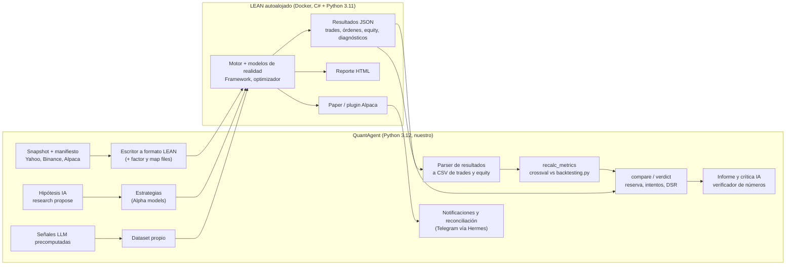

# QuantConnect y LEAN: qué ofrecen, dónde se cruzan con QuantAgent y si conviene construir encima

Ticket: sin asignar (propuesta en §12). Fecha: 2026-10-12. Estado: **análisis, falta decisión de Fede** (§11).

Fuentes: la documentación de QuantConnect leída desde su repositorio fuente (`QuantConnect/Documentation` @ `6ec9b23`,
2026-10-08), que es lo que publica https://www.quantconnect.com/docs/v2/, y el código de `QuantConnect/Lean` @ `80e7843`
(2026-10-06), `QuantConnect/lean-cli` y `QuantConnect/Lean.Brokerages.Alpaca`. No se creó cuenta ni se corrió LEAN.

## Respuesta corta

1. QuantConnect (QC) es dos cosas. **LEAN** es el motor open source (Apache 2.0): backtest, paper, live, optimizador,
   reporte y notebooks. **La nube de QC** es paga y suma datos institucionales, infraestructura live, un kanban por etapa
   (Research Pipeline) y agentes de IA por etapa (Ideas, Research, Validation, Backtest, Paper Testing y Live Monitoring),
   coordinados por un Conductor.
2. Se cruza con casi todo lo que construimos o planeamos: motor, costos, métricas, referencia, barrido de parámetros,
   paper, broker Alpaca, notificaciones y agentes. No se cruza con lo que nos diferencia: recálculo independiente de
   métricas, control trade por trade contra otra librería, reserva bajo candado, intentos contados y "la IA no calcula".
3. **Pivot: recomiendo construir sobre LEAN autoalojado, sin la nube de QC.** LEAN reemplaza unas 4.700 líneas nuestras
   (motor, órdenes, cartera, riesgo, broker de papel, scheduler) y casi todo M3. Además trae lo que no tenemos: cartera de
   varios activos con capital compartido, llenado en la apertura siguiente, reglas del broker, optimizador, reporte y
   diagnósticos automáticos de cada corrida. QuantAgent pasa a ser la capa de arriba: datos con manifiesto, validación,
   veredicto, IA y proceso de revisión.
4. **Cuándo:** antes de abrir la prueba 2019–2022 (lote 4 de M2). El veredicto fuera de muestra se mide una sola vez. Si
   el motor cambia después, hay que volver a medir sobre un tramo ya visto. Antes, un spike de 1 o 2 sesiones con
   criterio binario (§9). Si falla, seguimos con el motor propio y tomamos las ideas de §4.
5. El pivot tiene costos. La imagen Docker de LEAN pesa 14 GB comprimida en amd64. El motor es C#, así que sus bugs se
   arreglan upstream o se rodean. Corre con Python 3.11 y no con 3.12. Fuera de la nube las notificaciones no salen, y la
   evidencia de M1 y M2 hay que rehacerla contra LEAN. Ninguno bloquea; todos entran en el spike.
6. Sin pivot igual hay cinco ideas para tomar ya: llenar en la apertura siguiente, diagnóstico automático por corrida,
   test de significancia y bootstrap en el veredicto, tabla de crisis y mapa de estabilidad de parámetros.

---

## 1. Las piezas de QuantConnect

"LEAN" = está en el código open source y corre sin cuenta. "Nube" = solo en QuantConnect Cloud.

| Pieza | Qué hace | Dónde |
|---|---|---|
| Motor | Simulación por eventos: cada vela llega al algoritmo cuando termina su período ("time frontier"). Varios activos y resoluciones a la vez, universos dinámicos, más de 100 indicadores, eventos programados que conocen el calendario de cada mercado | LEAN |
| Modelos de realidad | Llenado por tipo de orden: stop con gap a `min(apertura, stop)`, órdenes a la apertura y al cierre con el precio de la subasta oficial. También slippage, comisión por broker, poder de compra, liquidación (settlement), disponibilidad de cortos y llamadas e interés de margen | LEAN |
| Modelos de broker | 37 clases con lo que acepta cada broker: tipos de orden, horarios, fraccionarias (`Common/Brokerages/`, incluye `AlpacaBrokerageModel.cs`) | LEAN |
| Algorithm Framework | Universo → Alpha (emite `Insight`: dirección, duración, confianza) → construcción de cartera (`PortfolioTarget`) → riesgo → ejecución. Cada módulo se cambia sin tocar los otros | LEAN |
| Estadísticas | Unas 22 métricas (Sharpe, PSR, alpha, beta, information ratio, capacidad estimada, etc.). Los trades se arman de los fills con agrupación y emparejamiento configurables (`FlatToFlat`, `FIFO`) | LEAN |
| Diagnóstico de corrida | 62 análisis automáticos del resultado: 15 generales y 47 sobre mensajes del broker y errores de órdenes. Entre ellos: curva plana, significancia de retornos diarios, percentil Monte Carlo, crisis, cantidad de parámetros, fills con dato viejo, stop y take profit llenados a la vez, fills fuera de horario, errores de órdenes por broker, margen (`Engine/Results/Analysis/Analyses/`) | LEAN. La nube se los pasa a los agentes |
| Optimizador | Grid y Euler. Objetivos: CAGR, drawdown, Sharpe y PSR. Restricciones del tipo `Drawdown <= 0.25` | LEAN (`Optimizer/`). La nube solo hace grid y hasta 3 parámetros |
| Reporte | HTML o PDF: métricas, retornos por trade, día, mes y año, los 5 peores drawdowns, exposición, beta y Sharpe móviles a 6 y 12 meses, unos 18 períodos de crisis y parámetros. Plantilla editable | LEAN (`Report/`) |
| Research | Jupyter con `QuantBook`, el mismo API que el algoritmo | LEAN (imagen de research). Leer backtests, optimizaciones y live desde un notebook por API es de la nube |
| Paper y live | Broker de papel. Plugins de broker en repos aparte; el de Alpaca trae órdenes, datos en vivo e historia (Apache 2.0). Estado en Object Store. Comandos en vivo (`OnCommand`, link por email que ejecuta una orden) | LEAN |
| Notificaciones | Email, SMS, Telegram, webhook por evento de orden o insight | Nube. En LEAN autoalojado `CanSend()` devuelve falso para los cinco tipos (`Common/Notifications/Notification.cs`) |
| Live administrado | Servidores en Equinix, regiones de respaldo, reinicio automático (5 intentos), backtest fuera de muestra en paralelo para comparar con el live, tablero de todos los algoritmos | Nube |
| Datos | Precios institucionales (feeds CTA/UTP), security master sin sesgo de supervivencia y unos 30 proveedores alternativos: noticias (Benzinga, Tiingo), sentimiento (Brain), operaciones del Congreso, lobby e insiders (Quiver), SEC, COT, FRED, BCE y curva del Tesoro | Nube. Los datos no salen de la nube (términos, §2.6); el uso local requiere licencia de descarga |
| Research Pipeline | Kanban Ideas → Research → Backtest → Paper → Live → Archivo. Cada tarjeta es un proyecto | Nube |
| Agentes | Mia (generalista), Conductor y 6 especialistas. Tareas programadas con reglas de mercado, transcript completo de cada corrida, agentes en cadena o en malla, salida con esquema JSON, skills, memoria y plantillas. Permisos por dominio: operar en vivo exige un permiso explícito. Aprobación humana con diff, escalado a un modelo más fuerte, clave propia del proveedor | Nube (el MCP requiere un nodo de agente pago) |
| MCP y API REST | Proyectos, archivos, compilación, backtests, live, optimizaciones, object store, reportes y agentes | Nube |
| LEAN CLI | `lean backtest`, `optimize`, `live`, `report` y `research` sobre Docker | Apache 2.0, pero `lean init` pide login. Según la doc, usarlo requiere un plan pago, y los plugins de broker para live se bajan con la cuenta (`lean/components/cloud/module_manager.py`) |
| Organización | Nodos de backtest, research, live, optimización y agentes. Cuotas, miembros y cifrado del código (AES-256 con clave local) | Nube |

## 2. Comparación por área

| Área | QuantConnect / LEAN | QuantAgent hoy | Plan | Lectura |
|---|---|---|---|---|
| Etapas del ciclo | Research Pipeline: kanban por etapa, un agente asignado a cada columna | No existe. BEADS registra trabajo de software, no estrategias | V52 (tabla de candidatas) | Falta un registro de estrategias con etapa (§5, fila 9) |
| Ideas | Ideas Agent: lee noticias y blogs, como mucho 3 ideas por corrida, no duplica tarjetas | Nada | V49–V50, hipótesis con "qué la refuta" | Nuestro formato es mejor; tomar el tope y la deduplicación |
| Research antes del backtest | Research Agent y Research Validation Agent en notebooks: ADF, Breusch-Godfrey, Breusch-Pagan, estabilidad entre tramos | Nada: se pasa directo a estrategia y backtest | Nada | No contemplado (§5, fila 10) |
| Motor y reloj | Por eventos, con time frontier | Motor propio, un activo después del otro; el reloj pasa de grilla a velas del dato (V06, `8to`) | `55x` (online y replay) | El riesgo 1 de M2 es lo que LEAN resolvió de base |
| Llenado y costos | Orden diaria a la apertura siguiente; stops con gap; modelo de comisión por broker; reglas del broker | Llena al cierre de la vela de señal; stops dentro de la vela con gap (`backtest.py:102`); `--costos etf` | `80x`: la apertura siguiente solo como sensibilidad | §4.1 |
| Arquitectura de estrategia | Alpha → cartera → riesgo → ejecución | `generate_signal` + `should_exit` + `assembler.py`; la regla de salida está duplicada (`beo`) | `beo` → V53 | El Framework resuelve `beo` de raíz |
| Cartera de varios activos | Capital compartido, universos | No la simula (respuesta a V19 en el plan de M2, §7) | Fuera de M2 | Con LEAN viene incluida |
| Métricas | Unas 22 + PSR + capacidad + métricas móviles | 5 auditadas + comprar y mantener | V22, V34, V35 | Faltan PSR, beta/alpha, exposición, rotación y Sharpe móvil |
| Referencia | SPY y curva de benchmark | Comprar y mantener del mismo activo con los mismos costos | Hecho en el CLI | La nuestra es más justa para ETFs que no son SPY |
| Reporte | Plantilla con crisis, mapa mensual y métricas móviles | 6–8 líneas + CSV | V24, V43–V48 | §4.4 |
| Sobreajuste | Contador orientativo de backtests, parámetros (detectados del código) y horas; t-test; Monte Carlo | Reserva con candado (hecho), intentos contados, walk-forward, Sharpe deflactado | V31, V32, V35 | Somos más estrictos; sumar t-test y Monte Carlo (§4.3) |
| Optimización | Grid/Euler, objetivo + restricciones, heatmap con zonas estables, costo estimado antes de lanzar | Nada | V31, V32 | §4.5 |
| Diagnóstico de corrida | 62 análisis con severidad, ejemplo, conteo y solución | Nada. Lo encuentra el PM a mano | Nada | No contemplado (§4.2) |
| Paper | Broker de papel + modelo del broker real; Paper Testing Agent con 3 preguntas | `PaperBroker` + APScheduler + controles en Streamlit | M4: "2 semanas sin intervención" | El criterio de M4 es solo operativo (§4.6) |
| Broker real | 20+ brokers; Alpaca con órdenes, datos e historia | Nada | M3: `13a`, `yme`, `qr6`, `y62` | Con LEAN, M3 casi desaparece (§7.4) |
| Reconciliación | Backtest fuera de muestra en paralelo al live, curvas superpuestas; doc de fuentes de diferencia | Nada | `y62` (posiciones contra Alpaca) | La de performance no estaba contemplada |
| Reinicios y estado | Reinicio sin estado: recupera cash, posiciones y órdenes del broker; el resto va a Object Store. 5 reintentos, solo si corrió 5 minutos | Endurecimiento del runtime de paper (`sft`), limpieza de posiciones viejas | — | §4.6 |
| Control en vivo | Órdenes manuales, liquidar, parar; comandos; confirmación por link ("grey box") | Start/stop del scheduler | "Human-in-the-loop" en `phase2_roadmap.md` | Patrón para M5 |
| Notificaciones | Email, SMS, Telegram, webhook (nube) | Telegram del loop vía Hermes | `b41` (resumen diario) | Con LEAN autoalojado siguen siendo nuestras |
| Datos de precios | Institucionales, ajustes configurables, registro público de problemas de datos | Snapshot de Yahoo con manifiesto y control contra NYSE; Binance | Alpaca para 4h | Lo nuestro es reproducible; tomar el registro de incidencias |
| Datos alternativos y macro | Unos 30 proveedores, con historia point-in-time | Nada | `wwi`, `577`, OpenBB por MCP (`6ie`) | Una señal macro o alternativa en un backtest pide historia point-in-time (§4.8) |
| Agentes de IA | Conductor + especialistas sobre un harness: permisos, transcript, despertar al terminar, escalado de modelo, telemetría | 4 agentes LLM como estrategia; loop de desarrollo (agente + PM + Codex); telemetría de tokens (`llm_telemetry.py`) | V43–V51 | QC usa agentes para investigar estrategias y nosotros para construir software. Las dos cosas sirven |
| Interfaz para agentes | MCP + API REST | CLI | — | Mantener el CLI como API; un MCP propio no hace falta todavía |
| Reproducibilidad | Copia del código en cada backtest, versión de LEAN fijable | `backtest verify`, `config_snapshot`, manifiesto | V24 (parámetros, hash, costos y fechas) | Falta el commit de cada corrida |
| UI | Página de resultados con pestañas, asset plot, kanban, tablero live | Streamlit con 9 vistas; la de backtesting no ejecuta | Fuera de M2 | §6 |

## 3. Lo que QuantAgent hace mejor y no se pierde con ninguna opción

- **Auditoría independiente.** `scripts/recalc_metrics.py` recalcula sin importar `quantagent`. QC confía en LEAN y no
  ofrece un segundo cálculo.
- **Control trade por trade contra otra librería** como condición del número oficial (`80x`, opción C). QC no tiene
  segundo motor.
- **Reserva bajo candado con registro de aperturas** (V08). QC solo muestra un contador orientativo.
- **Intentos contados por idea y Sharpe deflactado** (V31, V35). QC tiene PSR y el contador.
- **La IA no calcula** y un verificador comprueba cada número del texto (V44). En QC el Backtest Agent tampoco resume
  resultados, por el mismo motivo.
- **Costos con fuente** (`ld3`) y **revisión humana por entrega** con criterio binario.

Todo esto vive por encima del motor. Con el pivot se queda igual y pasa a validar a LEAN en lugar del motor propio.

## 4. Ideas para tomar aunque no haya pivot

### 4.1 Reloj y llenado

LEAN entrega cada vela en su hora de cierre (`end_time`). La vela diaria llega al cierre del mercado, y una orden de
mercado enviada en ese momento sale con el mercado cerrado, así que LEAN la convierte en orden a la apertura. Nuestro
motor llena al cierre de la vela que dio la señal. `80x` midió que ese supuesto pesa más que el slippage en las cinco
estrategias, y dejó la apertura siguiente como sensibilidad "hasta que el motor propio tenga ese modo". Sin pivot: un
ticket para el modo `next-open` y una decisión sobre cuál manda, antes del lote 4. Con pivot viene por defecto.

Stops: LEAN llena un stop en `min(apertura, stop)` cuando la vela abre más allá. `check_intrabar_stops` ya contempla el
gap.

### 4.2 Diagnóstico automático de cada corrida

LEAN corre sus análisis durante el backtest y al final. Cada hallazgo trae el problema, un ejemplo sacado de los logs o
las órdenes, la cantidad de veces, la severidad y una solución. Se ordenan por severidad, tienen un tope por corrida y se
silencian después de tres repeticiones. Los que nos aplican:

| Análisis de LEAN | Caso nuestro que lo habría marcado |
|---|---|
| `FlatEquityCurveAnalysis` | 52-week-high y triple-screen con 0 trades sobre `spy-90d` en M1 |
| `StatisticalSignificanceOfDailyReturnsAnalysis` (t-test del exceso diario al 5%) | Un veredicto PASA que no es significativo |
| `MonteCarloPercentileAnalysis` (bootstrap por bloques; marca la curva si queda arriba del percentil 90) | Una curva con suerte |
| `CrisisEventsAnalysis` | Estrategias que pierden contra la referencia en 2008, 2020 y 2022 |
| `ParameterCountAnalysis` (más de 10 parámetros) | Candidatas del generador de hipótesis |
| `StaleOrderFillsAnalysis` | Fills sobre un precio de una hora o más de antigüedad |
| `TakeProfitAndStopLossOrdersAnalysis` | Velas que tocan stop y take profit (riesgo 7 de M2) |
| Errores de órdenes | Cierres rechazados por el límite diario (`oat`) |

Sin pivot: `backtest run` escribe un `diagnostico.json` con 6 a 8 de estos controles; lo leen el PM, Codex y el crítico
(V47). Con pivot vienen hechos.

### 4.3 Sobreajuste

El Research Guide de QC muestra tres medidores: backtests por proyecto (0–30, 30–70, 70+), parámetros (0–10, 10–20, 20+)
y horas invertidas (0–8, 8–16, 16+). Los parámetros se detectan solos en el código: comparaciones numéricas, `timedelta`,
números pasados a indicadores u órdenes. Nuestras guardas son más fuertes (candado, intentos, Sharpe deflactado). Lo que
falta: sumar al veredicto el t-test y el Monte Carlo, y mostrar los medidores de intentos y parámetros en cada informe.

### 4.4 Reporte

Las secciones del reporte de LEAN sirven de contenido para el informe determinista, antes del texto del modelo (V45):
métricas clave, retornos por trade (histograma), mapa de calor mensual, retorno anual con su promedio, los 5 peores
drawdowns, exposición, beta y Sharpe móviles a 6 y 12 meses, crisis contra la referencia y parámetros.

### 4.5 Optimización

Lo que conviene copiar para V31 es un objetivo más restricciones que descartan corridas, y un mapa de calor por objetivo.
La zona estable (celdas vecinas de color parecido) es el criterio: un pico aislado es sobreajuste. Además, estimar el
costo o el tiempo antes de lanzar (nuestro riesgo 5 de M2, sin medir). El walk-forward de LEAN se programa dentro del
algoritmo, con reentrenamiento por calendario (`Train` + `DateRules`).

### 4.6 Paper y live

- **Criterio de M4.** El Paper Testing Agent se hace tres preguntas en orden. ¿El algoritmo hace lo que dice el código
  (símbolos, horarios, sentido y tamaño)? ¿Coincide con un backtest del mismo período? ¿El resultado fuera de muestra cae
  dentro de la envolvente del backtest, por ejemplo con un drawdown que no duplica el peor histórico? Si algo falla,
  agrega instrumentación, prueba hasta tres veces, y después para el algoritmo e informa separando hechos de hipótesis.
  Hoy M4 dice "2 semanas sin intervención manual", que es solo operativo.
- **Reinicios.** Un reinicio no guarda estado: recupera del broker cash, posiciones y (si se puede) órdenes abiertas. Lo
  demás se reconstruye con historia o se guarda en Object Store. Antes de pasar a dinero real, QC recomienda pruebas de
  estrés en paper: reiniciar con el mercado abierto y cerrado, redeployar y clonar.
- **Fuentes de diferencia entre backtest y live**, documentadas una por una: datos, modelado, broker, eventos programados
  e indicadores. En indicadores, la causa más común es el timestamp de inicio contra el de fin de la vela; es el caso de
  `col`.

### 4.7 Agentes

| Del harness de QC | Para QuantAgent |
|---|---|
| Prompt de sistema (rol y método) separado del prompt de tarea; reglas de lenguaje dentro de etiquetas | Ya lo hacemos con `loop/PROMPT.md` + el ticket |
| Salida con esquema JSON cuando otra pieza la consume | Esquema para las hipótesis (V49) |
| Permisos por dominio; operar en vivo exige un permiso explícito; edición con diff y aprobación | Antes de M5: el agente no puede tocar config live (antecedente: `push_guard.sh`) |
| El agente se despierta cuando termina el backtest, no hace polling | El loop ya trabaja así |
| Live Monitoring: solo noticias en contra del sentido de la posición, filtro de severidad, sin mail si no hay nada, nunca recomienda operar | Barato con las noticias de OpenBB (`6ie`) cuando haya posiciones |

Una advertencia: la receta del Research Agent (correlaciones, árbol de decisión, 5 modelos y ADF de residuos) sirve para
ideas de regresión o factores, no para reglas técnicas. Vale la etapa y la lista de controles del Validation Agent, no la
receta.

### 4.8 Datos

QC tiene una página de "malentendidos de datos": timestamps de inicio contra fin de la vela, Yahoo que incluye
operaciones OTC, normalización por splits y dividendos, y precios ajustados que cambian para atrás con cada evento
corporativo. Nuestro snapshot congelado resuelve lo último. Vale copiar dos cosas: un registro de incidencias por
snapshot, con la causa de cada hueco (feriado, split, suspensión), y la regla de que una señal macro o alternativa solo
entra a un backtest con historia point-in-time. Fuentes gratuitas con esa propiedad: ALFRED (versiones de FRED), COT de
la CFTC y EDGAR de la SEC.

## 5. Piezas que no teníamos contempladas

Tamaño en entregas de unas 100 líneas: es una estimación, no una medición. "Con LEAN" dice si el pivot la trae.

| # | Pieza | Qué resuelve | Cuándo | Tamaño | Con LEAN |
|---:|---|---|---|---|---|
| 1 | Diagnóstico automático por corrida | El PM deja de buscar a mano corridas que no operan o que tienen fills raros | Lotes 3–4 de M2 | 2–3 | Viene |
| 2 | t-test del exceso diario y Monte Carlo en el veredicto | Un PASA que no es significativo | Lote 4 | 1–2 | Viene como diagnóstico; el umbral es nuestro |
| 3 | Tabla de crisis | Ver cómo se comporta en 2008, 2020 y 2022 contra la referencia | Lote 4 | 1 | Viene |
| 4 | Reconciliación de performance paper vs backtest del mismo período | Prueba de que el motor modela el mercado real | M4 | 2–3 | Parcial: la superposición es de la nube; local se arma corriendo el backtest del período |
| 5 | Criterio de M4 con las 3 preguntas + pruebas de reinicio | M4 mide calidad, no solo uptime | Antes de M4 | doc | — |
| 6 | Reglas del broker aplicadas en el backtest | Órdenes que Alpaca rechazaría (horario, tipo, fraccionarias) | M3 | 2 | Viene |
| 7 | Política de estado y reinicio | Qué se recupera del broker y qué de la base | M3–M4 | 1–2 | Parcial |
| 8 | Confirmación humana por orden ("grey box") | Primera semana con dinero real | M5 | 2 | Viene el mecanismo; el canal es nuestro |
| 9 | Registro de estrategias candidatas por etapa | Saber en qué etapa está cada idea; BEADS no lo cubre | Después de M2 | 2–3 | — |
| 10 | Evidencia estadística antes del backtest | Descartar ideas antes de gastar una entrega | Después de M2 | 3 | Parcial (`QuantBook`) |
| 11 | Separación señal / cartera / riesgo / ejecución | `beo` y la cartera de varios activos | M3 | 6+ | Viene |
| 12 | Cartera con capital compartido | Rotación y momentum relativo entre ETFs | Después de M2 | 6+ | Viene |
| 13 | Monitoreo de noticias contra las posiciones | Avisar eventos adversos sin recomendar operaciones | M4–M5 | 2 | — |
| 14 | Permisos por dominio para agentes | Ningún agente toca live sin permiso explícito | Antes de M5 | 1 | — |
| 15 | Registro de incidencias de datos por snapshot | Cada hueco con su causa | M2 | 1 | — |
| 16 | Datos point-in-time para macro y alternativos | Señales sin sesgo de anticipación | Antes de cualquier señal macro | 2–3 | — |
| 17 | Commit del código en cada corrida | Reproducir una corrida vieja | M2 | 1 | Parcial |
| 18 | Capacidad estimada | Saber hasta qué capital escala | Si crece el capital | 1 | Viene |
| 19 | Señales de la estrategia LLM como dataset precomputado | Backtest determinista y barato de la estrategia de 4 agentes | Si vuelve esa estrategia | 2 | Encaja como dato propio de LEAN |

## 6. UI: cómo lo resolvió QC

La UI está fuera de M2. Esto queda como insumo para cuando vuelva y para las páginas HTML por corrida que propuso `6ie`.

| Pantalla de QC | Cómo está resuelta | Para QuantAgent |
|---|---|---|
| Resultados de backtest | Métricas en una banda arriba. Debajo, una grilla de gráficos (equity, drawdown, benchmark, exposición, capacidad, rotación) con zoom compartido (1m, 3m, 1y, All). Pestañas: resumen, órdenes (cada una se expande en sus eventos), trades (cada uno se expande en sus fills), insights, logs con filtro, código de esa corrida y reporte. Descarga en JSON/CSV; hora de Nueva York en pantalla, UTC en las descargas | Una página estática por corrida con las mismas secciones, más el commit y el hash del snapshot |
| Gráfico por activo | Precio con un marcador por evento de orden: envío (círculo gris), modificación (azul), cancelación (cuadrado), fill (flecha verde o roja). El tooltip muestra el tag de la orden; QC recomienda poner el motivo en el tag | Mostrar `exit_reason` y `reasoning` sobre la vela: es revisar un trade contra el gráfico, el objetivo de `gg6` |
| Optimización | Banda con completadas, fallidas, en cola y costo. Curvas de todas las corridas superpuestas. Mapa de calor 2D o 3D por objetivo, con la zona estable marcada | Mapa de V31 con la zona estable como criterio del veredicto |
| Live | Igual que el backtest, más la curva del backtest del mismo período y marcas de deploy, stop y error. Pestaña de posiciones con cash por moneda, agregar símbolo y orden manual | Vista de M4: curva de paper contra backtest |
| Tablero live | Una tabla con todos los algoritmos vivos | Reemplaza "Paper Trading" cuando haya más de una estrategia |
| Research Pipeline | Kanban por etapa + archivo. La tarjeta muestra "Running" si trabaja un agente y abre su transcript | Vista del registro de candidatas, con link al informe o al PR |
| Research Guide | Tres medidores verde, amarillo y rojo | Medidores de intentos y parámetros en cada informe |
| Ficha de dataset | Acerca de, documentación, notebook de ejemplo, algoritmos de ejemplo, licencias, precio, explorador de datos y "reportar problema" | Ficha por snapshot: manifiesto, licencia, reporte de calidad e incidencias |

Contra el Streamlit de hoy (Dashboard, Paper Trading, Configuration, Analyses, Backtesting, Replay, Orders & Positions,
Logs, Manual): QC organiza todo alrededor de la corrida y su página de resultados. Nosotros lo organizamos por tipo de
dato (órdenes, logs, análisis). Para cuando la UI vuelva, recomiendo el modelo de QC.

## 7. Pivot: construir sobre LEAN

### 7.1 Opciones

| Opción | Qué es | A favor | En contra |
|---|---|---|---|
| P0. Seguir con el motor propio | Lo de hoy + ideas de §4 | Cero cambio de rumbo; la evidencia de M1/M2 sigue valiendo | Construir y mantener motor, cartera de varios activos, optimizador, reporte, broker, reinicios y reconciliación |
| **P1. LEAN autoalojado (recomendada)** | LEAN corre en Docker (o compilado) en la VM con datos nuestros. QuantAgent orquesta, valida y hace la IA | Apache 2.0, sin cuenta ni suscripción, sin atarse a los datos de QC. Reemplaza unas 4.700 líneas y casi todo M3 | Imagen de 14 GB; motor en C#; Python 3.11; notificaciones propias; rehacer goldens y controles |
| P2. LEAN CLI + cuenta QC | Igual que P1, con el CLI y sus módulos | `lean backtest/optimize/live/report` resueltos; módulos de broker instalados | Plan pago (precio no verificado); login obligatorio; datos de QC con licencia por dataset |
| P3. Nube de QC | Estrategias, research, paper y live en QC; QuantAgent como capa de validación y agentes por MCP/API | Infraestructura live, datos, agentes y kanban listos | Los datos no salen de la nube: el recálculo independiente y los snapshots quedan adentro o se pierden. Costo no verificado. Agentes de caja negra. Mayor dependencia |

P2 es el plan B de P1 si autoalojar sin CLI resulta muy trabajoso. P3 no lo recomiendo: choca con la regla de que los
números se recalculan por fuera del motor, sobre datos propios.

### 7.2 Arquitectura con P1

El punto de unión es el parser. LEAN escribe un JSON por corrida con `closedTrades`, órdenes, el gráfico de equity y las
estadísticas. El parser lo pasa a las mismas columnas de `--out` y `--equity-out` de hoy. Con eso `recalc_metrics.py`,
`crossval_compare.py`, los goldens y `compare/verdict` siguen andando sin cambios.

### 7.3 Qué se reemplaza, qué se queda, qué es nuevo

| Hoy | Líneas | Con P1 |
|---|---:|---|
| `quantagent/backtesting/` (motor, export, fixtures, comprar y mantener) | 1.978 | Lo reemplaza LEAN. Comprar y mantener queda como referencia propia |
| `quantagent/trading/` (órdenes, broker de papel, riesgo, tamaño, monitor, scheduler) | 1.961 | Lo reemplaza LEAN: transacciones, broker de papel, modelos de riesgo, construcción de cartera, tiempo real |
| `quantagent/portfolio/manager.py` | 469 | Lo reemplaza el portfolio de LEAN |
| `quantagent/strategy/assembler.py` | 318 | Lo reemplaza el Algorithm Framework |
| Estrategias y `base.py` | 1.075 | Se portan a Alpha models o pasan por un adaptador (como `bt_adapter.py`). `base.py` deja de importar los modelos de SQLAlchemy |
| Datos (`data/snapshot.py`, `market_calendar.py`, CLI `data`) | se quedan | Nuevo: escritor a formato LEAN |
| Validación (`recalc_metrics.py`, `crossval_*`, `bt_adapter.py`, goldens) | se quedan | Validan a LEAN. El motor propio queda congelado como control hasta cerrar M2 |
| CLI `backtest run/verify/compare/verdict` y candado de la reserva | se quedan | Pasan a orquestar: arman el `config.json`, corren LEAN y parsean |
| Agentes LLM (`*_agent.py`, `trading_graph.py`) | se quedan | La estrategia LLM genera un dataset de señales que LEAN lee como dato propio |
| Base de datos (`models.py`, Alembic) | se achica | Una corrida = carpeta de resultados de LEAN + un índice |
| Notificaciones, digest y reconciliación | nuevas o se quedan | Leen resultados y logs de LEAN y mandan por el canal de Hermes |
| Streamlit | fuera de M2 | Cuando vuelva, lee resultados de LEAN |

Total que deja de ser nuestro: 4.726 líneas (`wc -l` de `backtesting/`, `trading/`, `portfolio/` y `assembler.py`).

### 7.4 Qué pasa con cada plan y ticket

| Plan o ticket | Con P1 |
|---|---|
| ADR `lcv` (motor propio, opción B) | Hay que reabrirlo: comparó `backtesting.py` y vectorbt, no LEAN |
| `80x` (número oficial = motor propio + coincidencia con la librería) | Pasa a ser LEAN + coincidencia con `backtesting.py` |
| Lote 3 `comparacion` (V21–V29) | `compare` corre LEAN por par. V26 (agregar una estrategia = un archivo) sale del Framework. V29 sigue como control |
| Respuesta a V19 ("no simula cartera compartida") | LEAN sí la simula: se abren carteras de varios ETFs (hoy fuera de M2) |
| Lote 4 (V30–V36) | Igual. V34 y V35 se apoyan además en las estadísticas y diagnósticos de LEAN |
| Lote 5, 4h (V37–V42) | LEAN maneja zona horaria y sesiones por activo. `col` desaparece si los datos se escriben en su formato |
| Lotes 6 y 7 (informe, hipótesis) | Igual, con más insumos: diagnósticos y reporte |
| M3: `13a` (interfaz Broker), `yme` (AlpacaBroker), `qr6` (credenciales y guardas) | Los reemplazan el plugin de Alpaca y la config `live-alpaca`. Quedan las guardas: paper por defecto y endpoint live bloqueado |
| `y62` (reconciliación de posiciones) | Sigue, más chica: LEAN carga cash y posiciones del broker al arrancar |
| `b41` (resumen diario) | Sigue: LEAN autoalojado no notifica |
| `beo` (regla de salida duplicada), `say` (paper manda la señal contraria), `55x` (reloj online), `8to` (historia por velas) | Desaparecen con el motor propio: backtest y live corren el mismo algoritmo |
| `cub`, `oat` (límite de pérdida diaria) | Se reemplazan por un modelo de riesgo del Framework (LEAN trae, por ejemplo, `MaximumDrawdownPercentPortfolio`) o uno propio |

### 7.5 Riesgos

| Riesgo | Por qué | Cómo se cubre |
|---|---|---|
| Diferencias de modelado contra M1 y M2 | LEAN llena la orden diaria a la apertura siguiente. `SetHoldings` deja 0,25% de colchón, redondea a lotes y la cuenta por defecto es de margen | Config explícita: cuenta cash, sin apalancamiento, slippage constante, comisión del perfil. Comparación trade por trade en el spike; cada diferencia explicada o aceptada por Fede (como en V10) |
| Tamaño y entorno | La imagen `quantconnect/lean:latest` pesa 14,05 GB comprimida en amd64 (Docker Hub, 2026-10-09): trae CUDA, torch y TensorFlow | Medir disco en la VM. Alternativa: compilar LEAN (dotnet 10) con un Python 3.11 liviano. En CI, los tests de integración con LEAN corren solo en la VM, como los del snapshot |
| Motor en C# | Un bug del motor no se arregla en Python | Reportarlo upstream. Los modelos de llenado, comisión y slippage se reemplazan con clases en Python |
| Python 3.11 y Python.NET | Más lento que Python puro; trazas mezcladas de C# y Python | Con velas diarias de 12 ETFs no pesa. La estrategia LLM corre afuera y entra como dataset |
| Dependencia de un API | `QCAlgorithm` atraviesa las estrategias | Apache 2.0, sin cuenta. La lógica de señal se aísla en funciones puras que se testean sin LEAN |
| CLI y módulos ligados a QC | `lean init` pide login; los plugins de broker para live se bajan con la cuenta | No usar el CLI: correr el Launcher con un `config.json` propio y compilar el plugin de Alpaca (Apache 2.0) |
| Notificaciones | Fuera de la nube no salen | Las mandamos nosotros desde logs y resultados |
| Datos de acciones | LEAN espera factor files y map files para equity | Escribir factor files desde los splits y dividendos del snapshot (LEAN trae un `FactorFileGenerator` en `ToolBox/`, no probado) o usar normalización `Raw` con precios ya ajustados. Se decide en el spike |
| Evidencia de M1 y M2 | Los goldens y el control trade por trade son del motor propio | Goldens nuevos sobre LEAN. El motor propio queda congelado como tercer control hasta cerrar M2 |
| Ritmo del loop | Tickets de integración, errores en otro lenguaje | Las entregas siguen chicas. `try.sh` necesita Docker en la VM |

### 7.6 Por qué decidir antes del lote 4

El lote 4 abre la prueba 2019–2022 con los umbrales ya fijados (V30), y la reserva se abre una sola vez (V54). Si el
motor cambia después del lote 4, el veredicto se vuelve a calcular sobre un tramo ya mirado y deja de servir como prueba.
El lote 3 (`comparacion`) sí puede seguir mientras corre el spike, siempre que no agregue features al motor propio
(cartera de varios activos, modo `next-open`) que el pivot tiraría.

## 8. Plan por fases, con puertas de decisión

| Fase | Qué | Tamaño (estimado) | Puerta: decide Fede |
|---|---|---|---|
| 0. Spike | §9, fuera del loop | 1–2 sesiones | Tabla de coincidencias + disco + tiempo → P1, P2 o P0 |
| 1. Paridad | Escritor de datos, adaptador de estrategias (o port de las 4 diarias), runner y parser. `backtest run --engine lean` imprime las mismas 6 líneas | Un lote, 6–8 entregas | "Coinciden N de N" LEAN contra `backtesting.py` en las 4 estrategias diarias, con el mismo supuesto de llenado |
| 2. LEAN motor oficial de M2 | `compare` y `verdict` corren sobre LEAN. Goldens nuevos. Se reescriben `80x` y el ADR `lcv` | Dentro del lote 3 o como lote propio | Antes de abrir el lote 4 |
| 3. M3 sobre LEAN | Paper con el broker de papel de LEAN; después Alpaca paper con el plugin. Guardas, notificaciones y reconciliación propias | 5–8 entregas (reemplaza `13a`, `yme`, `qr6`) | Criterio de M3 sin cambios: integración contra la cuenta paper |
| 4. Retiro | Se borran `backtesting/`, `trading/`, `portfolio/` y `assembler.py`. Streamlit apunta a resultados de LEAN | 2–3 entregas | Cierre de M2 |

## 9. Spike

Objetivo: saber si LEAN autoalojado da los mismos trades que nuestro control, sin cuenta de QC, y cuánto cuesta tenerlo
en la VM.

1. En la VM: `docker pull quantconnect/lean` (medir disco y tiempo) o compilar desde el código fuente.
2. Escribir SPY diario 2007-01-03 a 2018-12-31 del snapshot `etf-1d-2026-10` en `equity/usa/daily/spy.zip` (precios
   multiplicados por 10.000), más un factor file y un map file mínimos.
3. Portar `sma-cross` (102 líneas) y `rsi` a `QCAlgorithm` en Python, con `AlpacaBrokerageModel` en cuenta cash,
   slippage constante 0,0002, comisión 0,00001 (perfil `etf`) y 100% del capital.
4. Correr con el Launcher y un `config.json` propio, sin CLI ni login.
5. Pasar `closedTrades` a CSV con las columnas de `--out` y comparar contra el motor propio y contra
   `scripts/bt_adapter.py --fill next-open`.

Criterio (binario):

- (a) `sma-cross`: 5 de 5 trades con las mismas fechas que `bt_adapter.py --fill next-open`. `rsi`: 187 de 187, o cada
  diferencia con su causa.
- (b) Corre sin cuenta de QuantConnect.
- (c) Disco y tiempo de corrida medidos.

Si (a) o (b) fallan: P0, y se abren tickets para las ideas de §4. Si (b) falla y (a) no: evaluar P2.

## 10. Qué no pude verificar

- Precios de QC: la página de precios no mostró montos.
- Si un plan gratuito o pago permite usar el plugin de Alpaca con el CLI sin suscripción extra. Por eso el spike evita
  el CLI.
- Si LEAN corre equity sin factor files y map files, o con normalización `Raw`.
- Uso real de los agentes de QC: solo leí la documentación. La cifra "75% de código que funciona contra 25% de o3" es de
  QC.
- Tamaño de la imagen descomprimida y si entra en la VM. Que la VM tenga Docker (este entorno sí lo tiene; la VM no la vi).
- Si bajar el CSV de trades de una corrida en la nube viola §2.6 de los términos. No afecta a P1.

## 11. Decisiones para Fede

1. **Pivot a LEAN autoalojado (P1), sujeto al spike.** Recomiendo sí.
2. **Momento:** spike ya, fuera del loop; decisión antes de abrir el lote 4. Recomiendo sí.
3. **Mientras tanto:** el lote 3 sigue, pero sin features nuevas en el motor propio (cartera de varios activos, modo
   `next-open`). Recomiendo sí.
4. **Si el pivot no va:** tickets para las cinco ideas de §4 (`next-open`, diagnóstico, t-test y Monte Carlo, crisis,
   mapa de estabilidad) dentro de los lotes 3 y 4. Recomiendo sí.
5. **M4:** redefinir el criterio con las tres preguntas de §4.6 y la reconciliación de performance. Vale con o sin
   pivot. Recomiendo sí.
6. **Nube de QC (P3):** no por ahora. Revisarla si el live autoalojado da más trabajo del previsto en M4.

## 12. Qué NO se hizo

- No se crearon tickets en BEADS (`bd` no está instalado en este entorno). Propuesta de ticket: "Investigación:
  QuantConnect/LEAN como referencia y pivot del motor", con este documento como entregable, y otro para el spike de §9.
- No se tocó código, `PLAN-CONTINUACION.md`, `milestone-tracker.md` ni el plan de M2.
- No se editó `docs/04_decisions/README.md`. Fila propuesta para "Current Decisions":
  `[2026-10-12-DC-quantconnect-y-pivot-lean.md](./2026-10-12-DC-quantconnect-y-pivot-lean.md) - QuantConnect y LEAN:
  comparación con QuantAgent, piezas no contempladas y pivot a LEAN autoalojado (propuesta, decide Fede)`.
- No se corrió LEAN ni se probó la nube de QC.

## 13. Fuentes (consultadas el 2026-10-12)

Documentación (`github.com/QuantConnect/Documentation` @ `6ec9b23`):

- Agentes y harness: `09 AI Assistance/02 Agents/02 Why Use Agent Harness.html`, `06 Predefined Agents/`, `08 MCP Server/`.
- Research Pipeline: `01 Cloud Platform/12 Research Pipeline/`.
- Backtest y reporte: `01 Cloud Platform/08 Backtesting/02 Research Guide/`, `Resources/algorithm-results/`,
  `Resources/backtesting/results/`.
- Optimización: `01 Cloud Platform/11 Optimization/`, `03 Writing Algorithms/30 Optimization/02 Walk Forward Optimization/`,
  `05 Lean CLI/11 Optimization/`.
- Live: `01 Cloud Platform/10 Live Trading/` (reinicios, estado, notificaciones, control, riesgos),
  `Resources/live-trading/reconciliation/`, `03 Writing Algorithms/40 Live Trading/41 Commands/`, `99 Signal Exports/`.
- Motor y modelos: `03 Writing Algorithms/01 Key Concepts/03 Algorithm Engine/`, `05 Time Modeling/`,
  `24 Reality Modeling/`, `22 Trading and Orders/`, `34 Algorithm Framework/`.
- Datos: `01 Cloud Platform/09 Datasets/` (incidencias, malentendidos, licencias), `03 Writing Algorithms/14 Datasets/`,
  `06 LEAN Engine/03 Data Format/`, `01 Cloud Platform/03 Security and IP/08 Data Use.html`.
- Organización y plataforma local: `01 Cloud Platform/04 Organizations/`, `02 Local Platform/01 Key Concepts/`.

Código:

- `github.com/QuantConnect/Lean` @ `80e7843`: `LICENSE` (Apache 2.0), `readme.md`, `Launcher/config.json`
  (entornos `backtesting`, `live-paper`, `live-alpaca`), `Engine/Results/Analysis/Analyses/`, `Optimizer/Strategies/`
  (grid y Euler), `Report/`, `Common/Brokerages/`, `Common/Notifications/Notification.cs`, `DockerfileLeanFoundation`
  (Python 3.11, pandas 2.3.3, langchain 0.3.27, openai 2.14.0).
- `github.com/QuantConnect/Lean.Brokerages.Alpaca` (2026-09-28): encabezado Apache 2.0 en cada archivo; órdenes, datos en
  vivo e historia.
- `github.com/QuantConnect/lean-cli` (2026-09-04): `LICENSE` (Apache 2.0), `lean/commands/init.py` (login),
  `lean/components/cloud/module_manager.py` (módulos por organización).
- Docker Hub, `quantconnect/lean:latest`: 14,05 GB amd64 y 5,07 GB arm64 comprimidos, actualizada el 2026-10-09.
