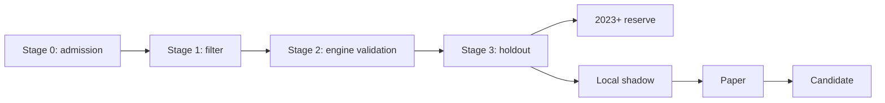

# Validation funnel

## Stage 0 — Admission

- **Input:** a hypothesis definition and its selected snapshot.
- **Measure:** structural and data eligibility checks; warnings do not block.
- **Pass criterion:** admission succeeds; the CLI records `PASA` or stops with `CORTA`.
- **Command:** `python -m quantagent.cli backtest hipotesis correr <hypothesis.yaml> --snapshot <snapshot> --carpeta <output-dir> --hasta-etapa 0`.
- **Source:** [Factory engine decision](../04_decisions/QuantAgent-d4cq-DC-motor-de-la-fabrica.md), 2026-10-14.

## Stage 1 — Filter

- **Input:** an admitted hypothesis over the 2007–2018 training period.
- **Measure:** out-of-sample filter Sharpe and trade count.
- **Pass criterion:** portfolio Sharpe is at least 0.10 and there are at least 30 trades, as defined by the factory filter.
- **Command:** `python -m quantagent.cli backtest hipotesis filtrar <hypothesis.yaml> --snapshot <snapshot>`.
- **Source:** [Portfolio filter criteria](../04_decisions/2026-10-17-DC-cartera-de-primas.md), 2026-10-17.
## Stage 2 — Engine validation

- **Input:** a stage 1 pass.
- **Measure:** the engine result against the filter and control, including the V30 checks.
- **Pass criterion:** engine validation passes; V30 is at least 2 trades, positive PnL, Sharpe at rate zero at least 0.10, and maximum drawdown no greater than 35%.
- **Command:** `python -m quantagent.cli backtest hipotesis correr <hypothesis.yaml> --snapshot <snapshot> --carpeta <output-dir> --hasta-etapa 2`.
- **Source:** [V30 thresholds](../04_decisions/QuantAgent-yo4s-DC-umbrales-y-llenado.md) (decision record); current portfolio thresholds are summarized in [criteria](criteria.md).

## Stage 3 — Holdout

- **Input:** a stage 2 pass, evaluated on the 2019–2022 holdout.
- **Measure:** portfolio Sharpe against the 1/N control in stages 2 and 3, positive-Sharpe holdout years, drawdown, and DSR reporting.
- **Pass criterion:** Sharpe is positive and above the control in both stages; at least 3 of 4 holdout years have positive Sharpe; drawdown stays within V30. DSR is reported and sets paper sizing/duration: below 0.50 means 50% size and 12 weeks; 0.50–below 0.95 means 75% and 6 weeks; at least 0.95 means no surcharge.
- **Command:** `python -m quantagent.cli backtest hipotesis correr <hypothesis.yaml> --snapshot <snapshot> --carpeta <output-dir>`.
- **Source:** [Stage 3 and research loop decision](../04_decisions/2026-10-19-DC-criterio-etapa3-y-loop-de-mejora.md), 2026-10-19.

## 2023+ reserve

- **Input:** only a prelisted eligible hypothesis; F1 and F2 must first pass stage 2.
- **Measure:** C0 and M1 (Sharpe in excess of the short rate); every attempt counts in N.
- **Pass criterion:** C0 passes. The reservation is capped at 3 hypotheses, each opened once; this is capacity, not a performance threshold.
- **Command:** `python -m quantagent.cli backtest hipotesis reserva <hypothesis.yaml> --snapshot <snapshot>`.
- **Source:** [R01 reserve decision](../04_decisions/QuantAgent-R01-DC-decisiones-investigacion-edge.md), 2026-10-21/22; [reserve protocol](../04_decisions/QuantAgent-e4jc.14-DC-protocolo-reserva-2023.md), 2026-10-21.

## Local shadow

- **Input:** a strategy selected for local shadow after historical evaluation.
- **Measure:** shadow execution and portfolio behavior; no numeric promotion threshold is set by the cited decisions.
- **Pass criterion:** none defined here; the stage is operational observation, not a historical gate.
- **Command:** no factory CLI command is defined for local shadow.
- **Source:** [Stage 3 and research loop decision](../04_decisions/2026-10-19-DC-criterio-etapa3-y-loop-de-mejora.md), 2026-10-19.

## Paper

- **Input:** a strategy admitted to paper trading.
- **Measure:** system checks: weights match shadow apart from rounding, rejected orders are explained, and dividends are handled correctly.
- **Pass criterion:** the checks match; paper does not establish edge or promote a strategy to live trading.
- **Command:** no factory funnel CLI command is defined for paper.
- **Source:** [R01 paper decision](../04_decisions/QuantAgent-R01-DC-decisiones-investigacion-edge.md), 2026-10-21/22.

## Candidate

- **Input:** a strategy completing the research process for possible paper use.
- **Measure:** the applicable historical gates and paper system checks; there is no separate numeric candidate threshold in the cited decisions.
- **Pass criterion:** no candidate promotion rule is defined; paper results do not authorize live trading.
- **Command:** no factory CLI command is defined for candidate promotion.
- **Source:** [R01 research purpose](../04_decisions/QuantAgent-R01-DC-decisiones-investigacion-edge.md), 2026-10-21/22.
