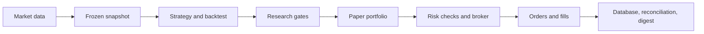

# Overview

QuantAgent turns frozen market data into analyzed, risk-checked orders. Research backtests evaluate strategies; paper trading checks the operating pipeline and does not authorize live trading.

Snapshots live outside version control under `$QUANTAGENT_SNAPSHOT_DIR` (default: `local-data/`). Backtests read a named snapshot. The paper scheduler builds portfolio targets, checks existing state, and submits orders through the paper broker; the database records executions and operational state.

The read-only web app and API show each portfolio's summary, equity, positions, and orders from that portfolio's own database.

See [operations](operations.md) for inspection commands and [the research funnel](funnel.md) for promotion gates.
